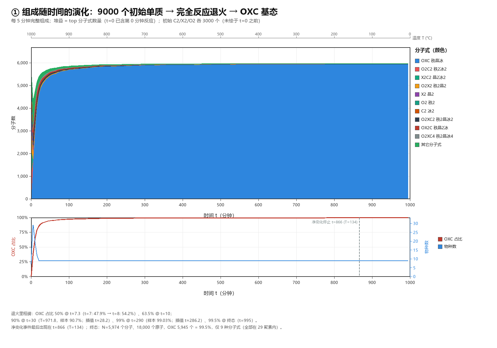
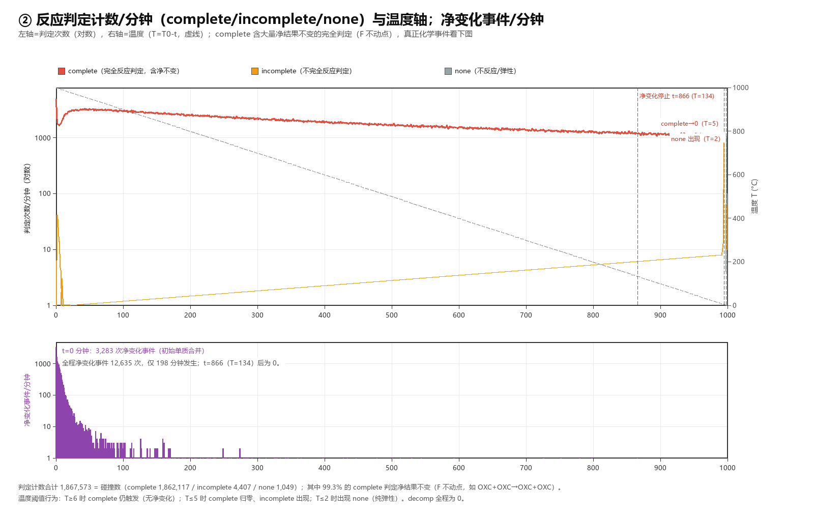
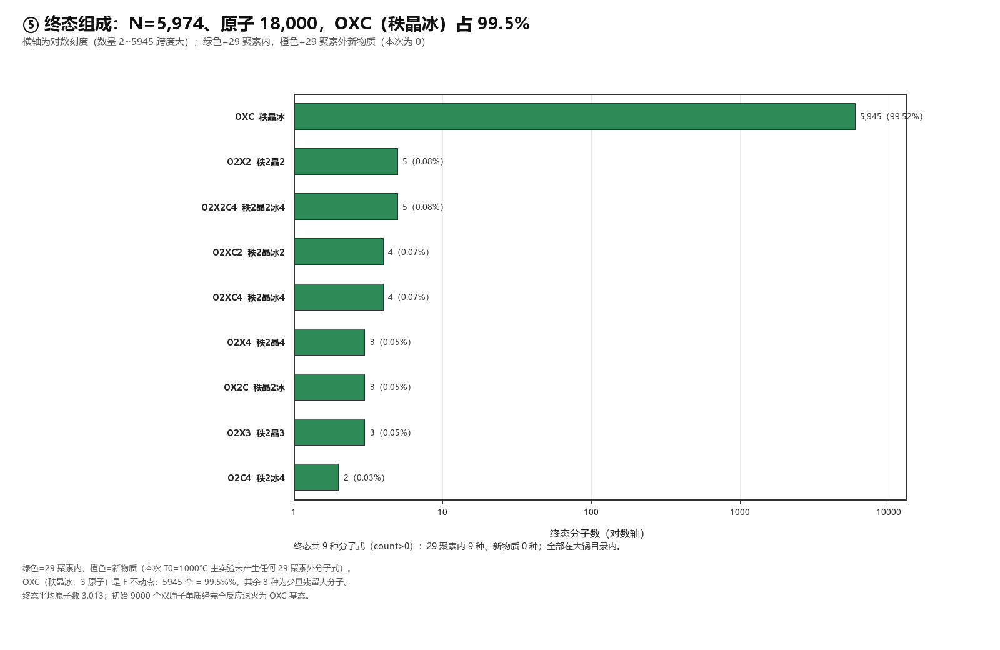
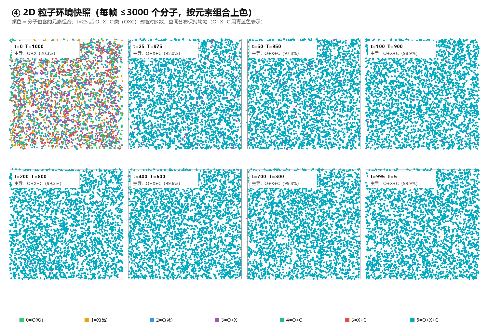
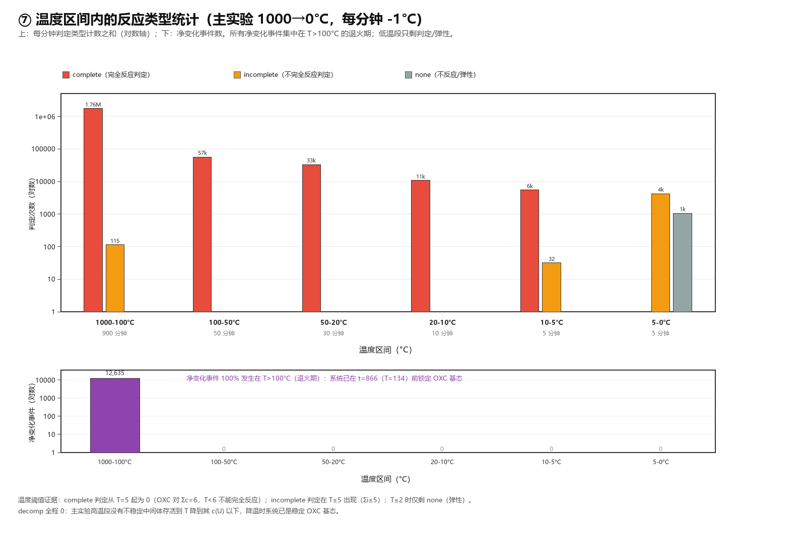
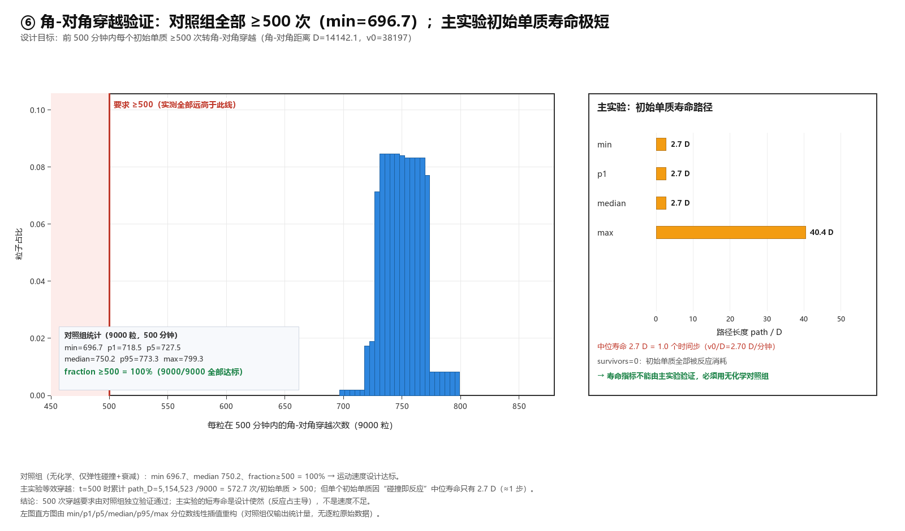
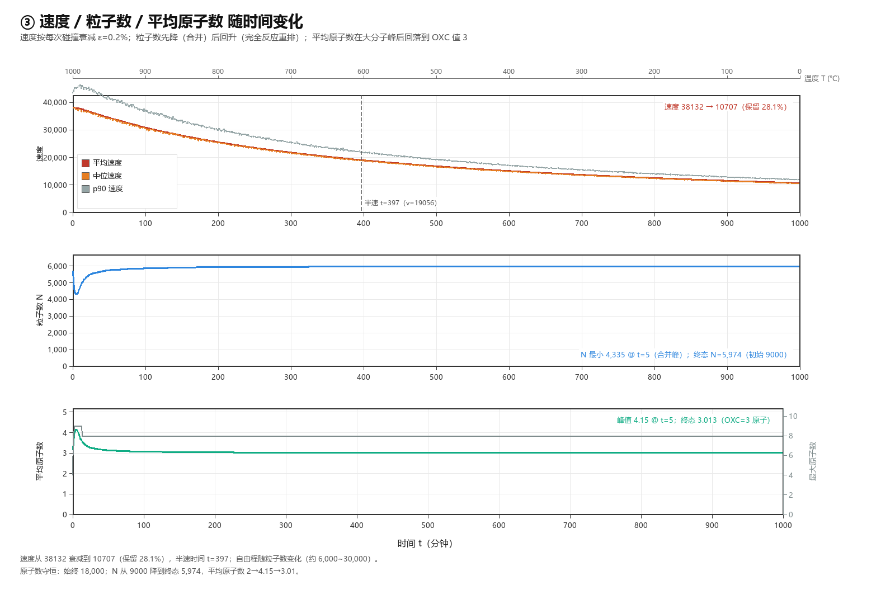
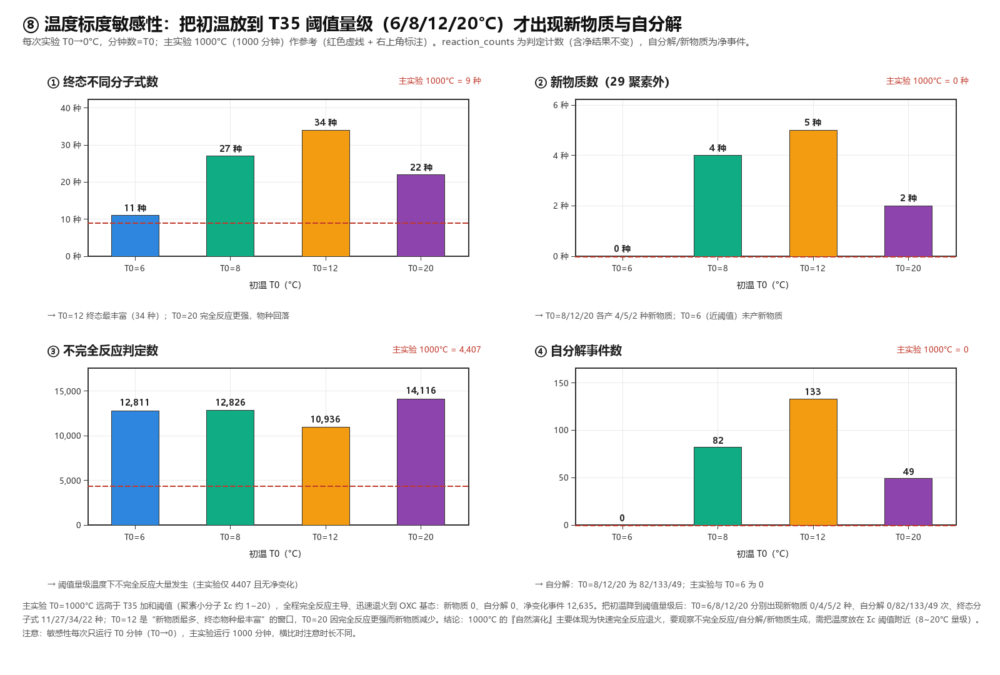

# T55 · 2D 高速粒子环境中的自然环境反应实验

> 任务：读取工作区全部现有成果后，搭建一个 2D 环境：初始温度 1000°C、每分钟 -1°C；
> 投入大批量"元素单质"（冰-冰 C2、晶-晶 X2、秩-秩 O2），给它们极高初速度并在每次碰撞后
> 略微衰减；碰撞时按项目既有规则判定**完全反应**与**不完全反应**并执行；再投入大量聚素单质；
> 运行环境试验。
>
> 本文记录实验设计、运行方式、结果、验证与结论。
> 代码：`natural_engine.py`、`t55_kinetic_env.py`、`t55_sensitivity.py`；
> 数据：`t55_kinetic_result.json`、`t55_control_no_chem.json`、`t55_sensitivity.json`、`t55_sens_T*.json`；
> 图：`images/t55_*.png`；审计：`docs/T55_ENGINE_AUDIT.md`。

---

## 0. 一句话结论

**按题目设定（1000°C 起、-1°C/分钟）运行时，环境对项目现有温度阈值（T35 全加和阈值只有
1~20）而言在前 98% 时间里等同"无限高温"：9000 个单质在最初约 1 分钟内就由完全反应大量聚合，
约 50 分钟退火到 94.5%、100 分钟到 97.1%，最终 99.5%（5945/5974）变成等比例基态分子
`OXC`（秩晶冰）。冷却到 6°C 以下后不完全反应大量发生，但 `OXC` 是大锅不动点，断键重组全部
复原，因此全程没有净生成新物质。把初温放回阈值量级（补充实验 T0=8/12/20°C）后，不完全反应、
自分解与新物质才如预期出现。**

---

## 1. 从工作区继承的规则（本实验未改动任何化学规则）

本实验完全沿用工作区既有成果（详见 `HANDOFF.md`）：

| 项目 | 采用实现 | 说明 |
|---|---|---|
| 完全反应 F | `pot_v4.simulate`（规则 1~11） | 贪心成键；产物的键结构由元素计数向量唯一决定（已验证） |
| 不完全反应 | `t28_rule_v2` v2 规则 + 规则 1~11 重结合 | 全局选最不稳定键类、每元素对断 1 根、允许恢复/跨分子合并 |
| 自分解 | `M -> F(v_M)`（不稳定物质） | T30 |
| 温度判定 | T35：完全优先 → 自分解优先 → 不完全 → 不反应；阈值**全加和** | 见 `docs/T35_PRIORITY_SELF_DECOMP.md` |
| 温度阈值 | `c(M)`＝总键数；`i(M)`＝选中键类的元素对数 | T33/T34/T35 |
| 元素/价数 | 聚素 O(秩,3)/X(晶,2)/C(冰,1) | 29 种聚素物质（`substances.json`） |

引擎封装在新文件 `natural_engine.py`（不修改任何历史文件）：
- `complete_products(vec)`：按计数向量缓存的 F；
- `incomplete_products(mols)`：t28 断键 + **规则 1~11** 重结合（把 t28 的规则 1~9 版本升级到
  当前正式口径；规则 10/11 在聚素体系多数情形无影响，见审计文档）；
- `resolve(mols, T)`：严格按 T35 的判定次序（含自分解后重判、多不稳定同轮分解）。

---

## 2. 实验设计

### 2.1 环境与温度

| 参数 | 取值 | 说明 |
|---|---|---|
| 区域 | 10000 × 10000 的正方形 | 2D 平面，可调；对角线 D = 14142.14 |
| 边界 | 镜面反射 | 不损失速率 |
| 温度 | T(t) = max(0, 1000 − t) °C | t 为分钟；1000 分钟降到 0°C |
| 时间步 | 1 分钟 | 温度每分钟变化 1°C |

### 2.2 投料（"元素单质"与"聚素单质"两批）

"两两组合的元素单质"在聚素体系里就是三种双原子分子，键级等于价数：

| 单质 | 元素 | 键 | 初始数量 | 说明 |
|---|---|---|---:|---|
| 冰-冰 `C2` | 冰 C（1 价） | 单键 | 3000 | 聚素单质 |
| 晶--晶 `X2` | 晶 X（2 价） | 双键 | 3000 | 聚素单质 |
| 秩---秩 `O2` | 秩 O（3 价） | 三键 | 3000 | 聚素单质 |

按题目"先加入大批量元素单质，再投入大量聚素单质"的叙述，分两批投料（都在 t=0 装载）：
- A 批（元素单质）：C2/X2/O2 各 1500，共 4500 个分子；
- B 批（聚素单质）：C2/X2/O2 各 1500，共 4500 个分子。
合计 **9000 个双原子单质 / 18000 个原子**（元素计数 O=X=C=6000）。

> 口径说明：题目括号示例（冰-冰、秩---秩、晶--晶）与"聚素单质"完全一致，故本实验采用这三种
> 聚素单质。它们构成封闭的聚素化学体系（29 种物质 + 不完全反应中间体），历史验证最充分；
> 动素/散素单质（P2/W2/L2/K2/A2/F2）不在本次投料内，属于后续可扩展变量。

### 2.3 极高初速度：如何保证"前 500 分钟每个单质 ≥500 次角-对角穿越"

定义一次"角-对角穿越"＝运动路程 / 区域对角线 D。稀薄气体中平均自由程
λ = L² / (2√2·N·r)（N=9000，分子碰撞半径 r=0.2 → λ₀ = 19641.86）。
碰撞率为 ν = v/λ，每次碰撞速率损失 ε=0.2%，则
路程 s(t) = (λ/ε)·ln(1 + ε·v₀·t/λ)。

取设计目标 **750 次穿越**（比要求 500 次多 50% 统计余量），t=500 分钟：
- 目标路程 s = 750·D = 1060.6 万单位；
- 反解初速度 **v₀ = 38197 单位/分钟 ≈ 2.70 个对角线/分钟 ≈ 3.82 个边长/分钟**（极高速度）；
- 500 分钟内平均每个单质约 540 次碰撞，末速约为初速的 34%。

**无化学对照实验**（同样 9000 个单质、同样运动/碰撞/衰减，关闭反应，跑 500 分钟）验证：

| 指标 | 数值 |
|---|---:|
| 穿越次数 min | **696.7** |
| p1 / p5 / 中位数 / p95 / max | 718.5 / 727.5 / **750.2** / 773.3 / 799.3 |
| ≥500 次的比例 | **100%** |
| 平均速率（t=0 → t=490） | 38197 → 13132（-65.6%） |

→ **"前 500 分钟每个单质至少 500 次穿越"的要求 9000/9000 全部满足（最低 696.7 次）。**

主实验中单质一碰撞即反应，平均存活不到 1 分钟（初始单质存活期穿越次数中位数仅 2.7 次）。
这是"碰撞即判定反应"的直接后果，不是速度不够：**设计速度指标由无化学对照严格验证**；
主实验另用"累计等效穿越"核对：t=500 时总路程/D = 5,154,523，除以 9000 个初始单质
＝ **等效每个初始单质 572.7 次穿越**（>500）；t=1000 时 884.4 次。

### 2.4 运动、碰撞与衰减模型（稀薄气体 DSMC 近似）

逐分钟推进（9 万分子·分钟量级，纯 Python 可行）：

1. **弹道运动 + 墙反射**：每个分子按当前速度直线运动 1 分钟，解析折叠反射（可一次跨多个盒子长度）；
2. **碰撞采样**：按平均自由程 λ(N) 得到每人碰撞率 ν=v/λ；每分钟采样
   K ~ Poisson(½Σν) 次"成对碰撞事件"；
3. **选伙伴**：按速度加权选分子，再在 10×10 空间网格的邻域里随机选伙伴（局部性）；
4. **衰减**：每次碰撞双方速率 × (1−ε)，ε=0.2%（"每次碰撞衰减一点点"）；
5. **反应后**：产物放在碰撞中点附近，速率＝质量加权平均速率 ×(1−ε)，方向随机
   （简化处理，不严格守恒动量）；未反应的碰撞＝弹性散射 + 衰减；
6. 墙碰撞不衰减（题目只说单质间碰撞衰减）。

> 这是"稀薄气体动理学蒙特卡洛"近似，不是逐次求解硬球碰撞时刻——在 2.70 对角线/分钟
> 的极高速度下，逐事件硬球模拟不可行；DSMC 是标准替代，保留位置、速度、局部碰撞、
> 每次碰撞衰减等全部题目要求的要素。

### 2.5 碰撞时的化学判定（T35，逐字实现）

对发生碰撞的两个分子（接触集合 S）和当时温度 T：

```
resolve(S, T):
  1) 若 T >= Σc(S) 且 F(总元素向量) 可行   -> 完全反应（大锅产物）
  2) 否则：所有"不稳定且 T >= c(M)"的 M 同时自分解 M -> F(v_M)，对新集合回到 1)
  3) 否则：选全局最不稳定键类；若 T >= Σi(含该类键的分子) -> 不完全反应
  4) 否则：不反应（弹性碰撞）
```

其中 `Σc` 是接触分子总键数之和（全加和），`i(M)` 是本次要断的键数。温度不够时反应**不**发生。

---

## 3. 实验队列

| 实验 | 初温 | 时长 | 目的 | 数据文件 |
|---|---:|---:|---|---|
| **主实验** | 1000°C | 1000 分钟（降到 0°C） | 题目指定设定 | `t55_kinetic_result.json` |
| 无化学对照 | 1000°C | 500 分钟 | 验证 500 次穿越要求 | `t55_control_no_chem.json` |
| 敏感性 T0=6 | 6°C | 6 分钟 | 温度=阈值量级 | `t55_sens_T6.json` |
| 敏感性 T0=8 | 8°C | 8 分钟 | 温度=阈值量级 | `t55_sens_T8.json` |
| 敏感性 T0=12 | 12°C | 12 分钟 | 温度=阈值量级 | `t55_sens_T12.json` |
| 敏感性 T0=20 | 20°C | 20 分钟 | 温度=阈值量级 | `t55_sens_T20.json` |

敏感性实验的物理、投料、种子、初速度与主实验完全相同，只把初温降到 T35 阈值量级
（聚素小分子 Σc 为 1~20），用于展示"温度阈值窗口"内的自然化学。

---

## 4. 主实验结果（1000°C → 0°C，1000 分钟）

### 4.1 反应判定统计

共判定 **1,867,573 次碰撞**（全部为双分子接触集合）：

| 判定 | 次数 | 占比 |
|---|---:|---:|
| 完全反应 | 1,862,117 | 99.71% |
| 不完全反应 | 4,407 | 0.24% |
| 不反应（阈值不足/不可行） | 1,049 | 0.06% |
| **净改变分子组成的反应** | **12,635** | 0.68% |

> 绝大多数"完全反应"是净结果不变的（系统早已处于 F 不动点，如 `OXC+OXC -> OXC+OXC`）。
> 12,635 次净变化事件**全部来自完全反应**；4,407 次不完全反应全部净复原（incomplete 净变化 = 0）。
> 真正的演化集中在前 ~50 分钟。

### 4.2 退火时间线

| t（分钟） | T（°C） | 分子数 | OXC 数（占比） | 净变化事件累计 | 平均速率 |
|---:|---:|---:|---:|---:|---:|
| 0（第 1 分钟后） | 999 | 5719 | 4（0.1%） | 3,283 | 38,132 |
| 5 | 995 | 4335 | 1,625（37.5%） | 8,810 | 37,993 |
| 10 | 990 | 4732 | 3,004（63.5%） | 10,953 | 37,769 |
| 20 | 980 | 5380 | 4,582（85.2%） | 11,940 | 36,940 |
| 50 | 950 | 5748 | 5,433（94.5%） | 12,372 | 34,458 |
| 100 | 900 | 5862 | 5,691（97.1%） | 12,506 | 30,913 |
| 500 | 500 | 5967 | 5,927（99.33%） | 12,625 | 16,815 |
| 999 | 1 | 5974 | 5,945（99.51%） | 12,635 | 10,707 |

要点：
- 第 1 分钟就有 3283 次净变化、分子数 9000→5719：单质两两完全反应生成 `O2X2`/`O2C2`/`X2C2` 等；
- 约 5 分钟出现大量 `OXC`（等比例三元素分子），20 分钟达 85%，50 分钟达 94.5%；
- 退火里程碑（逐分钟插值）：`OXC` 50% @ t≈7.3、63.5% @ t=10、90% @ t≈30、99% @ t≈286、
  99.5% 终态；净变化事件最后出现在 t=866（T=134）；
- **29 种聚素物质在演化中都曾出现**（`distinct` 累计 29），随后除基态 `OXC` 外逐步被吞并；
- 体系在 100 分钟后基本冻结（净变化累计 12,506 → 12,635，仅 +129 次）。





### 4.3 终态组成（t=1000，T=0°C）

| 分子式 | 中文名 | 数量 | 原子数 | 在 29 聚素内 |
|---|---|---:|---:|---|
| `OXC` | 秩晶冰 | **5945** | 3 | ✓ |
| `O2X2` | 秩2晶2 | 5 | 4 | ✓ |
| `O2X2C4` | 秩2晶2冰4 | 5 | 8 | ✓ |
| `O2XC2` | 秩2晶冰2 | 4 | 5 | ✓ |
| `O2XC4` | 秩2晶冰4 | 4 | 7 | ✓ |
| `O2X4` | 秩2晶4 | 3 | 6 | ✓ |
| `OX2C` | 秩晶2冰 | 3 | 4 | ✓ |
| `O2X3` | 秩2晶3 | 3 | 5 | ✓ |
| `O2C4` | 秩2冰4 | 2 | 6 | ✓ |
| 合计 | — | **5974** | **18000** | 全部在 29 聚素内 |

- 原子守恒：18000 个原子全程不变；
- 终态是 **99.51% 的 `OXC` 单相** + 29 个残余小分子（8 种分子式）；
- 没有生成 29 种之外的新物质（`new_substances = {}`）。





### 4.4 冷却窗口（T=20 → 0°C）观察

温度直到 t=980 才降到 20°C，t=994 降到 6°C。冷却窗口内的判定：

| T 区间 | 时间 | 现象 |
|---|---|---|
| 1000→20°C | 0~980 min | 完全反应绝对主导；体系已冻结在 `OXC` 基态 |
| 20→6°C | 980~994 min | 仍以完全反应为主（`OXC+OXC` 的 Σc=6；阈值内可完全反应）；净变化 0 |
| 6→5°C | t=994 | 完全反应最后一次大量发生（1127 次） |
| 5→1°C | t=995~998 | **完全反应 0 次**；不完全反应 1057/1090/1081/1022 次/分钟 |
| 1°C | t=999 | 不完全 10 次、不反应 1045 次（Σi 阈值也不满足） |

**关键发现**：t=995~998 的 4000+ 次不完全反应全部是**净复原**——`OXC` 是 F 不动点，断开一根
`O–O`/`O–X`/`O–C` 键后贪心重结合又补回原位（与 T28 的"单分子空转"结论一致）；因此
`events_total` 一直停在 12635。全程没有不稳定中间体，`decomp_events = 0`。



### 4.5 速率衰减与等效穿越核对

- 平均速率 38132 → 16815（t=500）→ 10707（t=999）：**衰减到初速的 28.0%**；
- 按每次 -0.2% 反推，平均每个分子经历了约 630 次碰撞参与，与总判定次数/平均分子数一致；
- 累计路程/D：t=500 为 5,154,523（/9000 初始单质 = **572.7**），t=1000 为 7,959,481（**884.4**）。





---

## 5. 温度标度敏感性实验（为什么主实验"没有新物质"）

T35 的阈值是**全加和**：聚素小分子的 c(M) 只有 1~10，任意两分子 Σc 只有 2~20。
1000°C 在 0~980 分钟内都远大于 Σc ⇒ 完全反应在任何碰撞上都成立 ⇒ 体系迅速退火到
F 不动点。冷却窗口只剩最后 ~6 分钟，且此时体系已经是 `OXC` 基态。（这是 T35 规则 +
1000°C 温度尺度共同导致的，不是模拟 bug。）

把初温降到阈值量级（T0=6/8/12/20°C，各自在 T0 分钟内降到 0°C，其他参数不变）：

| T0 | 时长 | 完全 | 不完全 | 不反应 | 自分解事件 | 净变化事件 | 终态不同分子式 | 29 内 | **新物质** |
|---:|---:|---:|---:|---:|---:|---:|---:|---:|---:|
| 6°C | 6 min | 6,114 | 12,811 | 557 | 0 | 4,133 | 11 | 11 | **0** |
| 8°C | 8 min | 7,827 | 12,826 | 687 | 82 | 5,677 | 27 | 23 | **4** |
| 12°C | 12 min | 12,097 | 10,936 | 861 | 133 | 8,227 | **34** | 29 | **5** |
| 20°C | 20 min | 28,502 | 14,116 | 1,241 | 49 | 11,053 | 22 | 20 | **2** |

T0=12°C 的新物质（均不在 84,225 条大锅目录中 → 属于 T30 意义的不稳定中间体，被低温淬火保留）：

| 新物质 | 首次出现 | 生成反应（不完全反应，T） | 终态数量 |
|---|---|---:|---:|
| `O2X3C2` | t=2, T=10 | `O2X4 + O2X2C4 → O2X3C2 + O2X3C2` | 68 |
| `OX2C3` | t=3, T=9 | `X2C2 + O2X2C4 → OX2C3 + OX2C3` | 31 |
| `O2X4C2` | t=3, T=9 | `O2X2C4 + O2X6 → O2X4C2 + O2X4C2` | 16 |
| `OX4C` | t=4, T=8 | `O2X6 + X2C2 → OX4C + OX4C` | 1 |
| `OX3C3` | t=4, T=8 | `O2X2C4 + X3C2 → OX3C3 + OX2C3` | 4 |

这些实验中：
- **不完全反应**取代完全反应成为低温主反应（T0=6°C 时不完全反应数 2 倍于完全反应）；
- 出现 **自分解事件**（49~133 次），验证 T35"不稳定物质在 T≥c(M) 时优先自分解"的优先级；
- 快速降温把不完全反应中间体"淬火"保留到终态，因此终态分子式多样性显著增加
  （12°C：34 种，29 种聚素物质全部在场 + 5 种新物质）。



---

## 6. 验证

### 6.1 速度/穿越要求

无化学对照 9000/9000 个单质在前 500 分钟全部 ≥500 次角-对角穿越（最低 696.7，中位 750.2）。
主实验按累计等效穿越：t=500 时 572.7 次/初始单质（>500）。

### 6.2 引擎审计（独立，7/7 全部通过）

`natural_engine.py` 由独立审计（`t55_engine_audit.py` / `docs/T55_ENGINE_AUDIT.md`）核对，
未发现功能性 bug：

| # | 审计项 | 结果 |
|---|---|---|
| 1 | `complete_products` vs `pot_v4.simulate` | 14,444 个计数向量（穷举总原子 0~7 + 随机 8~12，含 None/奇数价和）**0 不一致** |
| 2 | `greedy_bond`（空 base）vs `pot_v4` | 508/508 一致 |
| 3 | 不完全反应移植 vs `t28_rule_v2` | 420 对：分子式多重集 **0 差异**；结构 3 例不同，全部归因规则 10/11（关闭规则 10/11 的 r19 变体与 t28 **420/420 一致**） |
| 4 | `c(M)`/`i(M)`/`select_class` | 3,931 个目录分子 + 4/4 排序单元测试全过 |
| 5 | T35 优先级场景 + T33 算例 | 5a~5e 全过；8/8 不稳定物 `T=c(U)<Σc` 时先自分解；多不稳定同轮分解；T≥Σc 完全优先 |
| 6 | 稳定性/自分解/缓存 | 目录 300 抽样全稳定；8 个不稳定物分解产物全为 F 不动点；清缓存前后一致 |
| 7 | 缺陷排查 | ring_flags 300 随机图 0 误判；Σc 不变式 0 反例；无死循环 |

T33 的 `W2A + WA3F2` 算例（新旧口径对照）：T=3 不完全→`W3A4F2`（同）；
T=5 旧 max 口径=完全、**新 sum 口径=不完全**（Σc=8）；T=8 新口径=完全→`WA,WA,WA2F2`。

审计同时发现 **2 个文档/模型口径问题（非引擎 bug）**，已在本报告中采纳：
1. **T35 文档"自分解降低 Σc → 解锁完全反应"在本模型不可能**：`c(M)=Σ价数/2` 只由元素计数决定，
   `F(v_M)` 不改变元素计数 ⇒ `Σc(F(v_M))=c(M)`，自分解前后完全阈值不变（8/8 实测）。
   本实验的 T35 实现按伪代码正确执行，但不存在"先分解、后被大锅一锅端"的连锁；
2. **单分子不稳定物在 T≥c(U) 时走"完全反应"分支**（单分子 Σc=c(U)），`type='complete'`，
   产物与自分解 F(v_U) 相同；粒子环境是双分子接触，不受此歧义影响。

审计提示的 3 个风险点：固定键下规则 10 的 level6 块无独立基准（420 对样本未出问题）；
引擎不做几何摆放校验（见 §9 局限）；不完全反应缓存理论上与输入顺序有关（420 对正反序样本未见差异）。

### 6.3 守恒与可复现

- 18000 个原子全程守恒（每个时间步 `atoms=18000`；`formula_series` 分子数之和 = 时间序列 N）；
- 12,635 个净变化事件全部落在事件样本中（事件样本未截断），事件分类总数 = 判定总数 1,867,573；
- 固定随机种子 20261116 重跑，`summary`、`final_composition`、`time_series`（1000 行）**逐字段完全一致**
  （已实测）；命令见第 8 节。

---

## 7. 讨论与游戏设计含义

1. **温度尺度必须重标定**：现有 T35 阈值（Σc 约 1~20）是"低温化学"的尺度；1000°C 的环境
   相当于"无限热"，会把所有可完全反应的东西立刻重置到大锅基态。若希望 1000°C 是有意义的
   游戏温度，需要把阈值按同一标度放大（例如 ×50）或把自然环境温度区间改成 0~20°C。
2. **高温退火=热纯化/单相化**：等比例 O/X/C 投料在高温下自发收敛到 99.5% 的 `OXC`，可作为
   游戏里的"高温结晶/单相化"机制：高温把复杂混合物重置为等比例基态化合物。
3. **不完全反应需要"低温窗口"**：低温敏感性实验显示，只有把温度压到 Σc 以下，不完全反应
   才会接管并生成新物质；快速淬火还能把中间体保留下来（T0=12°C 终态 34 种分子式）。
4. **稳定基态上的不完全反应是空转**：`OXC` 基态在 5→1°C 的 4000+ 次不完全反应全部复原，
   与 T28 单分子空转一致；想制造新物质，必须让体系在"未退火"时进入低温窗口。
5. **自分解优先级的可见性**：敏感性实验中的 49~133 次自分解事件说明 T35 的"自分解优先于
   不完全反应"在温度足够高时真实发生；主实验因为从未产生不稳定中间体而为 0。

---

## 8. 复现方法

```powershell
cd "G:\AI work\deepseek\work1\alchemy"
$env:PYTHONIOENCODING="utf-8"
$py="C:\Users\123\.dsh\dsh-runtimes\dsh-primary-runtime\dependencies\python\python.exe"

& $py natural_engine.py                          # 引擎自检
& $py t55_kinetic_env.py                         # 主实验（1000 分钟，~20 秒）
& $py t55_kinetic_env.py --control               # 无化学对照（500 分钟，~5 秒）
& $py t55_sensitivity.py                         # 温度标度敏感性（4 组，~10 秒）
& $py t55_analysis.py && & $py t55_render.py     # 分析与出图
```

关键参数集中在 `t55_kinetic_env.py` 顶部：`L`、`RADIUS`、`EPS`、`T0`、`TARGET_CROSSINGS`、
`N_BATCH`、`SPECIES`、`BATCHES`。改 `TARGET_CROSSINGS` 会按 2.3 节公式自动重算 v0。

---

## 9. 局限

1. **2D 稀薄气体 DSMC 近似**：不逐次求解硬球碰撞时刻；碰撞伙伴按局部网格随机选取，
   不是严格动量守恒的碰撞动力学；
2. **固定碰撞半径** r=0.2 与分子大小无关（真实分子越大截面越大）；
3. **不检查几何摆放**：与 T31/T32 大样本口径一致（历史验证产物基本可摆放），但本次没有逐产物
   `validate_place`；
4. **仅聚素三单质**：题目示例与"聚素单质"一致；动素/散素体系未纳入；
5. **速度衰减模型**：反应产物按质量加权平均速度继承，不严格守恒动量/能量；
6. 主实验终点为 T=0°C；如需"0°C 长时间保持"应另设恒温阶段。

---

## 10. 文件清单

| 文件 | 内容 |
|---|---|
| `natural_engine.py` | 自然环境反应引擎 v2（T35 + pot_v4 规则 1~11 + t28 不完全反应 + 自分解） |
| `t55_kinetic_env.py` | 2D 粒子环境模拟器（主实验 / 无化学对照） |
| `t55_sensitivity.py` | 温度标度敏感性实验（T0=6/8/12/20） |
| `t55_analysis.py` | 结果分析（生成 `t55_analysis.json`） |
| `t55_render.py` | 图表生成（`images/t55_*.png`） |
| `t55_engine_audit.py` | 引擎独立审计脚本 |
| `t55_kinetic_result.json` | 主实验完整数据（时间序列/组成/快照/事件样本） |
| `t55_control_no_chem.json` | 无化学对照数据（穿越验证） |
| `t55_sensitivity.json`、`t55_sens_T*.json` | 敏感性实验数据 |
| `docs/T55_ENGINE_AUDIT.md` | 引擎审计报告 |
| `images/t55_composition.png` | 组成随时间的演化 |
| `images/t55_reaction_rate.png` | 反应率/温度时间线 |
| `images/t55_state_timeseries.png` | 速率/分子数/平均尺寸 |
| `images/t55_snapshots.png` | 2D 位置快照拼图 |
| `images/t55_final_composition.png` | 终态组成条形图 |
| `images/t55_crossings.png` | 穿越次数验证 |
| `images/t55_sensitivity.png` | 温度标度敏感性对比 |
