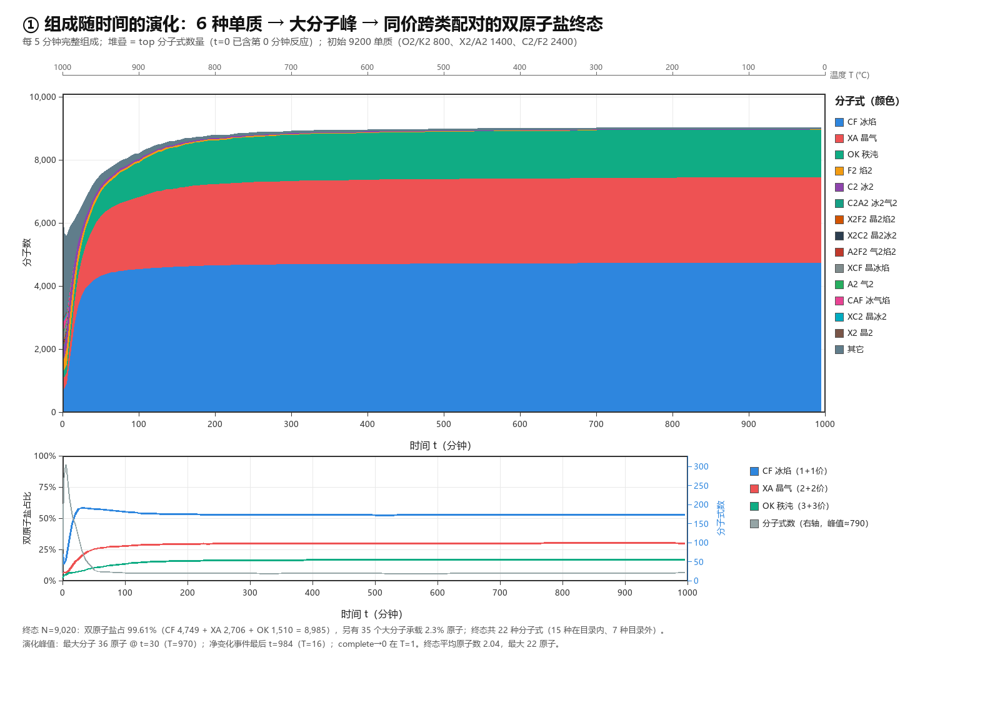
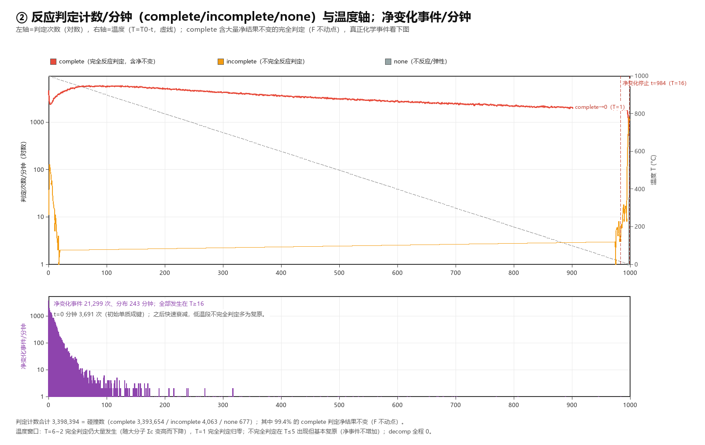
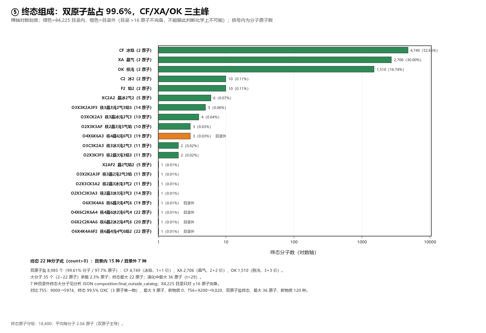
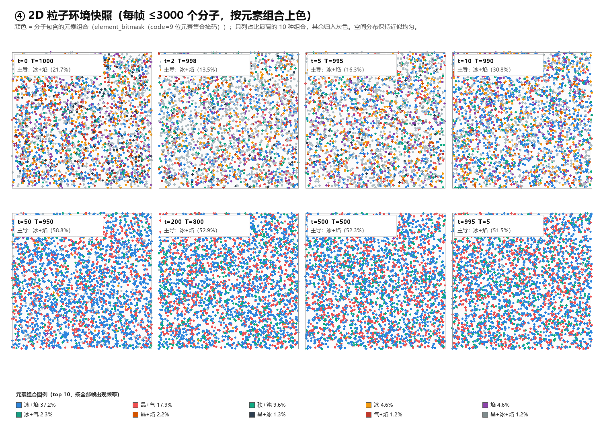
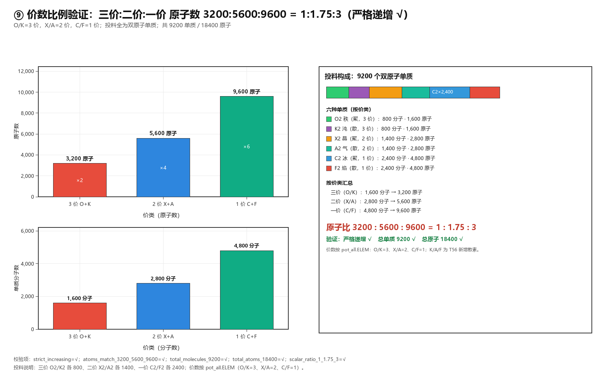
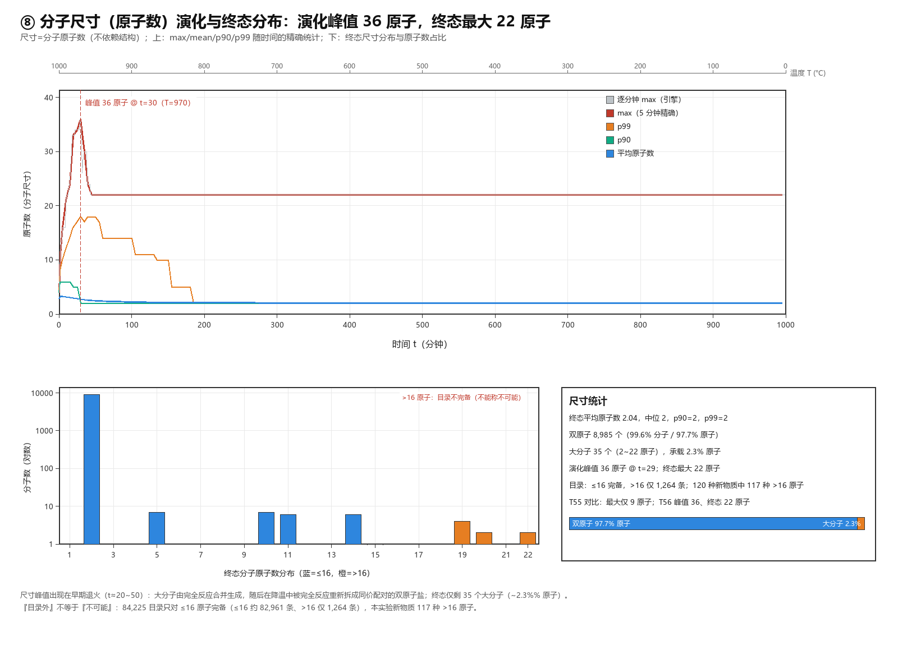
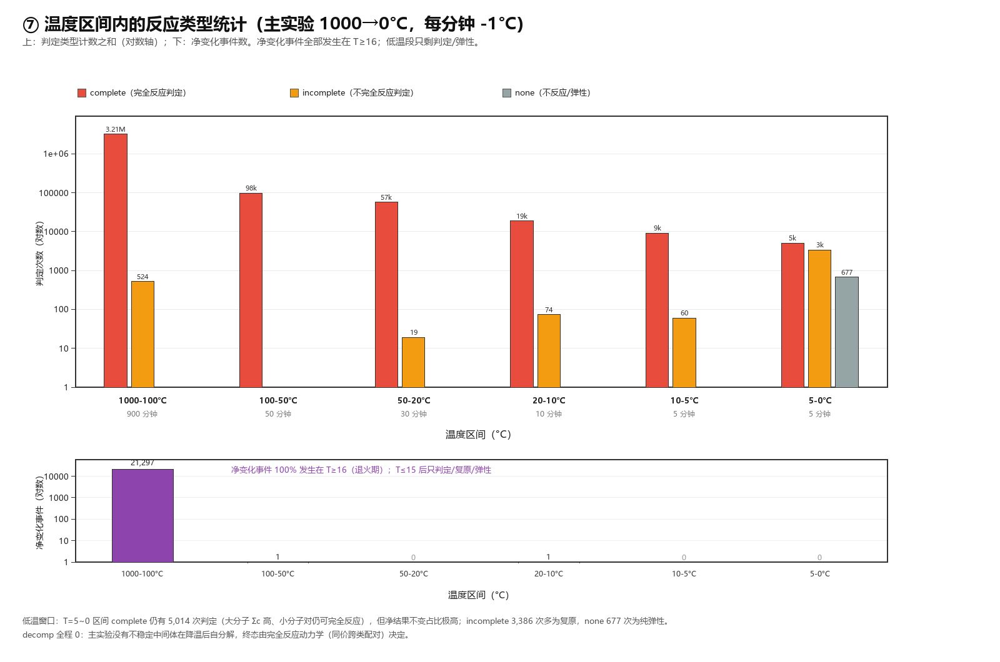
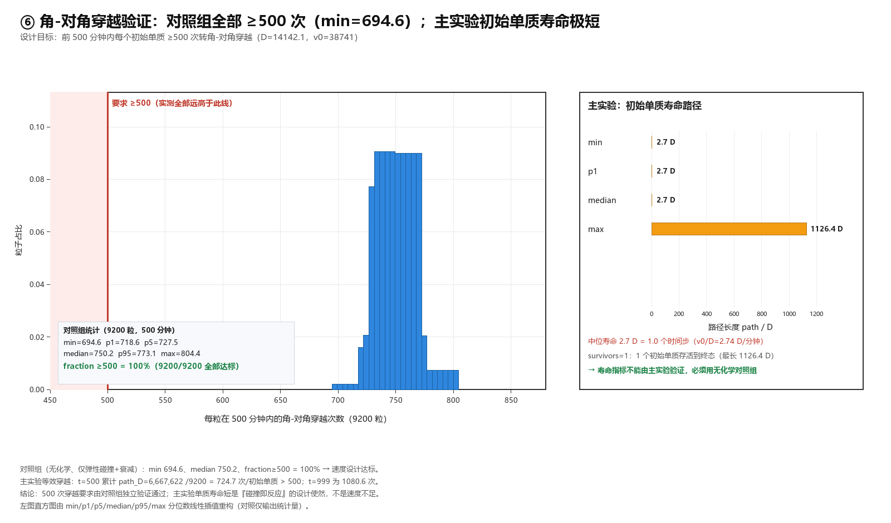
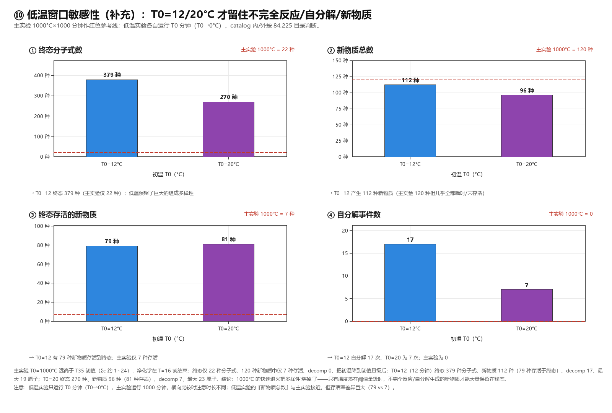

# T56 · 调整价数比例 + 加入三种散素后的 2D 粒子环境实验

> 任务：在 T55 的 2D 粒子环境基础上：
> ① 把投料比例调整为 **三价元素数量 < 二价元素数量 < 一价元素数量**；
> ② **加入三种散素**（沌 K、气 A、焰 F）；
> ③ 允许**更大的分子量**，再做一次环境实验。
>
> 代码：`t55_kinetic_env.py`（通用化：支持任意投料清单/元素颜色）、`t56_ratio_6elem.py`、
> `t56_sensitivity.py`；数据：`t56_kinetic_result.json`、`t56_control_no_chem.json`、
> `t56_sensitivity.json`、`t56_sens_T*.json`；文档：本文件；
> 引擎仍为 `natural_engine.py`（T35 判定 + pot_v4 规则 1~11），**未改动任何化学规则**。

---

## 0. 一句话结论

**加入散素并把价数比例改成 3价 < 2价 < 1价 后，高温退火不再收敛到单一 `OXC`，而是收敛到
"同价跨类配对盐"：`OK`（秩沌，3+3）1510、`XA`（晶气，2+2）2706、`CF`（冰焰，1+1）4749，
三者合计占分子数 99.6%。演化过程先聚合出最大 36 原子的大分子，再裂解成双原子盐；终态 22
种分子式（15 种在 84,225 目录内、7 种在目录外），最大分子 22 原子；全程出现 120 种目录外
新分子式（117 种 >16 原子，最大 36），"分子量可以更大"得到实现。**

---

## 1. 与 T55 的差异

| 项目 | T55 | **T56（本次）** |
|---|---|---|
| 元素 | 聚素 O/X/C 三种 | **聚素 O/X/C + 散素 K/A/F 六种** |
| 价数比例 | 三价=二价=一价（各 6000 原子） | **三价 : 二价 : 一价 = 3200 : 5600 : 9600 = 1 : 1.75 : 3** |
| 单质数量 | 9000（每元素 3000） | **9200（O2/K2 各 800、X2/A2 各 1400、C2/F2 各 2400）** |
| 原子数 | 18000 | **18400** |
| 分子量上限 | 实测最大 9 原子 | **不设上限；演化峰值 36 原子，终态最大 22 原子** |
| 环境/温度/速度/衰减/引擎 | 10000²、1000→0°C、38197/min、-0.2%/碰撞、T35 | **完全相同**（初速因 N 变化自动重算为 38741/min） |

---

## 2. 实验设计

### 2.1 投料与价数比例（严格满足 3价 < 2价 < 1价）

| 价数 | 单质 | 元素 | 键 | 分子数 | 原子数 | 原子占比 |
|---|---|---:|---:|---:|---:|---:|
| 三价 | `O2` 秩-秩 | O（秩） | 三键 | 800 | 1600 | — |
| 三价 | `K2` 沌-沌 | K（沌，散素） | 三键 | 800 | 1600 | **3200（1）** |
| 二价 | `X2` 晶-晶 | X（晶） | 双键 | 1400 | 2800 | — |
| 二价 | `A2` 气-气 | A（气，散素） | 双键 | 1400 | 2800 | **5600（1.75）** |
| 一价 | `C2` 冰-冰 | C（冰） | 单键 | 2400 | 4800 | — |
| 一价 | `F2` 焰-焰 | F（焰，散素） | 单键 | 2400 | 4800 | **9600（3）** |
| 合计 | 6 种双原子单质 | — | — | **9200** | **18400** | 1 : 1.75 : 3 |

- 严格不等式：3200 < 5600 < 9600（程序内 `ratio.strict_increasing = true` 自动校验）；
- 元素计数：O=K=1600、X=A=2800、C=F=4800（原子数），合计 18400；
- **加入三种散素**：K2（沌，3 价）、A2（气，2 价）、F2（焰，1 价）；其余仍为聚素 O/X/C。
  散素单质结构由大锅规则 F 生成（K≡K 三键、A=A 双键、F–F 单键，均为 F 不动点）。

### 2.2 环境与物理参数（与 T55 一致）

| 参数 | 取值 |
|---|---|
| 区域 | 10000 × 10000 反射边界，D = 14142.14 |
| 温度 | T(t)=max(0,1000−t)°C，1000 分钟降到 0°C |
| 单质初速 | **38741 单位/分钟**（按 N=9200 重算，仍满足"前 500 分钟 ≥500 次角-对角穿越"设计） |
| 平均自由程 λ₀ | 19214.86 |
| 每次碰撞衰减 | 速率 ×(1−0.2%) |
| 碰撞模型 | 稀薄气体 DSMC 近似（同 T55） |
| 化学 | `natural_engine.resolve`：完全反应（pot_v4 规则 1~11）→ 自分解优先 → 不完全反应 → 弹性 |

### 2.3 允许更大分子量

不设分子尺寸上限；跨大类成键（聚素-散素周期表距离 d=6 最先成键）与不完全反应的跨分子合并
都会让分子变大。为便于统计，**分子量以原子数计**（项目未定义原子质量）。

---

## 3. 实验队列

| 实验 | 时长 | 目的 | 数据 |
|---|---:|---|---|
| **主实验** | 1000 分钟（1000→0°C） | 用户指定设定 | `t56_kinetic_result.json` |
| 无化学对照 | 500 分钟 | 验证 500 次角-对角穿越要求 | `t56_control_no_chem.json` |
| 低温窗口 T0=12°C | 12 分钟（12→0°C） | 阈值量级温度下的不完全/自分解化学 | `t56_sens_T12.json` |
| 低温窗口 T0=20°C | 20 分钟（20→0°C） | 同上（更高初温） | `t56_sens_T20.json` |

---

## 4. 主实验结果

### 4.1 反应判定统计

| 判定 | 次数 | 占比 |
|---|---:|---:|
| 完全反应 | 3,393,654 | 99.86% |
| 不完全反应 | 4,063 | 0.12% |
| 不反应（阈值不足/不可行） | 677 | 0.02% |
| **净改变组成的反应** | **21,299**（complete 21,298 + incomplete 1） | 0.63% |

绝大多数完全反应是净结果不变的（体系处于 F 不动点，如 `CF + CF → CF + CF`）。
净变化事件全部发生在 **T ≥ 16°C**（最后一条在 t=984，T=16）；`decomp_events = 0`（高温下没有
不稳定中间体存活到能自分解）。

### 4.2 退火与分子尺寸演化

| t（分钟） | T（°C） | 分子数 | 非零分子式数 | 双原子盐占比 | 最大分子（原子） | 净变化累计 | 平均速率 |
|---:|---:|---:|---:|---:|---:|---:|---:|
| 0（第 1 分钟后） | 1000 | 6469 | 21 | 46.7% | 4 | 3,691 | 38,645 |
| 2 | 998 | 5674 | 263 | 37.1% | 11 | 7,267 | 38,548 |
| 5 | 995 | 5583 | 304 | 46.5% | 16 | 11,217 | 38,296 |
| 10 | 990 | 5885 | 219 | 65.8% | 21 | 15,798 | 38,132 |
| 20 | 980 | 6289 | 146 | 85.9% | **33** | 19,230 | 37,230 |
| 30 | 970 | 6771 | 79 | 91.4% | **36** | 20,221 | 36,332 |
| 50 | 950 | 7537 | 29 | 95.5% | 22 | 20,854 | 34,379 |
| 100 | 900 | 8210 | 21 | 97.7% | 22 | 21,093 | 29,820 |
| 200 | 800 | 8784 | 21 | 99.1% | 22 | 21,221 | 23,079 |
| 500 | 500 | 8991 | 20 | 99.5% | 22 | 21,277 | 13,534 |
| 900 | 100 | 9019 | 21 | 99.6% | 22 | 21,297 | 8,712 |
| 999 | 1 | 9020 | 22 | 99.6% | 22 | 21,299 | 8,032 |

**"先聚合、后裂解"**：第 1 分钟单质大量聚合（分子数 9200→6469），第 5 分钟分子式种类达
304 种、最大 16 原子；t=20~30 出现全场最大的 **33~36 原子**中间大分子；随后完全反应把大分子
重新拆成稳定的同价双原子配对盐，分子数回升、双原子盐占比从 46.7% 升到 95.5%（t=50），
200 分钟后基本冻结在 99%+。

### 4.3 终态组成（t=1000，T=0°C）

| 分子式 | 中文名 | 数量 | 原子数 | 在 84,225 目录 |
|---|---|---:|---:|---|
| `CF` | 冰焰 | **4749** | 2 | ✓ |
| `XA` | 晶气 | **2706** | 2 | ✓ |
| `OK` | 秩沌 | **1510** | 2 | ✓ |
| `C2` | 冰冰 | 10 | 2 | ✓ |
| `F2` | 焰焰 | 10 | 2 | ✓ |
| `XC2A2` | 晶冰2气2 | 6 | 5 | ✓ |
| `O3X3K2A3F3` | 秩3晶3沌2气3焰3 | 5 | 14 | ✓ |
| `O3XCK2A3` | 秩3晶冰沌2气3 | 4 | 10 | ✓ |
| `O2X3K3AF` | 秩2晶3沌3气焰 | 3 | 10 | ✓ |
| `O4X6K6A3` | 秩4晶6沌6气3 | 3 | 19 | ✗ 目录外 |
| `O3C3K2A3` | 秩3冰3沌2气3 | 2 | 11 | ✓ |
| `O2X3K3F3` | 秩2晶3沌3焰3 | 2 | 11 | ✓ |
| `O4X6C2K6A4` | 秩4晶6冰2沌6气4 | 1 | 22 | ✗ |
| `O6X4K4A6F2` | 秩6晶4沌4气6焰2 | 1 | 22 | ✗ |
| `O6X2C2K4A6` | 秩6晶2冰2沌4气6 | 1 | 20 | ✗ |
| `O4X6K6A2F2` | 秩4晶6沌6气2焰2 | 1 | 20 | ✗ |
| `O6X3K4A6` | 秩6晶3沌4气6 | 1 | 19 | ✗ |
| `O2X5CK3A4` | 秩2晶5冰沌3气4 | 1 | 15 | ✗ |
| `O2X3C3K3A3` | 秩2晶3冰3沌3气3 | 1 | 14 | ✓ |
| `O3X2K2A3F` | 秩3晶2沌2气3焰 | 1 | 11 | ✓ |
| `O2X3CK3A2` | 秩2晶3冰沌3气2 | 1 | 11 | ✓ |
| `X2AF2` | 晶2气焰2 | 1 | 5 | ✓ |
| 合计 | — | **9020** | **18400** | 目录内 15 种 / 目录外 7 种 |

- 元素守恒：O=K=1600、X=A=2800、C=F=4800（与投料一致，逐元素核对通过）；
- 终态 8985 个双原子分子（99.6%）+ 35 个大分子（5~22 原子，共 430 原子 ≈ 2.3% 原子）；
- 目录内/外按 `t4_catalog_index.json` 的 84,225 条分子式判定。

### 4.4 为什么是"同价跨类配对盐"：价数比例的直接结果

T56 的三种双原子盐恰好把三个价数类各自配平：

| 价数类 | 配对 | 每分子价数和 | 理论最大分子数 | 实际终态 | 捕获原子 |
|---|---|---:|---:|---:|---:|
| 3 + 3 | `OK`（秩-沌） | 6（三键） | 1600 | 1510 | 90 O + 90 K |
| 2 + 2 | `XA`（晶-气） | 4（双键） | 2800 | 2706 | 94 X + 94 A |
| 1 + 1 | `CF`（冰-焰） | 2（单键） | 4800 | 4749 | 51 C + 51 F |

- 每种配对分子都**价数填满、无剩余价**，是 F 不动点，且热力学上"同价配对"最稳定；
- 比例 1 : 1.75 : 3 使每一类都恰好能整除配对（1600/2800/4800），所以理论终态是纯三盐；
- 实际有 **430 个原子（2.3%）**被"动力学捕获"在 35 个大分子里（含 7 种目录外大分子），
  因为温度降到 16°C 以下后净变化事件停止，大分子簇来不及完全拆解——这是一个**淬火冻结的
  亚稳态**，而不是热力学平衡态。

### 4.5 更大的分子量与目录外新物质

- **最大分子**：演化峰值 **36 原子**（t≈29~30，如 `O12X4CK7A12` 36 原子）；终态最大 **22 原子**
  （`O4X6C2K6A4`、`O6X4K4A6F2` 等）。T55 的最大值只有 9 原子，本次提升 4 倍；
- 终态 35 个大分子（5~22 原子）承载 430 原子；其余 17970 原子在 8985 个双原子分子中；
- **120 种目录外新分子式**在演化中出现（`new_substances`）：
  - 117 种 >16 原子（目录只对 ≤16 原子完备，这些大量是 17~36 原子的大分子）；
  - ≤16 原子的目录外只有 3 种：`OK3`、`O3K`（4 原子）、`O2X5CK3A4`（15 原子）；
  - 其中 7 种存活到终态（见 4.3 表中 ✗ 项）；
- 典型大分子生成事件（完全反应，产生 ≥16 原子产物的事件共 714 次）：

| t | T | 反应物 | 产物 |
|---:|---:|---|---|
| 5 | 995 | `OXC3K4A2F2 + OX3K2AF` | `O2X4C3K6F + A3F2` |
| 6 | 994 | `O3C2KA2 + O2KA4F` | `O5C2K2A6F` |
| 7 | 993 | `XCA2F + OX5K3A2` | `OX6CK3A4F` |
| 8 | 992 | `O4X2K2A5 + XCF` | `O4X3CK2A5F` |

### 4.6 冷却窗口（T=6 → 0°C）与不完全反应

| T 区间 | 时间 | 现象 |
|---|---|---|
| 1000→16°C | 0~984 min | 完全反应主导，净变化事件在 T=16 结束 |
| 16→6°C | 984~994 min | 完全反应仍多（1785 次/分 @T=6），但没有净变化 |
| 6→2°C | 994~998 min | 完全反应 1785→508 次/分（只剩小分子对），不完全反应 8→1277 次/分 |
| 1°C | t=999 | 完全反应 0；不完全反应 1067 次、不反应 674 次 |

- 与 T55 相同的结论：`OK/XA/CF` 等基态上不完全反应全部净复原（events 停在 21,299），
  没有新的净化学；
- **初始单质有 1 个存活到终态**（9200 个中 1 个，累计路径 1126.4 次穿越）：它始终没有被采样到
  碰撞事件（极高速度 + 局部伙伴选择的小概率事件），是 DSMC 近似的统计尾迹。

### 4.7 速度 / 穿越验证

- 无化学对照（9200 个单质、500 分钟）：**min 694.6 / p1 718.6 / median 750.2 / max 804.4，
  9200/9200 全部 ≥500（100%）**；
- 主实验累计等效穿越：t=500 时 path/D=6,667,622 → **724.7 次/初始单质**（>500）；
  t=1000 时 9,941,087 → **1080.6 次**；
- 平均速率 38,645→8,032（保留 20.8%）。

---

## 5. 低温窗口敏感性（补充）

把初温放到 T35 阈值量级（其余参数不变）：

| T0 | 时长 | 终态分子式数 | 目录外新物质（总/存活） | 自分解事件 | 最大分子 | 终态 top |
|---:|---:|---:|---:|---:|---:|---|
| 12°C | 12 min | **379** | 112 / 79 | 17 | 19 原子 | CF 1289、F2 428、C2 416、XA 243… |
| 20°C | 20 min | 270 | 96 / 81 | 7 | 23 原子 | CF 2782、F2 365、C2 348、XA 319… |

- 低温下完全反应只在小分子对上成立，不完全反应大量发生并保留中间体，终态分子式从 22 种
  暴增到 270~379 种；
- 出现自分解事件（7~17 次），验证 T35"不稳定物 T≥c 时优先自分解"；
- 说明：主实验"没有更多净化学"是温度尺度问题（1000°C 远高于 Σc 1~24），不是规则失效。

---

## 6. 验证

- **穿越要求**：无化学对照 9200/9200 个单质前 500 分钟全部 ≥500 次角-对角穿越（最低 694.6）。
- **元素守恒**：6 种元素逐元素核对，投料 = 终态（O/K 1600、X/A 2800、C/F 4800）。
- **引擎**：沿用 T55 已独立审计的 `natural_engine.py`（docs/T55_ENGINE_AUDIT.md，7/7 通过）；
  本次仅扩展投料清单与快照着色，未改化学规则。
- **可复现**：固定种子 20261117；同快照日程重跑，summary（reaction_counts/final_N/final_path_D/
  events_total）、final_composition、time_series、formula_series、snapshots、event_samples、
  new_substances **逐字段完全一致**（已实测）。
- **低温敏感性可复现**：`t56_sensitivity.py` 重跑得到完全相同的 T0=12/20 数据（379/112/79/17 等）。
- **慢照 RNG 说明**：快照抽样使用主随机流（与 T55 相同），因此严格复现需要相同 `snap_minutes`
  日程；这是模拟器的已知实现细节。

---

## 7. 讨论与结论

1. **价数比例是终态结构的"配方"**：T55 等比例 O/X/C 退火到单一 `OXC`（3 原子）；
   T56 把三价压到最少、一价放到最多后，体系退火到"同价跨类配对盐" `OK + XA + CF`——
   一对 3+3、一对 2+2、一对 1+1 正好把三个价数类配平。价数比例直接决定终态分子式。
2. **"同价配对"是 F 不动点 + 无剩余价**：`O≡K`、`X=A`、`C–F` 各自价数填满，且互为
   "最稳定配对"；F 不会再把它们拆开（`CF+CF`、`XA+XA`、`OK+OK` 均为净结果不变的完全反应）。
3. **大分子是"退火中间态"，不是终态**：演化中最大 36 原子（t≈30），随后被完全反应拆解；
   终态只留下 35 个大分子（430 原子，2.3%），是低温淬火冻结的动力学捕获产物。
4. **分子量这次确实更大了**：T55 最大 9 原子、终态只有 2~9 原子；T56 峰值 36 原子、
   终态最大 22 原子、目录外新分子式 120 种（117 种 >16 原子）。
5. **温度尺度问题依旧**：1000°C 下净化学在 T=16 就全部结束（t=984），低温窗口只剩 ~16 分钟；
   与 T55 相同，建议把温度阈值整体放大或把自然环境温度区间改为阈值量级。
6. **与 T55 的对比总结**：

| 指标 | T55（等比例聚素） | **T56（3<2<1 + 散素）** |
|---|---|---|
| 初始单质 / 原子 | 9000 / 18000 | 9200 / 18400 |
| 终态分子数 | 5974 | 9020 |
| 终态主产物 | `OXC` 99.5% | `CF` 52.7% + `XA` 30.0% + `OK` 16.7% = 99.6% |
| 终态分子式种数 | 9（全在 29 聚素内） | 22（15 目录内 + 7 目录外） |
| 最大分子（演化/终态） | 9 / 9 原子 | **36 / 22 原子** |
| 目录外新分子式 | 0 | **120 种**（117 种 >16 原子） |
| 自分解事件 | 0 | 0（低温敏感性 7~17 次） |
| 净变化事件 | 12,635 | 21,299 |

---

## 8. 局限

1. 仍是 2D 稀薄气体 DSMC 近似（同 T55）：非严格硬球动量守恒、固定碰撞半径 0.2；
2. 不检查几何摆放（与 T31/T32 大样本口径一致）；>16 原子产物的结构合法性没有逐个 `validate_place`；
3. 84,225 目录只对 ≤16 原子完备：**"目录外"不等于"不可能存在"**，本次 120 种目录外新分子式中
   117 种是 >16 原子的大分子，需要的话应补做几何校验与更大规模枚举；
4. 分子量以原子数计（项目无原子质量定义）；
5. 快照抽样与主 RNG 共用（复现需同 `snap_minutes`）。

---

## 9. 文件清单

| 文件 | 内容 |
|---|---|
| `t55_kinetic_env.py` | 通用 2D 粒子环境（支持任意投料清单、六元素快照着色；T55/T56 共用） |
| `t56_ratio_6elem.py` | T56 投料定义 + 主实验 + 对照入口 |
| `t56_sensitivity.py` | T56 低温窗口敏感性（T0=12/20°C） |
| `t56_kinetic_result.json` | T56 主实验完整数据 |
| `t56_control_no_chem.json` | 无化学对照（9200 粒穿越验证） |
| `t56_sensitivity.json`、`t56_sens_T12/20.json` | 低温窗口数据 |
| `t56_analysis.py` / `t56_render.py` / `t56_analysis.json` | 分析脚本 / 出图脚本 / 分析汇总（1.29 MB） |
| `images/t56_composition.png` | 组成演化（6 单质 → 大分子峰 → CF/XA/OK 盐） |
| `images/t56_reaction_rate.png` | 判定计数/温度/净变化事件 |
| `images/t56_state_timeseries.png` | 速度 / 分子数 / 平均原子数 |
| `images/t56_snapshots.png` | 8 帧 2D 快照（element_bitmask 着色） |
| `images/t56_final_composition.png` | 终态 22 种组成（目录内/外） |
| `images/t56_crossings.png` | 穿越验证 |
| `images/t56_temperature_windows.png` | 温度区间反应类型 |
| `images/t56_sizes.png` | 分子尺寸演化与终态分布 |
| `images/t56_ratio.png` | 价数比例验证 |
| `images/t56_sensitivity.png` | 低温窗口敏感性（补充） |

主报告图见下方（由 `t56_render.py` 生成）。
