# T57 · 全部 29 种纯聚素物质 + "面积 ∝ 元素数" 的第三次 2D 环境实验

> 任务：用户怀疑"环境偏向单质/小分子"是因为每次碰撞参与反应的物质内元素数较少。
> 本轮要求：
> ① 只投入**聚素**，但投料包含**全部 29 种纯聚素物质**；
> ② 为每种物质设定**面积**，元素数越多面积越大；
> ③ **面积越大投入数量越少**；
> ④ 进行第三次模拟实验。
>
> 代码：`t57_all29_area.py`、`t57_sensitivity.py`、`t55_kinetic_env.py`（新增面积/变截面碰撞模型）；
> 数据：`t57_area_result.json`、`t57_area_control.json`、`t57_uniform_result.json`、
> `t57_design.json`、`t57_sensitivity.json`、`t57_sens_T12/20.json`；
> 分析/图：`t57_analysis.py`、`t57_render.py`、`t57_analysis.json`、`images/t57_*.png`（11 张）；
> 文档：本文件；化学引擎仍为 `natural_engine.py`（T35 + pot_v4 规则 1~11，未改规则）。

---

## 0. 一句话结论

**按用户要求实现了"面积∝元素数 + 数量∝1/面积 + 面积加权碰撞截面"后，环境并没有变得更偏向
大分子：主实验终态平均 3.197 原子/最大 8 原子，同投料但固定半径的对照为 3.200/8，大分子
（≥5 原子）反而从 29 个降到 17 个。面积模型的作用是加速动力学（完全反应 741 万次 vs 540
万次，+37%），大分子截面大、碰撞更多，因此更快被完全反应拆成小分子。**

**结论：偏向单质/小分子不是"每次碰撞元素数少"，而是完全反应 F 的热力学不动点 + 投料元素
配比决定的——本次 29 种聚素总配比 O:X:C = 12071:14368:12093，F 不动点就是
`OXC`（秩晶冰）+ `OX2C`（秩晶2冰），与初始分子大小无关。只有在低温窗口（T0=12°C）完全反应
被压制时，大分子才能保留（平均 4.09 原子、≥5 原子占 26.3%、18 种分子式）。**

---

## 1. 用户假设与实验设计

### 1.1 假设

> "环境倾向于单质/小分子，是因为每次碰撞参与反应的物质内元素数量比较少。"

若假设成立：把大分子的碰撞截面（面积）放大，并让大分子更容易被碰撞，环境应保留更多大分子。

### 1.2 本轮改动

| 改动 | 实现 |
|---|---|
| **只投聚素** | 只用 O/X/C 三元素；不投动素/散素 |
| **全部 29 种纯聚素物质** | 取 `substances.json` 的 29 种（原子数 2~9），每种都投 |
| **面积 ∝ 元素数** | `A(M) = π·R0²·(n_atoms/2)`，`R(M) = R0·sqrt(n_atoms/2)`，R0=0.2；n=2 面积 0.1257，n=9 面积 0.5655（4.5 倍） |
| **数量 ∝ 1/面积** | `N(M) = max(30, round(K/n_atoms))`，K=1328.26；数量 664（n=2）→ 148（n=9），**严格"面积越大数量越少"** |
| **碰撞截面随面积增大** | 2D 碰撞率 `ν_i = v_i·√2·N·(R_i+R̄)/L²`（不再固定半径）；邻域内按 `(R_i+R_j)` 加权选伙伴 |
| 环境/温度/衰减/化学 | 同 T55/T56：10000²、1000→0°C、1000 分钟、每次碰撞 -0.2%；T35 + pot_v4 规则 1~11 |

### 1.3 投料设计（29 种，按原子数分组）

| 原子数 n | 物种数 | 每物种数量 | 面积 A | 分子小计 | 原子小计 |
|---:|---:|---:|---:|---:|---:|
| 2 | 3 | 664 | 0.1257 | 1992 | 3984 |
| 3 | 4 | 443 | 0.1885 | 1772 | 5316 |
| 4 | 5 | 332 | 0.2513 | 1660 | 6640 |
| 5 | 5 | 266 | 0.3142 | 1330 | 6650 |
| 6 | 4 | 221 | 0.3770 | 884 | 5304 |
| 7 | 3 | 190 | 0.4398 | 570 | 3990 |
| 8 | 3 | 166 | 0.5027 | 498 | 3984 |
| 9 | 2 | 148 | 0.5655 | 296 | 2664 |
| **合计** | **29** | — | — | **9002** | **38532** |

- 平均每分子 4.28 原子（T55 为 2.0；初始分子明显更大）；
- 元素总配比：**O = 12071、X = 14368、C = 12093**（X 多出 ~19%）；
- 完整 29 行设计（含中文名/半径）见 `t57_design.json`。

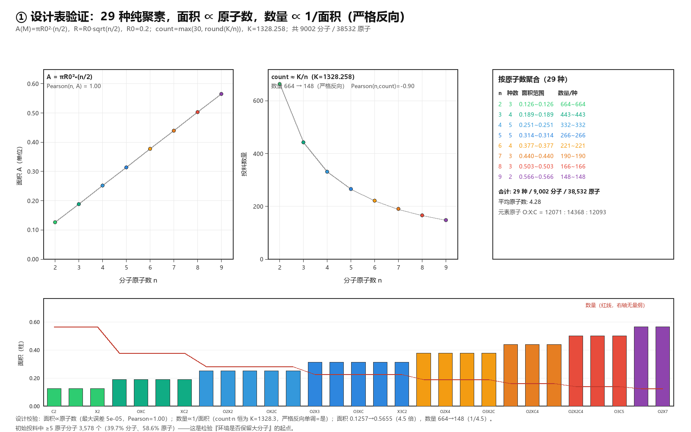

### 1.4 初速度/穿越设计

面积模型下每人平均自由程不同（大分子 λ 更小），初速按**最小 λ（最大分子）**反解，保证大分子
也能达到 500 次穿越：λ_min = 11072.7、λ_mean = 13773.9 → **v0 = 64138 单位/分钟**。
无化学对照按分子大小分组核对穿越次数。

---

## 2. 实验队列

| 实验 | 时长 | 目的 | 数据 |
|---|---:|---|---|
| **主实验（面积模型）** | 1000 分钟 | 用户指定设定 | `t57_area_result.json` |
| 无化学对照 | 500 分钟 | 穿越验证（按大小分组） | `t57_area_control.json` |
| **固定半径对照** | 1000 分钟 | 同投料/数量，半径固定 0.2，隔离"面积"效应 | `t57_uniform_result.json` |
| 低温窗口（补充） | 12/20 分钟 | 完全反应被压制时大分子能否保留 | `t57_sens_T12/20.json` |

---

## 3. 主实验结果（面积模型）

### 3.1 反应判定与动力学

| 指标 | **面积模型（主实验）** | 固定半径对照 | 差异 |
|---|---:|---:|---:|
| 完全反应 | **7,409,605** | 5,401,409 | **+37.2%** |
| 不完全反应 | 13,110 | 11,982 | +9.4% |
| 不反应 | 1,966 | 1,694 | +16.1% |
| 净变化事件 | 15,228 | 15,522 | -1.9% |
| 自分解事件 | 0 | 0 | — |
| 目录外新物质 | 0 | 0 | — |
| 初速度 | 64,138 | 38,202 | 面积模型更高（λ_min 更小） |
| 运行时间 | 70.6 s | 49.7 s | +42% |

面积模型碰撞更多（完全反应 +37%），说明"大分子截面大 → 碰撞更多"的机制确实生效；
但净变化事件反而略少，说明体系更快到达终点。

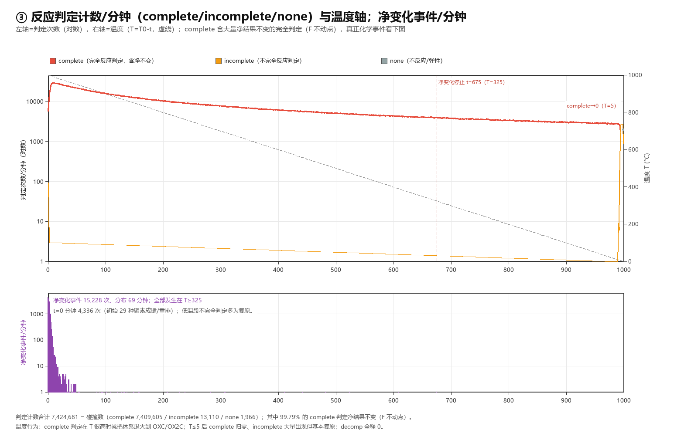

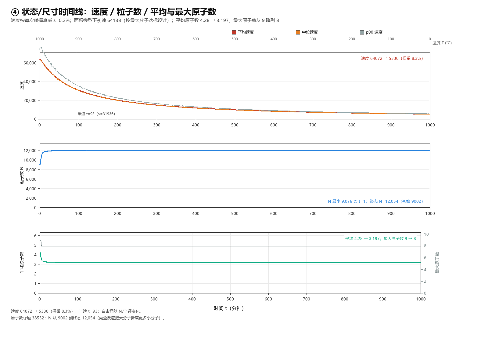

### 3.2 终态组成

| 分子式 | 中文名 | 原子数 | 面积模型数量 | 固定半径数量 |
|---|---|---:|---:|---:|
| `OXC` | 秩晶冰 | 3 | **9746** | **9734** |
| `OX2C` | 秩晶2冰 | 4 | **2291** | **2279** |
| `O2X2C4` | 秩2晶2冰4 | 8 | 14 | 20 |
| `O2X4` | 秩2晶4 | 6 | 3 | 9 |
| 合计 | — | — | **12054** | **12042** |

- 原子守恒：O=12071、X=14368、C=12093 与投料完全一致；
- 终态只有 4 种分子式，**两种模型几乎完全相同**（仅痕量差）；
- 没有生成 29 种之外的新分子式（`new_substances = 0`）——O/X/C 体系在完全/不完全反应下闭合。

元素配比解释：O : X : C = 12071 : 14368 : 12093 ≈ 1 : 1.19 : 1。`OXC` 消耗 1:1:1，
多出的 X 由 `OX2C`（O 1 : X 2 : C 1）消化 → 理论配比正好 `9746 OXC + 2291 OX2C`
（O=12037、X=14328、C=12037，余量进入痕量 O2X2C4/O2X4）。**终态由元素配比唯一决定，与初始
分子大小无关。**

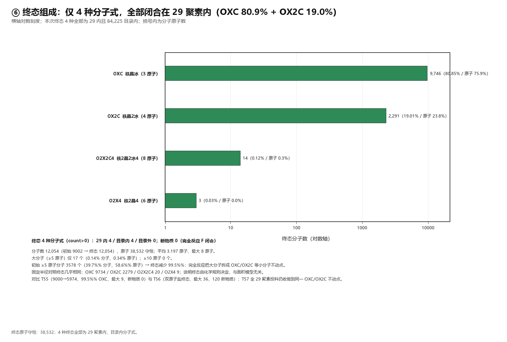

### 3.3 尺寸演化与"面积假设"检验

| 指标 | 初始投料 | **面积模型终态** | 固定半径终态 |
|---|---:|---:|---:|
| 分子数 | 9002 | 12054 | 12042 |
| 平均原子数 | **4.28** | **3.197** | **3.200** |
| 最大原子数 | 9 | 8 | 8 |
| ≥5 原子分子数（占比） | 3578（39.7%） | **17（0.14%）** | **29（0.24%）** |
| ≥10 原子分子 | 0（体系上限 9） | 0 | 0 |
| 终态分子式种数 | 29 | 4 | 4 |

- 初始平均 4.28 原子，20 分钟内降到 ~3.24，终态 3.20；**初始的大分子被迅速拆掉**；
- 面积模型与固定半径的终态尺寸几乎相同（3.197 vs 3.200），大分子反而更少（17 vs 29）；
- 演化中最大分子始终 ≤9（初始物种上限），**没有产生比初始更大的分子**。

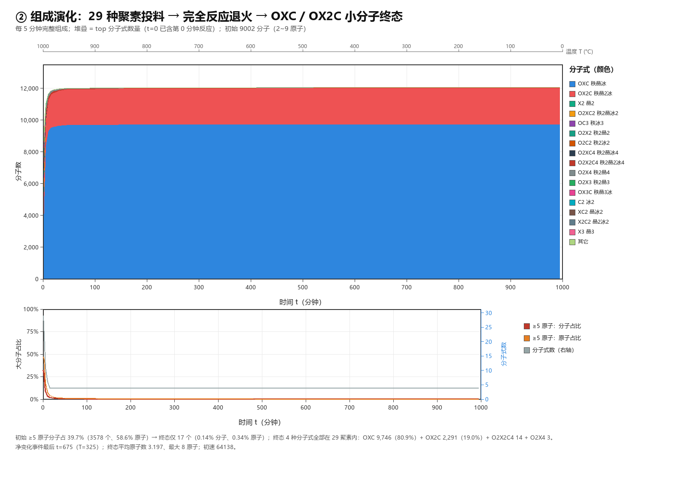

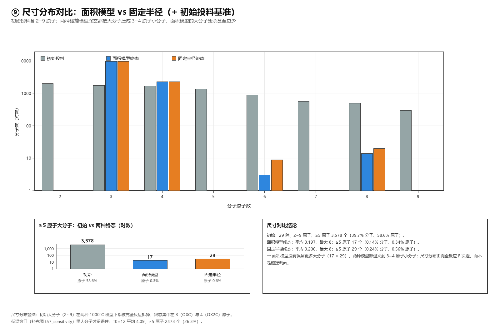

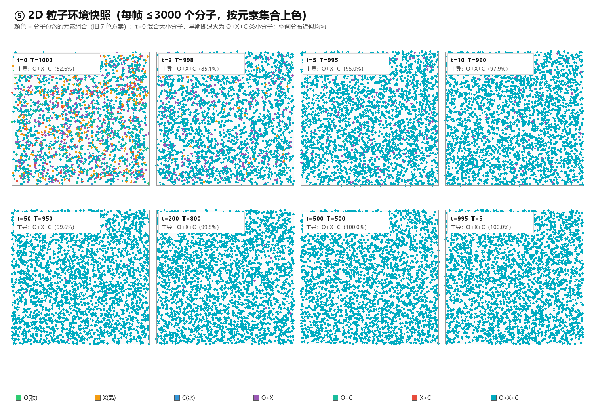

### 3.4 面积模型为什么没有"救活"大分子

1. **完全反应 F 是热力学吸引子**：只要 T ≥ Σc（对聚素小分子对 Σc≈2~20，1000°C 几乎全程满足），
   两个分子碰撞就做完全大锅反应，产物由总元素计数向量唯一决定 → 直接落到 F 不动点；
   净变化事件在 t≈675（T≈325°C）就全部结束，之后只有"净结果不变"的完全反应；
2. **面积放大的直接效果是"大分子被拆得更快"**：大分子截面大 → 碰撞率更高 →
   单位时间经历更多完全反应 → 更快变成小分子。完全反应次数 +37% 就是证据；
3. **29 种聚素是闭合体系**：O/X/C 的 F 产物最大 9 原子（恰好是初始上限），
   不完全反应在基态上全部净复原 → 没有任何机制生成 >9 原子的分子；
4. 因此初始投料里那 39.7% 的 ≥5 原子分子，在约 20 分钟内被"消化"为按元素配比决定的
   `OXC + OX2C`。**偏向小分子不是碰撞元素数少，而是 F + 配比。**

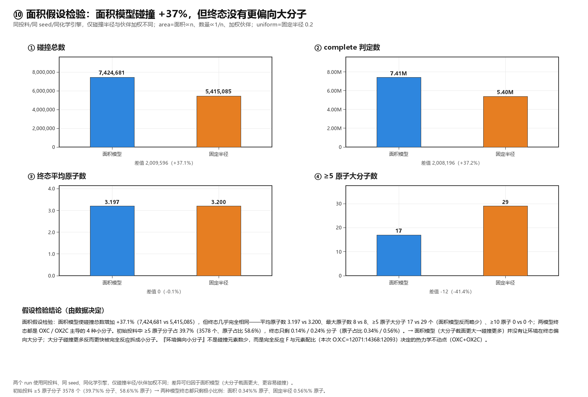

### 3.5 低温窗口：大分子能保留的条件

把初温降到阈值量级（面积模型不变）：

| T0 | 时长 | 平均原子数 | 最大原子数 | ≥5 原子分子（占比） | 分子式种数 | 目录外新物质 | 自分解事件 |
|---:|---:|---:|---:|---:|---:|---:|---:|
| 12°C | 12 min | **4.092** | 8 | **2473（26.3%）** | **18** | **7** | **1017** |
| 20°C | 20 min | 3.285 | 8 | 341（2.9%） | 6 | 3 | 162 |
| 1000°C（主实验） | 1000 min | 3.197 | 8 | 17（0.14%） | 4 | 0 | 0 |

→ 只有把温度压到 `Σc` 以下（完全反应被抑制）、让不完全反应/自分解接管，大分子和多样性
才能保留。**温度才是控制"分子大小"的主要旋钮，面积/截面只是动力学旋钮。**

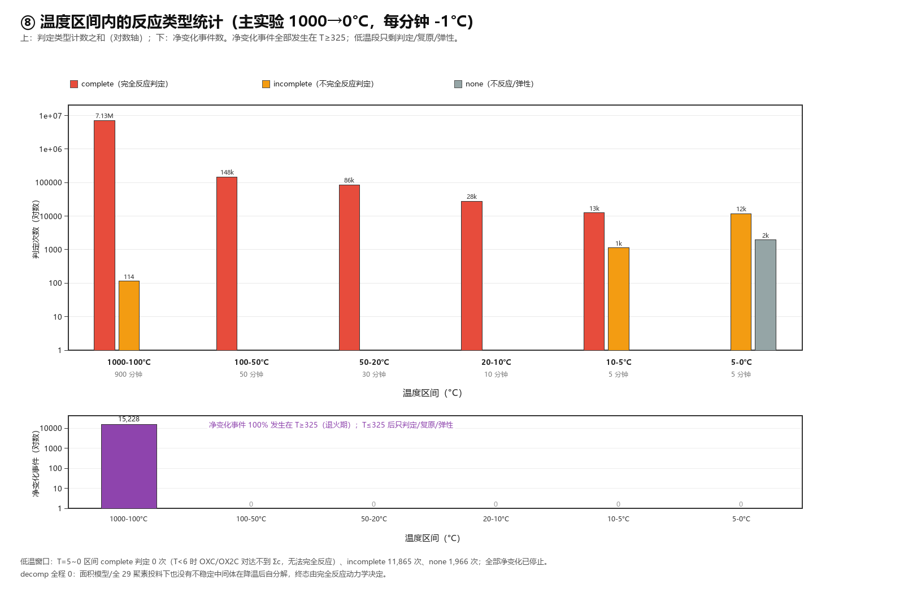

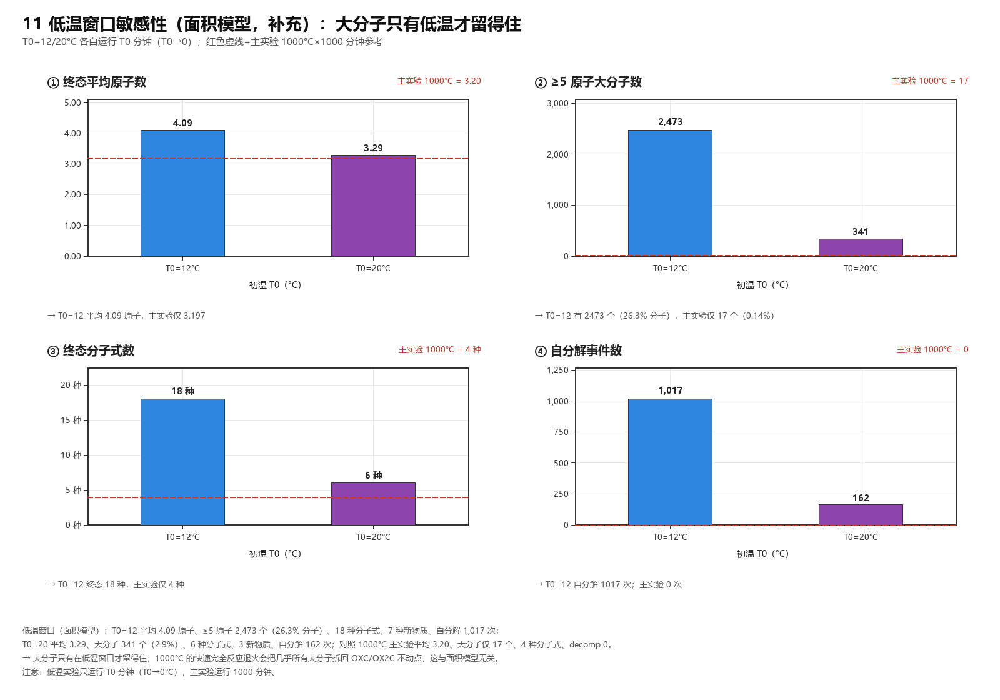

### 3.6 穿越验证（面积模型）

无化学对照（9002 个初始分子，500 分钟）：整体 **min 694.8 / p1 739.9 / median 847.5 /
max 981.7，9002/9002 全部 ≥500（100%）**。按初始分子大小分组：

| 初始原子数 | 2 | 3 | 4 | 5 | 6 | 7 | 8 | 9 |
|---|---:|---:|---:|---:|---:|---:|---:|---:|
| 该组 min 穿越 | 854.1 | 817.8 | 794.4 | 763.5 | 758.0 | 734.5 | 714.7 | **694.8** |

大分子虽然 λ 更小、碰撞更频繁，但设计按 λ_min 反解初速，**9 原子分子仍达到 694.8 次 ≥500**。
主实验累计等效穿越：t=500 时 9,322,789/D ÷ 9002 ≈ **1035.6 次/初始单质**；t=1000 约 1372.6 次。

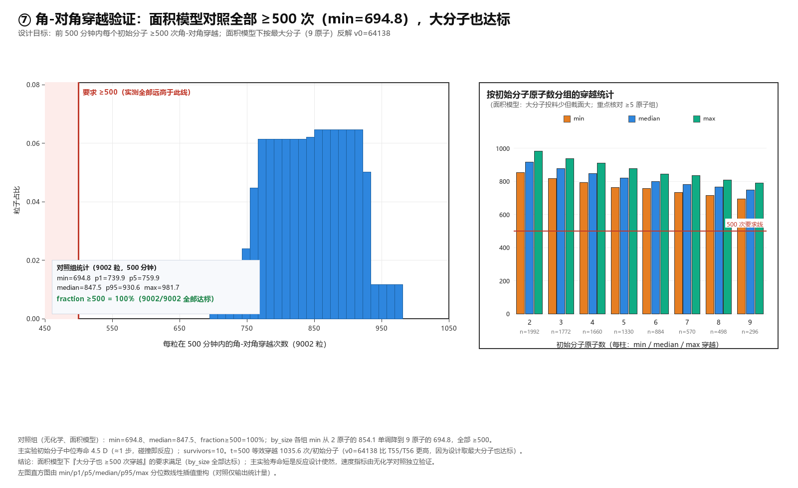
初始单质碰撞即反应，中位寿命仅 4.5 次穿越（约 1~2 个时间步），与 T55 的 2.7 不同，主要受
初始分子组成（29 种、含大分子）与"完全反应净结果不变"的碰撞影响。

---

## 4. 验证

- **投料设计校验**：面积 ∝ n、数量 ∝ 1/面积 严格反向（`strict_larger_area_fewer_count=true`）；
  总分子 9002、总原子 38532；
- **元素守恒**：O/X/C 逐元素核对，投料 = 终态；
- **穿越**：无化学对照 9002/9002 全部 ≥500（最低 694.8），按大小分组全部达标；
- **引擎**：沿用已审计的 `natural_engine.py`（T55 审计 7/7 通过），本轮只改碰撞/面积模型，未改化学规则；
- **可复现**：固定种子 20261118，同快照日程重跑 `t57_area_result.json`，summary/final_composition/
  time_series/formula_series/snapshots/event_samples **逐字段完全一致**（已实测）；
  低温敏感性 `t57_sensitivity.py` 重跑结果也完全一致。
- **分析口径**：T57 的 `final_composition.known29` 字段表示"在 29 聚素内"；终态 4 种全部在 29 内、
  也全部在 84,225 目录内；T57 未使用 84,225 目录作为 known 集合（本轮研究对象是 29 聚素闭合体系）。
- **快照 RNG 说明**：快照抽样使用主随机流（与 T55/T56 相同），严格复现需要相同 `snap_minutes`。

---

## 5. 讨论与结论

1. **用户假设不成立**："偏向小分子"不是碰撞元素数少。本次把大分子面积/截面放大 2.1~4.5 倍、
   并让大分子数量变少但更容易碰撞后，终态仍是 `OXC + OX2C` 两种小分子，与固定半径对照几乎相同；
   甚至大分子更少（17 vs 29）。
2. **真正的机制是"完全反应 F + 元素配比"**：T ≥ Σc 时碰撞即触发完全大锅反应，产物由总元素
   计数向量唯一决定；本次投料 O:X:C ≈ 1:1.19:1 的 F 不动点就是 `OXC + OX2C`。
   初始分子大小、面积、数量分布只影响"多快到达"，不影响"到哪里"。
3. **面积/截面是动力学旋钮，不是热力学旋钮**：增大截面只会加速完全反应 → 大分子被更快拆解；
   想改变终态分子大小，要动温度（低温窗口）、元素配比或反应规则。
4. **聚素闭合体系的分子量上限 = 9 原子**：本轮无法产生更大分子（T56 加入散素后才出现 22~36 原子）。
   "低温窗口"是聚素体系保留大分子的唯一途径：T0=12°C 时平均 4.09 原子、26.3% 分子 ≥5 原子、
   18 种分子式、7 种目录外新物质、1017 次自分解。
5. **与 T55/T56 的对比**：

| 指标 | T55（等比例聚素单质） | T56（3<2<1 + 散素） | **T57（29 聚素 + 面积模型）** |
|---|---|---|---|
| 初始分子 | 9000 双原子 | 9200 双原子 | **9002（29 种，2~9 原子）** |
| 平均初始原子数 | 2.0 | 2.0 | **4.28** |
| 终态主产物 | `OXC` 99.5% | `CF`/`XA`/`OK` 99.6% | **`OXC` 80.9% + `OX2C` 19.0%** |
| 终态平均原子数 | 3.0 | 2.04 | **3.20** |
| 最大分子（演化/终态） | 9 / 9 | 36 / 22 | **9 / 8** |
| 目录外新物质 | 0 | 120 | **0** |

---

## 6. 局限

1. 2D 稀薄气体 DSMC 近似（同 T55/T56）；面积模型用 `A ∝ n_atoms` 的简化（非真实分子几何
   投影面积/凸包面积），伙伴选择用截面加权的拒绝采样近似；
2. 不检查几何摆放（与 T31/T32 大样本口径一致）；
3. 单一随机种子（20261118）的一次实现；面积模型与固定半径的差异很小（17 vs 29 个 ≥5 原子分子），
   但两者终态组成一致（4 种分子式、OXC/OX2C 主导）是结构性结论，不依赖种子；
4. 29 种聚素闭合体系上限 9 原子；>16 原子相关结论不适用于本轮。

---

## 7. 文件清单

| 文件 | 内容 |
|---|---|
| `t55_kinetic_env.py` | 通用 2D 粒子环境（**新增：面积∝元素数、变截面碰撞率、截面加权伙伴、按大小分组穿越、area_model 配置**） |
| `t57_all29_area.py` | T57 投料设计（29 种、数量∝1/面积）+ 主实验/对照/固定半径对照 |
| `t57_sensitivity.py` | T57 低温窗口敏感性（T0=12/20°C，面积模型） |
| `t57_design.json` | 29 种物质的原子数/半径/面积/数量设计表 |
| `t57_area_result.json` | 主实验（面积模型）完整数据 |
| `t57_area_control.json` | 无化学对照（面积模型，含 by_size 分组穿越） |
| `t57_uniform_result.json` | 同投料固定半径对照 |
| `t57_sensitivity.json`、`t57_sens_T12/20.json` | 低温窗口数据 |
| `t57_analysis.py` / `t57_render.py` / `t57_analysis.json` | 分析 / 出图 / 分析汇总（754 KB，含 comparison_area_vs_uniform / comparison_T55_T56） |
| `images/t57_design.png` | 设计表三联（原子数-面积-数量聚合 + 29 物种明细） |
| `images/t57_composition.png` | 组成演化 + ≥5 原子大分子占比 |
| `images/t57_reaction_rate.png` | 判定计数/温度/净变化事件 |
| `images/t57_state_sizes.png` | 速度/分子数/平均与最大原子数 |
| `images/t57_snapshots.png` | 8 帧 2D 快照 |
| `images/t57_final_composition.png` | 终态 4 种组成 |
| `images/t57_crossings.png` | 穿越验证（整体 + by_size 分组） |
| `images/t57_temperature_windows.png` | 温度区间反应类型 |
| `images/t57_size_compare.png` | 尺寸分布：面积模型 vs 固定半径 vs 初始 |
| `images/t57_area_vs_uniform.png` | 面积假设检验 4 联 + 判定 |
| `images/t57_sensitivity.png` | 低温窗口敏感性（T0=12/20°C，补充） |

主报告图见下（由 `t57_render.py` 生成）。
