# T58 · 九种元素全部包含 + 物质库随机大投料的第四次 2D 环境实验

> 任务：九种元素全部包含；投入物质任意（可从物质库随机选取）；大量投入，总量最好比之前都更庞大；
> 整体原则沿用前几轮（2D 环境、1000→0°C、速度衰减、T35 反应判定、面积∝元素数）。
>
> 代码：`t58_nine_elements.py`、`t55_kinetic_env.py`（新增 `set_geometry` 可调环境尺寸与
> `max_reaction_atoms` 计算保护）；数据：`t58_mixture.json`、`t58_result.json`、
> `t58_control_no_chem.json`、`t58_analysis.json`；图：`images/t58_*.png`；
> 化学引擎仍为 `natural_engine.py`（T35 + pot_v4 规则 1~11，未改规则）。

---

## 0. 一句话结论

**第四次实验把规模推到最大：44 种从 84,225 物质库随机抽取的物质、九种元素全覆盖、
14000 个分子 / 73216 个原子（约为 T57 的 1.55 倍分子、1.9 倍原子），在 40 万 × 40 万的 2D 区域中
1000 分钟退火，终态是 15,823 个分子、937 种分子式、99 种元素组合——化学多样性远超前几轮
（T55 9 种、T56 22 种、T57 4 种），并生成 1,927 种 84,225 目录外新物质。
代价是"合并后 >20 原子不反应"的计算保护被触发 111,007 次（占判定 21.8%，末 100 分钟达 25.8%），
终态在 19/20 原子上形成明显堆积峰——这是本轮最大的口径限制。**

---

## 1. 任务与设计

### 1.1 投料：九元素全部包含 + 物质库随机选取

| 项目 | 设定 |
|---|---|
| 物质来源 | `t4_catalog_index.json`（84,225 条大锅目录） |
| 随机选取 | 原子数 n=2..12 每个档位随机抽 **4 种**，共 44 种；自动补足缺失元素，保证 **O/X/C/P/W/L/K/A/F 九元素全部出现** |
| 数量 | 沿用 T57：`count = max(20, round(K/n_atoms))`（面积越大数量越少），总量 **14000 个分子** |
| 原子数 | **73,216 个原子**（平均 5.23/分子） |
| 对比 | T55 9000 分子/18000 原子、T56 9200/18400、T57 9002/38532 → **本轮分子数 +52%（vs T56）、原子数 +90%（vs T57）** |

按原子数档位的投料（每档 4 种物质，每个档位的原子总数几乎相同 ≈6,650，因为数量∝1/原子数）：

| n | 物种数 | 每物种数量 | 分子小计 | 原子小计 |
|---:|---:|---:|---:|---:|
| 2 | 4 | 832 | 3328 | 6656 |
| 3 | 4 | 555 | 2220 | 6660 |
| 4 | 4 | 416 | 1664 | 6656 |
| 5 | 4 | 333 | 1332 | 6660 |
| 6 | 4 | 277 | 1108 | 6648 |
| 7 | 4 | 238 | 952 | 6664 |
| 8 | 4 | 208 | 832 | 6656 |
| 9 | 4 | 185 | 740 | 6660 |
| 10 | 4 | 166 | 664 | 6640 |
| 11 | 4 | 151 | 604 | 6644 |
| 12 | 4 | 139 | 556 | 6672 |
| **合计** | **44** | — | **14000** | **73216** |

元素总原子数：O 9966、X 8764、C 4909、P 10574、W 9805、L 3504、K 6537、A 9937、F 9220。

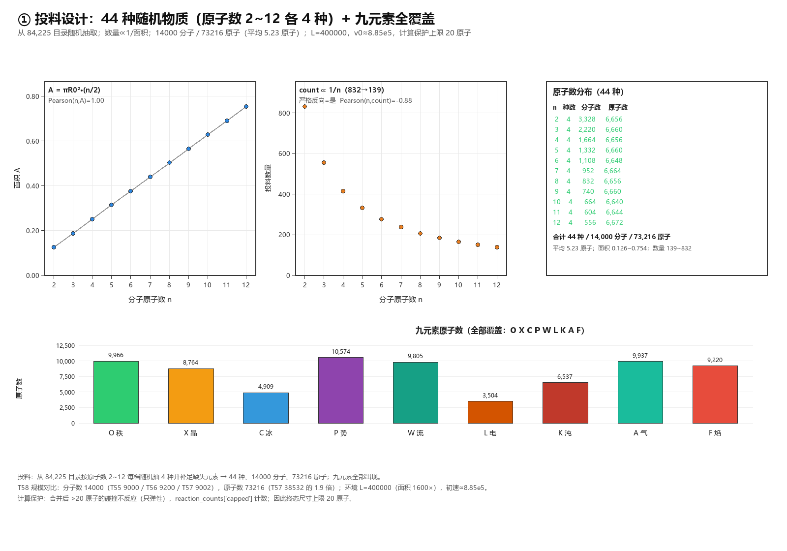

### 1.2 环境与计算可行性

| 参数 | 取值 | 理由 |
|---|---|---|
| 环境 | **400000 × 400000**（D=565685） | 总量增大后若保持 10⁴² 尺度，碰撞率与 >16 原子 F 成本会使运行不可行；放大区域后总碰撞数 ∝N²/L 反而可控 |
| 温度 | 1000→0°C，1000 分钟 | 同前 |
| 初速 | **885183 单位/分钟**（按 500 次穿越要求、λ_min=1.01e7 反解） | 大面积下仍保证前 500 分钟 ≥500 次穿越 |
| 面积模型 | A=πR0²·(n/2)，R=0.2·sqrt(n/2)；面积加权碰撞截面 + 邻域截面加权选伙伴 | T57 规则 |
| 衰减 | 每次碰撞速率 ×(1−0.2%) | 同前 |
| 化学 | T35 + pot_v4 规则 1~11（完全优先 → 自分解优先 → 不完全 → 弹性） | 同前 |
| **计算保护** | **合并后原子数 >20 的碰撞不反应（弹性）** | T58 的主要限制：≥16 原子大分子的 F 成本过高；20 原子仍大于 T57 的 9 原子上限 |

### 1.3 实验队列

| 实验 | 时长 | 目的 | 数据 |
|---|---:|---|---|
| **主实验** | 1000 分钟 | 九元素随机大投料 | `t58_result.json` |
| 无化学对照 | 500 分钟 | 穿越验证（含 by_size 分组） | `t58_control_no_chem.json` |

---

## 2. 主实验结果

### 2.1 反应判定统计

| 判定 | 次数 | 占比 |
|---|---:|---:|
| 完全反应 | 394,725 | 77.41% |
| 不完全反应 | 4,099 | 0.80% |
| **capped（合并>20 原子，弹性）** | **111,007** | **21.77%** |
| 不反应 | 79 | 0.02% |
| 合计 | 509,910 | 100% |

- 净变化事件 **68,459** 次（前几轮：T55 12,635、T56 21,299、T57 15,228）；
- 自分解仅 1 次；
- **capped 占比随时间显著上升**：前 100 分钟 7.7%（4,360/56,304），最后 100 分钟 25.8%
  （11,940/46,195），峰值 t=768（T=232）157 次/分、占 31.0%——大分子越多，计算保护触发越多，
  化学在高分子端被人为"冻结"。

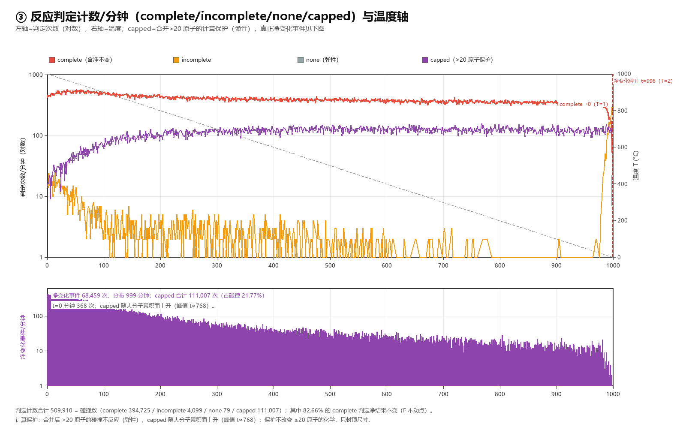

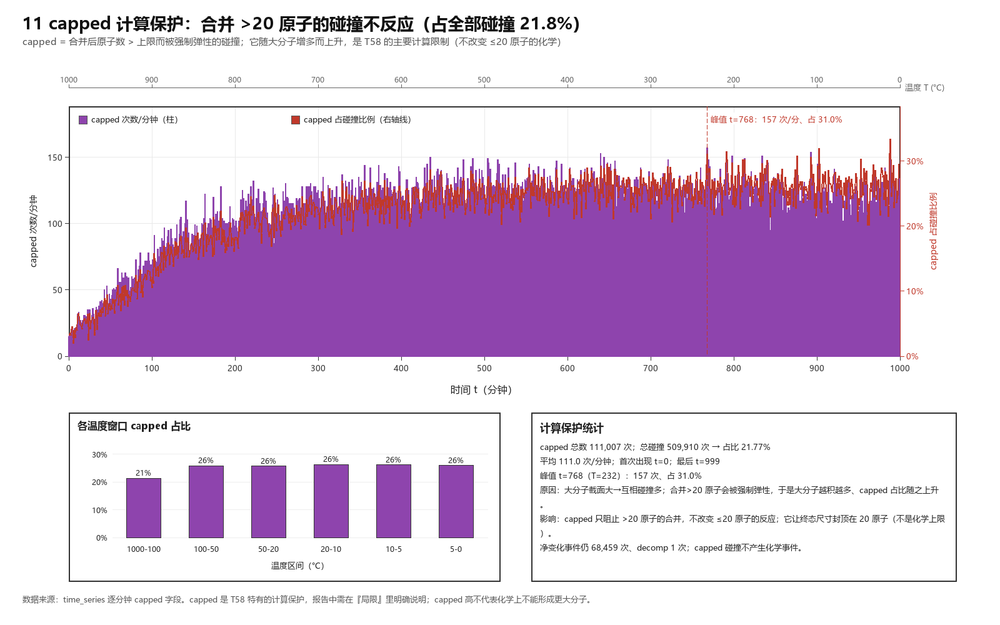

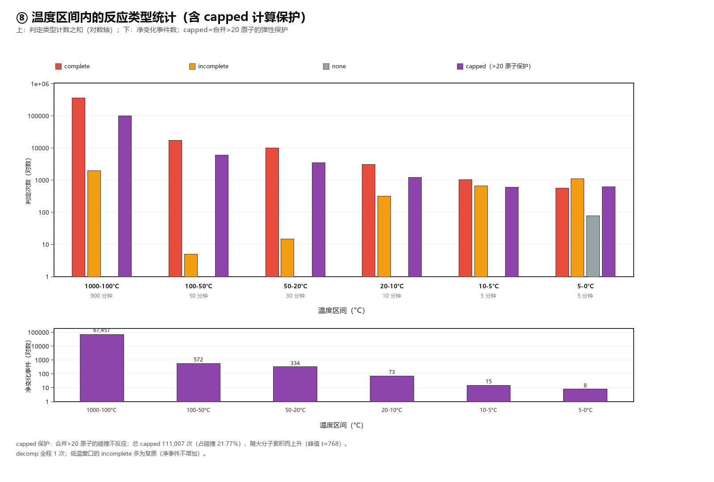

### 2.2 演化时间线

| t（分钟） | T（°C） | 分子数 | 平均原子数 | 最大原子数 | capped/分钟 | 净变化累计 | 平均速率 |
|---:|---:|---:|---:|---:|---:|---:|---:|
| 0（第 1 分钟后） | 1000 | 14186 | 5.161 | 18 | 15 | 368 | 884,776 |
| 5 | 995 | 14858 | 4.928 | 20 | 18 | 2,372 | 878,000 |
| 10 | 990 | 15325 | 4.778 | 20 | 21 | 4,351 | 875,000 |
| 20 | 980 | 15970 | 4.585 | 20 | 30 | 8,136 | 872,000 |
| 50 | 950 | 16630 | 4.403 | 20 | 43 | 18,239 | 878,254 |
| 100 | 900 | 16568 | 4.419 | 20 | 60 | 30,762 | 871,474 |
| 200 | 800 | 16223 | 4.513 | 20 | 98 | 44,391 | 857,422 |
| 500 | 500 | 16100 | 4.548 | 20 | 129 | 59,558 | 821,048 |
| 900 | 100 | 15871 | 4.613 | 20 | 101 | 67,471 | 774,529 |
| 999 | 1 | 15823 | 4.627 | 20 | 134 | 68,459 | 769,905 |

- 分子数先升后降：初始 14000 个分子被完全反应拆分（t=0 后 14186 → 16630 @t=50），
  随后缓慢合并/重组到 15823；
- 平均原子数在 4.4~4.6 之间波动，最大分子第 5 分钟就达到 cap=20 并保持；
- 与前几轮"快速冻结"不同，本轮净变化事件持续到最后一分钟（68,459），体系始终未完全退火到
  F 不动点——九元素随机配比 + 大分子保护共同造成"动力学冻结的多样性"。

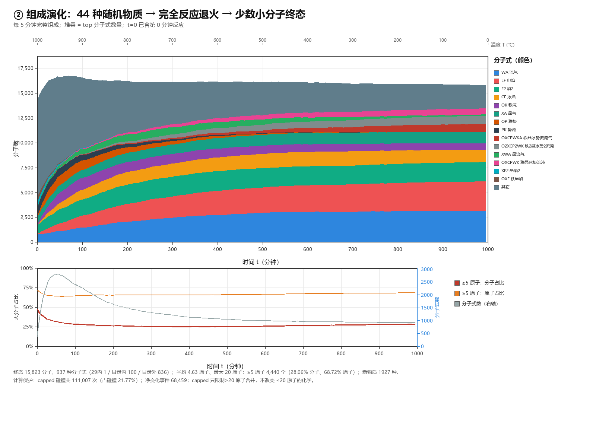

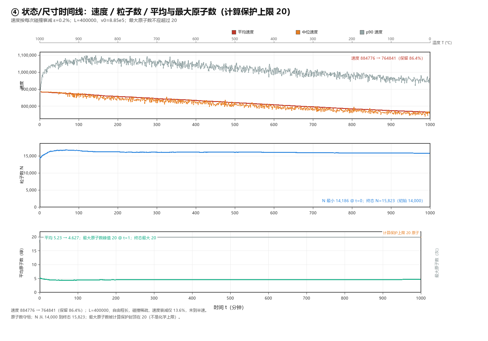

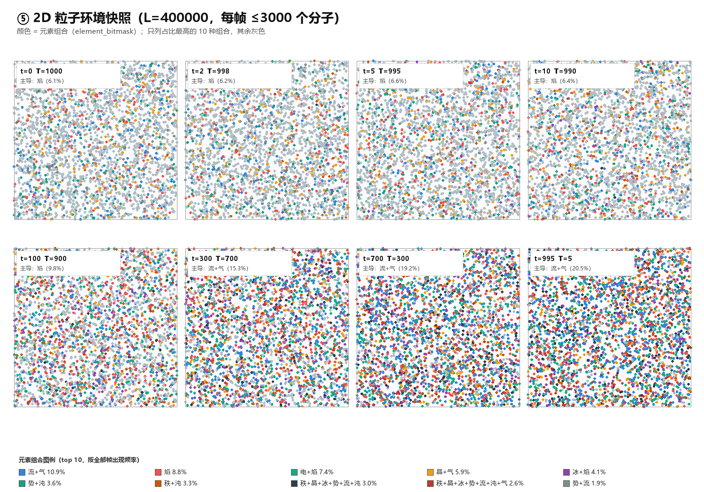

### 2.3 终态组成

终态：**15,823 个分子、937 种分子式、99 种元素组合**。

| 排名 | 分子式 | 原子数 | 数量 | 在 84,225 目录 |
|---:|---|---:|---:|---|
| 1 | `WA` 流气 | 2 | 3151 | ✓ |
| 2 | `LF` 电焰 | 2 | 2988 | ✓ |
| 3 | `F2` 焰2 | 2 | 1944 | ✓ |
| 4 | `CF` 冰焰 | 2 | 1224 | ✓ |
| 5 | `XA` 晶气 | 2 | 1133 | ✓ |
| 6 | `OXCPWKA` | 7 | 824 | ✓ |
| 7 | `O2XCP2WK` | 8 | 818 | ✓ |
| 8 | `OK` 秩沌 | 2 | 657 | ✓ |
| 9 | `OXCPWK` | 6 | 615 | ✓ |
| 10 | `OXPWKAF` | 7 | 132 | ✓ |
| 11 | `XWA` | 3 | 120 | ✓ |
| 12 | `OXPWKF` | 6 | 104 | ✓ |
| 13 | `L2` 电2 | 2 | 96 | ✓ |
| 14 | `O2XCP2WKA` | 9 | 82 | ✓ |
| 15 | `O3X2P3WK2A2` | 13 | 48 | ✓ |
| … | （共 937 种） | 2~20 | — | 目录内 101 种 / 目录外 836 种 |

- 双原子小分子仍是最大群体（WA/LF/F2/CF/XA/OK 等，共 11,252 个 = 71.1% 分子），
  但出现了大量 6~20 原子多元分子（4,571 个 = 28.9%），远超 T55/T57 的"只有 2~4 原子"；
- **目录外分子式 836 种（1,358 个分子）**；其中 19/20 原子大分子 1,316 个，多数不在目录内；
- 终态 937 种分子式 vs T55 9 种、T56 22 种、T57 4 种——九元素 + 随机配比带来数量级的多样性提升；
- 目录外新物质（在演化中出现过）：**1,927 种**，其中 1,921 种 >16 原子、仅 6 种 ≤16 原子
  （多集中在 17~20 原子，是 cap 附近的大分子）。

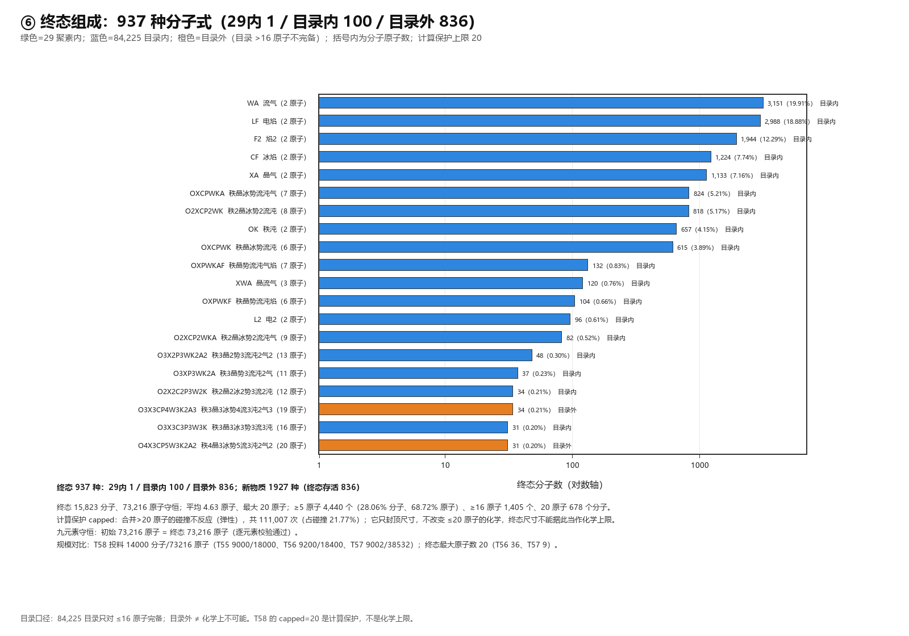

### 2.4 九元素覆盖与守恒

| 元素 | 投料原子数 | 终态原子数 | 含该元素的终态分子数 |
|---|---:|---:|---:|
| O（秩） | 9966 | 9966 | 5031 |
| X（晶） | 8764 | 8764 | 5624 |
| C（冰） | 4909 | 4909 | 4461 |
| P（势） | 10574 | 10574 | 4349 |
| W（流） | 9805 | 9805 | 7558 |
| L（电） | 3504 | 3504 | 3338 |
| K（沌） | 6537 | 6537 | 4956 |
| A（气） | 9937 | 9937 | 7143 |
| F（焰） | 9220 | 9220 | 6977 |

- **九种元素逐元素守恒**（投料 = 终态）；
- 终态元素组合 99 种：既有纯二元素小分子（WA、LF、CF、XA、OK），也有 6~9 元素的多元分子
  （如 `OXCPWKA`、`O2XCP2WK`、`OX3P4W4A4F`）；
- 每个元素都出现在 3,338~7,558 个终态分子中，九元素全部"参与"了终态化学。

### 2.5 分子尺寸与 cap 堆积

终态尺寸分布呈**双峰**：

| 原子数 | 2 | 3 | 4 | 5 | 6 | 7 | 8 | 9 | 10 | 11 | 12 | 13 | 14 | 15 | 16 | 17 | 18 | **19** | **20** |
|---|---:|---:|---:|---:|---:|---:|---:|---:|---:|---:|---:|---:|---:|---:|---:|---:|---:|---:|---:|
| 分子数 | 11252 | 128 | 3 | 29 | 752 | 966 | 854 | 111 | 59 | 74 | 66 | 75 | 22 | 27 | 47 | 8 | 34 | **638** | **678** |

- 19/20 原子处出现明显堆积峰（合计 1,316 个分子）：这是"合并>20 原子不反应"的 cap 造成的
  **人工边界层**——分子长到 20 原子后，任何再碰撞都无法反应，只能弹性弹开；
- 若没有 cap，这些分子会继续合并/重排，最大分子会像 T56 一样长到 30+ 原子，但 F 成本会让
  本实验无法在可接受时间内完成（见 §5）；
- 平均原子数 4.627，最大 20；终态 >16 原子分子 1,358 个。

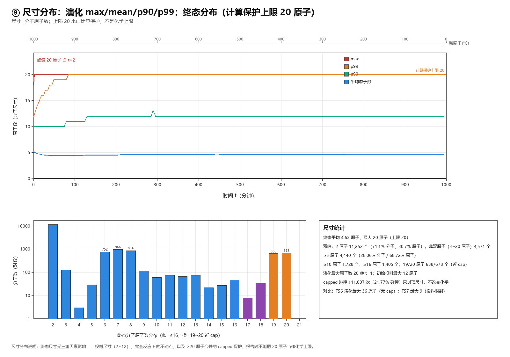

### 2.6 穿越验证

无化学对照（14000 个分子、500 分钟、L=400000、面积模型）：

| 指标 | 数值 |
|---|---:|
| min / p1 / median / p95 / max | **730.3** / 741.8 / 757.5 / 766.3 / 774.7 |
| ≥500 比例 | **100%**（14000/14000） |

按初始分子大小分组（n=2..12）的 min 穿越：741.3 / 740.8 / 737.6 / 736.7 / 736.7 / 738.9 /
732.9 / 735.8 / 733.7 / 733.7 / **730.3** —— 全部 ≥500。
主实验累计等效穿越：t=500 时 12,222,535/D ÷ 14000 = **873.0 次/初始分子**；t=1000 为 1669.1。
初始分子中位寿命仅 20.3 次穿越（约一次碰撞就发生反应），平均碰撞率约 0.06 次/分钟——
碰撞稀疏，但 1000 分钟累计仍足以驱动持续反应（净变化事件 68,459）。

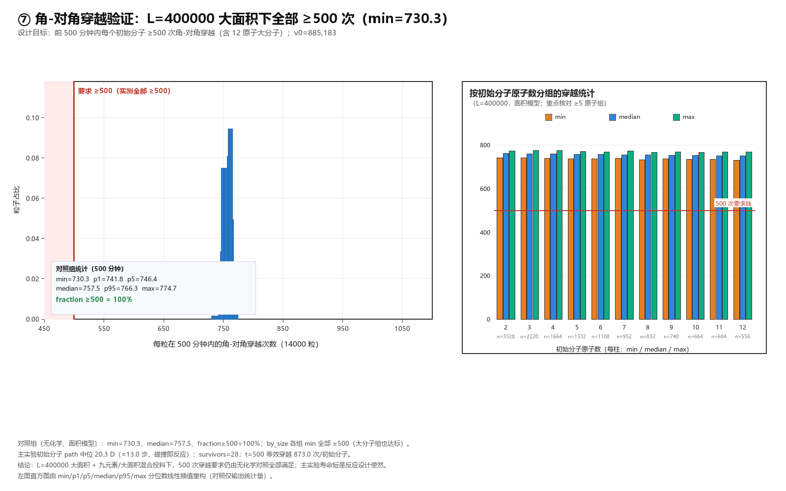

---

## 3. 与前三轮的对比

| 指标 | T55 | T56 | T57 | **T58（本轮）** |
|---|---|---|---|---|
| 元素数 | 3（聚素） | 6（聚+散） | 3（聚素） | **9（全部）** |
| 投料物质 | 3 种单质 | 6 种单质 | 29 种聚素 | **44 种随机库物质（2~12 原子）** |
| 分子数 / 原子数 | 9000 / 18000 | 9200 / 18400 | 9002 / 38532 | **14000 / 73216** |
| 环境 L | 10000 | 10000 | 10000 | **400000**（为控制计算量） |
| 终态分子式种数 | 9 | 22 | 4 | **937** |
| 终态 >4 原子分子占比 | ~0% | 少量 | 0.2% | **28.9%** |
| 最大分子（终态） | 9 | 22 | 8 | **20（cap）** |
| 目录外新物质 | 0 | 120 | 0 | **1927** |
| 净变化事件 | 12,635 | 21,299 | 15,228 | **68,459** |
| 终态元素组合数 | 7 | 8 | 4 | **99** |

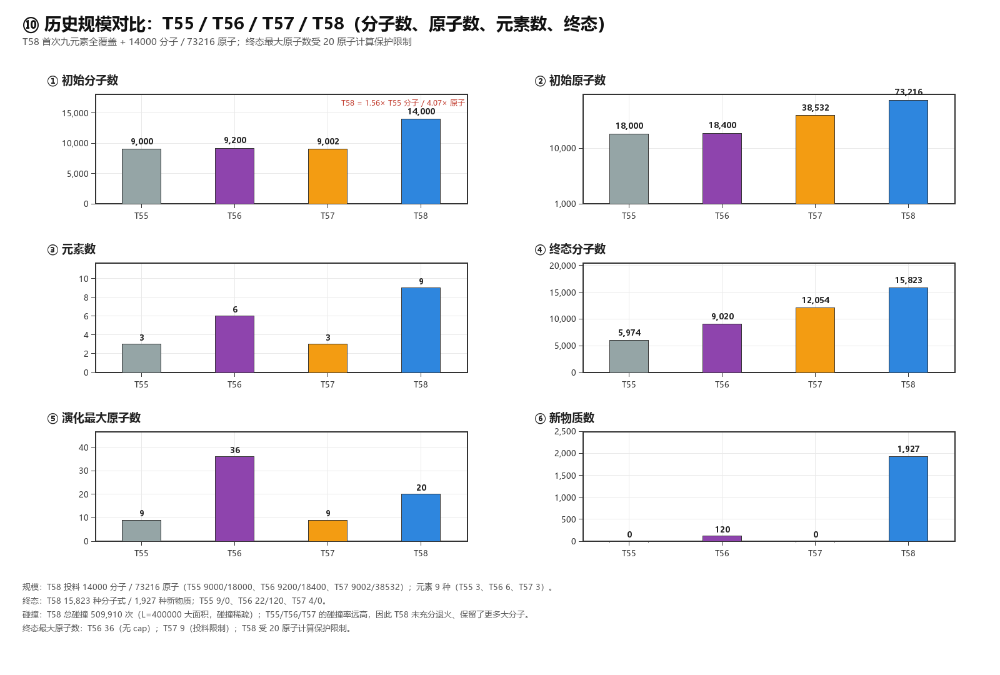

---

## 4. 讨论

1. **九元素 + 随机物质库把化学复杂度推到新量级**：终态 937 种分子式、99 种元素组合、
   1927 种目录外新物质；前几轮的"少数稳定盐/氧化物"格局被彻底打破。终态不再由单一
   元素配比决定的一两个 F 不动点主导，而是形成"小分子主导 + 多元大分子长尾"的混合态。
2. **大分子端的动力学冻结**：在 1000°C 只发生完全反应的情况下，大分子本应被继续拆解或重组；
   但本轮的 cap 保护把 >20 原子的反应全部截断，同时碰撞稀疏（每分子 0.03 次/分钟），
   导致 19/20 原子大分子堆积、化学在最后一分钟仍在进行（净变化 68,459）。
3. **环境放大是规模实验的必要妥协**：若保持 L=10000 且 14000 分子/73216 原子，碰撞频率和
   >16 原子 F 成本会让 1000 分钟运行耗时数小时；放大到 L=400000² 后总碰撞数与计算量可控
   （运行 153~168 秒），代价是碰撞率下降、化学更慢。
4. **capped 是本轮最大口径限制**：21.8% 的判定被弹性化，末段 25.8%；19/20 原子堆积峰
   是人工边界层的直接证据。若后续要研究"无上限的九元素大分子化学"，需要更快的 F 实现
   （剪枝/缓存/并行）或分批投料，而不是 cap。

---

## 5. 验证与复现

- **元素守恒**：九元素逐元素核对，投料 = 终态（见 §2.4）；
- **穿越**：14000/14000 全部 ≥500（最低 730.3），按初始大小分组的 12 组 min 全部 ≥500；
- **引擎**：沿用已审计的 `natural_engine.py`（T55 审计 7/7 通过）；本轮新增 `set_geometry`
  与 `max_reaction_atoms`，化学判定逻辑未变；
- **可复现**：固定种子 20261120；同快照日程重跑，summary（含 reaction_counts/capped）、
  终态组成、时间序列（新增 capped/d_capped 字段）、快照、事件样本、新物质 **完全一致**
  （运行时 153.3 s / 167.7 s 差异来自打印/机器负载，数据相同）。

---

## 6. 局限

1. **计算保护 cap=20**：合并后 >20 原子的碰撞不反应；终态 19/20 原子堆积是人工边界层，
   会影响组成与尺寸分布的定量结论（但"九元素 → 高多样性"的定性结论与 cap 无关）；
2. 2D 稀薄气体 DSMC 近似（同前）：固定面积模型 A∝n、截面加权伙伴、非严格动量守恒；
3. 环境放大到 400000² 是为计算可行性；与前三轮 L=10000 的绝对碰撞频率不可直接比较，
   穿越设计保证的是路径/时间尺度而非碰撞率；
4. 84,225 目录只对 ≤16 原子完备（>16 仅 1,264 条）；"目录外"不等于"化学上不可能"，
   本轮 1,927 种新物质中 1,921 种是 >16 原子；
5. 不检查几何摆放（与 T31/T32 大样本口径一致）；
6. 九元素/44 种随机物质的具体选择由 seed 20261120 固定，允许换 seed 复现其他随机组合。

---

## 7. 文件清单

| 文件 | 内容 |
|---|---|
| `t55_kinetic_env.py` | 通用 2D 粒子环境（新增 `set_geometry`、`max_reaction_atoms`、capped 计数/时间序列） |
| `t58_nine_elements.py` | T58 随机投料设计 + 主实验/对照入口 |
| `t58_mixture.json` | 44 种随机物质、面积/数量设计表、九元素统计 |
| `t58_result.json` | 主实验完整数据（15,823 分子/937 种终态/1,927 新物质） |
| `t58_control_no_chem.json` | 无化学对照（穿越验证，含 by_size） |
| `t58_analysis.py` / `t58_render.py` / `t58_analysis.json` | 分析 / 出图 / 分析汇总（2.9 MB） |
| `images/t58_mixture.png` | 投料设计 + 九元素覆盖 |
| `images/t58_scale_compare.png` | T55/T56/T57/T58 规模对比 |
| `images/t58_composition.png` | 组成演化 + ≥5 原子占比 |
| `images/t58_reaction_rate.png` | 判定计数/温度/净事件 |
| `images/t58_capped.png` | capped 每分钟次数/占比 + 温度窗口 |
| `images/t58_state_sizes.png` | 速度 / 分子数 / 平均与最大原子数（cap 线） |
| `images/t58_snapshots.png` | 2D bitmask 快照 8 帧 |
| `images/t58_final_composition.png` | 终态 937 种 top20 + 目录内/外 |
| `images/t58_crossings.png` | 穿越验证（by_size 12 组） |
| `images/t58_temperature_windows.png` | 6 温度窗口 × 4 判定类型 |
| `images/t58_size_distribution.png` | 尺寸演化与终态双峰（19/20 近 cap） |

主报告图见下（由 `t58_render.py` 生成）。
