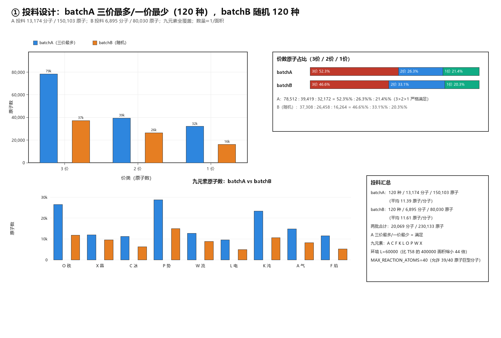
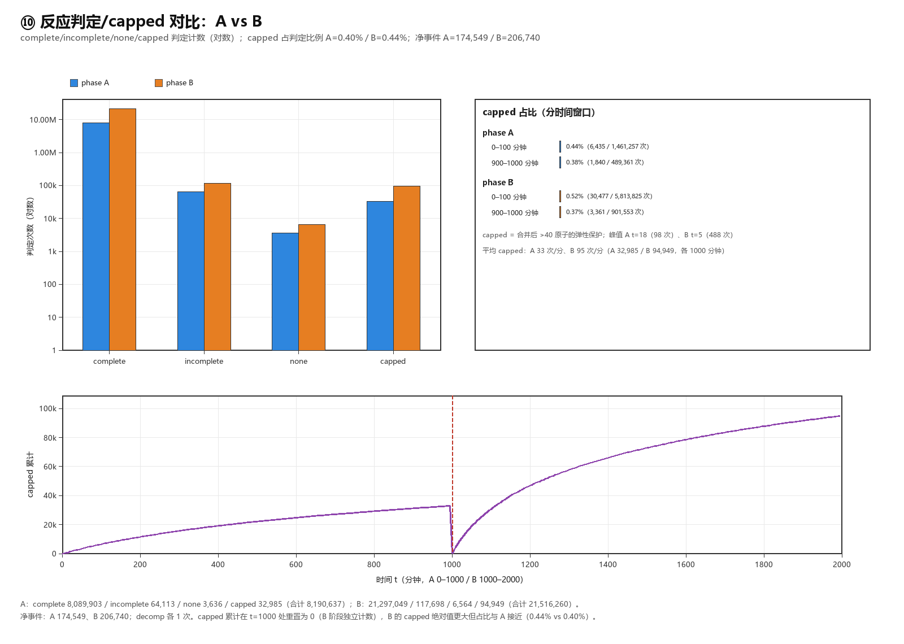
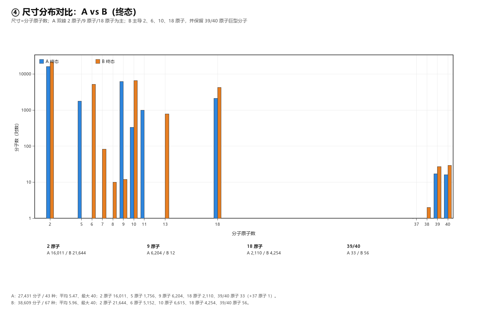
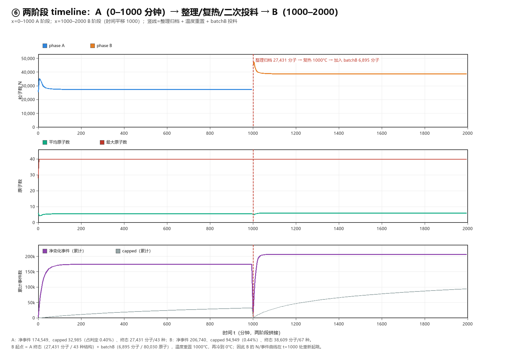
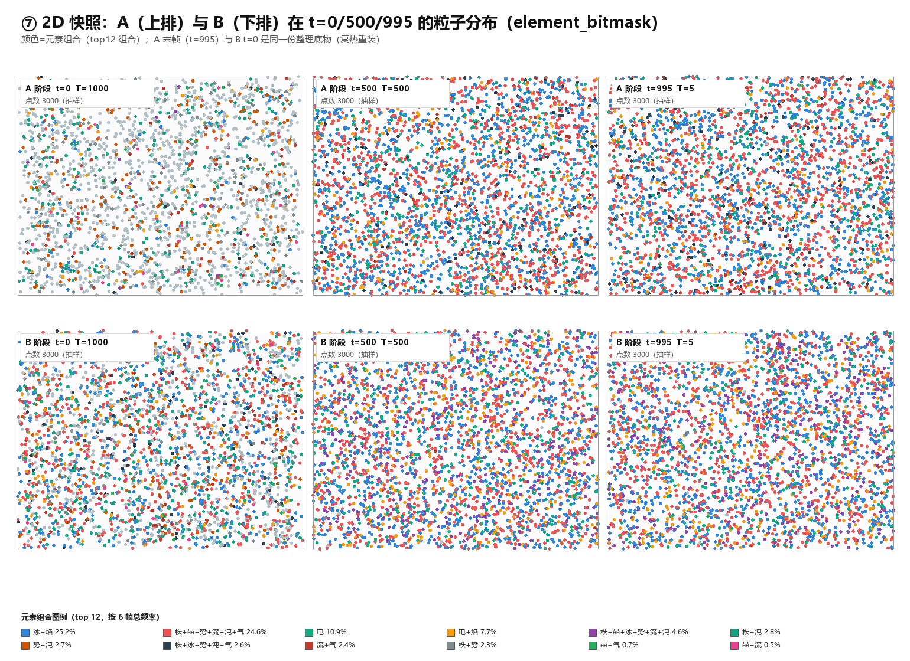
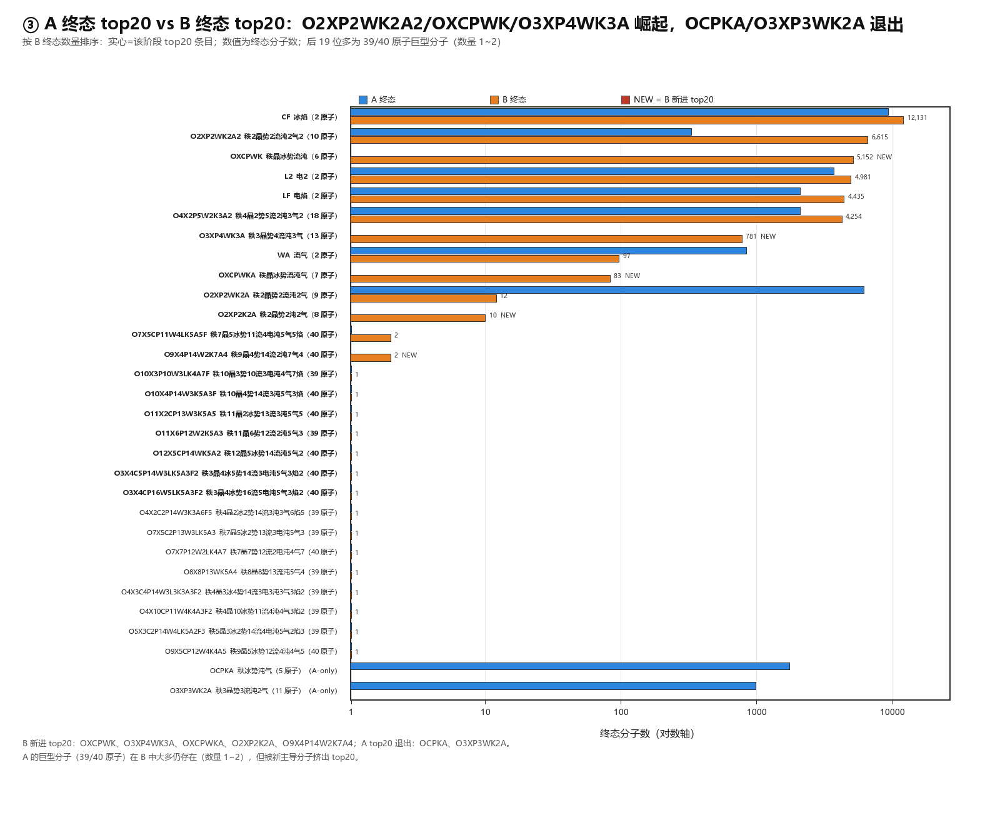
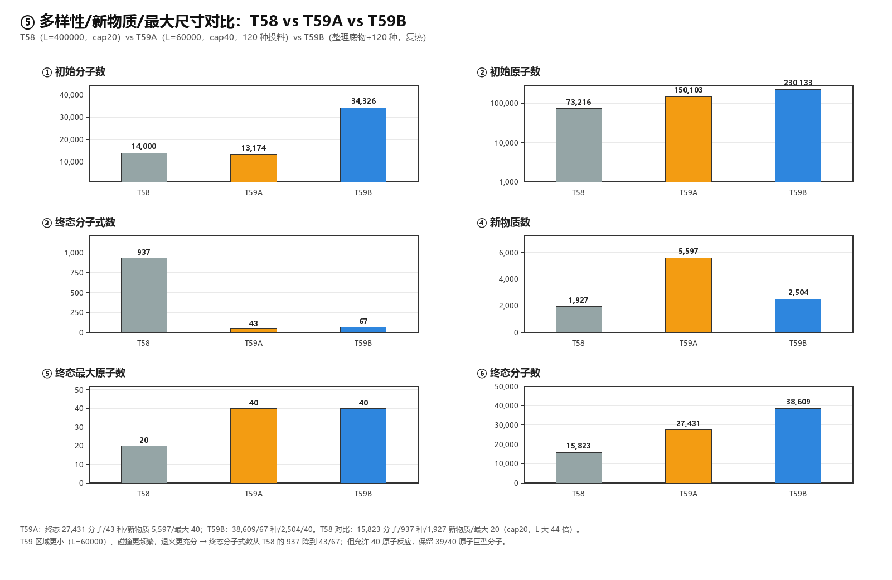
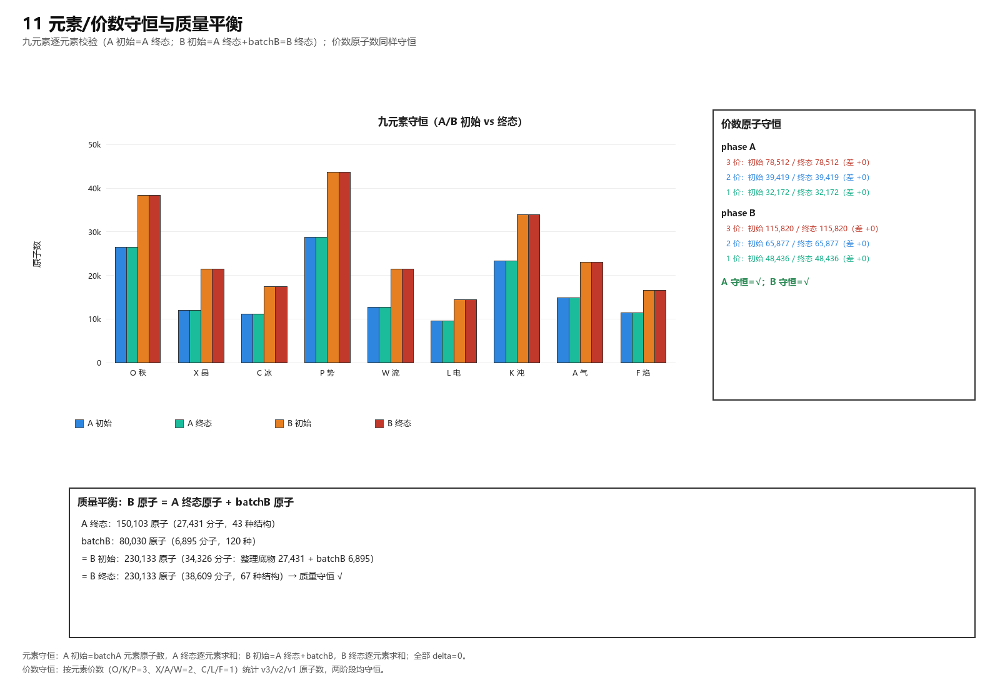
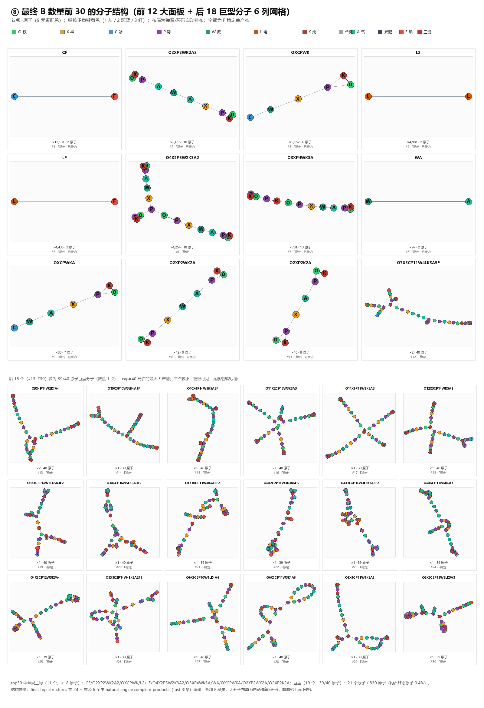
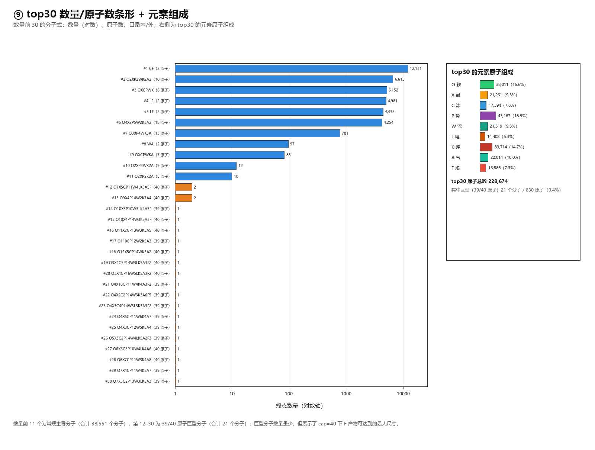

# T59 · 九元素两阶段连续实验（100+ 种物质，三价最多/一价最少）

> 任务：优化算法、缩小区域、让大分子之间的反应也能发生；然后做第四次之后的又一次实验：
> ① 九种元素全部包含；② 三价元素含量最多、一价元素含量最少；③ 初始物质 ≥100 种，数量足够多；
> ④ 第一阶段温度降到 0°C 后"整理"，再投入一次随机大量物质，温度重置 1000°C 做连续第二阶段；
> ⑤ 给出两次实验对比汇报；⑥ 把最终结果数量前 30 的分子结构画成图并分析。
>
> 代码：`fast_pot.py`（加速引擎）、`natural_engine.set_fast`、`t59_mixture.py`、`t59_two_phase.py`；
> 数据：`t59_loads.json`、`t59_phaseA_result.json`、`t59_stateA.json`、
> `t59_phaseB_result.json`、`t59_stateB.json`、`t59_control_A.json`、`t59_analysis.json`；
> 审计：`docs/T59_FAST_ENGINE_AUDIT.md`；图：`images/t59_*.png`（含 `t59_top30_structures.png`）。

---

## 0. 一句话结论

**算法优化后（`fast_pot` 增量并查集 + 分层字典序筛选，完全/不完全反应与 pot_v4 规则 1~11
逐项等价，F 加速 3.6~6.3 倍），环境从 T58 的 400000² 缩小到 **60000²（面积减小 44 倍）**，
大分子反应上限提高到 40 原子。两阶段实验总耗时仅 9 分钟：
- **第一阶段**（120 种物质、三价最多/一价最少）：13,174 分子/150,103 原子 → 27,431 分子/
  150,103 原子/**43 种终态结构**；
- **整理**：保留全部 27,431 个分子（43 种结构）作为底物，清点归档、空间重排、速度重置；
- **第二阶段**（底物 + 第二批 120 种随机物质，原子 230,133，T 重置 1000→0）：38,609 分子/
  230,133 原子/**67 种终态结构**；主导分子从 `O2XP2WK2A`（6204→12）切换为
  `O2XP2WK2A2`（6615）、`OXCPWK`（5152）、`O3XP4WK3A`（781），而 `CF`/`L2`/`LF`/`O4X2P5W2K3A2`
  等"稳健分子"继续保留并增长。最终 top30 中 11 种是常规主导分子，另外 19 种是 39/40 原子
  （cap）巨型分子。**

---

## 1. 算法优化：fast_pot 快速引擎

### 1.1 优化内容

T58 的瓶颈是 >16 原子完全反应 F 的 Python 贪心循环（每步重算组件/距离/环标记，O(n²) 候选 ×
O(n) 步）。`fast_pot.py` 做了三项优化：

1. **增量并查集**维护组件、组件大小/元素掩码/剩余价和，不再每步 BFS 重算；
2. **分层字典序筛选**：按 key 的优先级逐层过滤（dt 最大 → rem 和最大 → 族 → cross → gd →
   大小/种类/剩余价 → 规则 9 → 规则 10 → 规则 11），只在仍有并列时计算高代价项
   （最短路、规则 9 元素计数、环标记）；
3. 保持**逐字等价**：产物结构、失败状态、level6 块、固定键（不完全反应）路径全部一致。

### 1.2 独立审计结果（`docs/T59_FAST_ENGINE_AUDIT.md`）

| 审计项 | 结果 |
|---|---|
| 完全反应等价 | 27,315 个向量（穷举 0~7 原子、=8 原子、随机 8~24）与 pot_v4：公式/`mol_label`/None/level6 **0 不一致** |
| 固定键/不完全反应 | 450 对真实分子（4,732 条 base_edges，58 对真实重排）+ 200 组合成固定键：**0 不一致** |
| set_fast 端到端 | complete 350 / incomplete 200 / resolve 280 / is_stable 60 共 890 次对比 **0 不一致** |
| 速度（单次 F） | n=12/16/20/24：0.30/0.63/1.17/1.24 ms（慢版 3.6~5.0×）；n=30/40/60：**5.6/6.3/5.8×** |

### 1.3 环境缩小与运行时间

| 实验 | 环境 L | 面积相对 T58 | 两阶段总运行时间 |
|---|---:|---:|---:|
| T58（上一轮） | 400000 | 1× | 154 s（单阶段） |
| **T59（本轮）** | **60000** | **1/44.4** | **534 s（A 207 s + B 324 s）** |

缩小区域后平均自由程减小、碰撞更频繁：第一阶段 1000 分钟发生 **809 万次完全反应判定**
（T58 全程仅 39.5 万），反应更充分；同时 `fast_pot` 使 >16 原子大分子反应可行
（`max_reaction_atoms=40`，允许最多 40 原子合并反应，T58 是 20）。

---

## 2. 投料设计

### 2.1 第一批 batchA（第一阶段，满足"三价最多、一价最少"）

从 84,225 物质库按价数偏向分组随机抽取 **120 种物质**：
60 种三价丰富（O/P/K 原子占比 ≥50%）、40 种二价丰富（X/W/A ≥50%）、20 种一价丰富（C/L/F ≥50%），
并补足九元素；数量 ∝1/原子数，再用 3×3 线性方程把三组的数量倍数调到目标价数比例。

| 项目 | 数值 |
|---|---|
| 物种数 | **120** |
| 分子 / 原子 | 13,174 / **150,103** |
| 平均原子数 | 11.394 |
| 三价 : 二价 : 一价（原子） | **78,512 : 39,419 : 32,172 = 52.31% : 26.26% : 21.43%** |
| 价数顺序 | **三价 > 二价 > 一价 ✓** |
| 九元素 | O 26,466、X 11,919、C 11,145、P 28,757、W 12,685、L 9,567、K 23,289、A 14,815、F 11,460 |

### 2.2 第二批 batchB（第二阶段前投入）

从 84,225 物质库**随机抽 120 种物质**（不限制价数），数量 ∝1/原子数：

| 项目 | 数值 |
|---|---|
| 物种数 | **120** |
| 分子 / 原子 | 6,895 / **80,030** |
| 平均原子数 | 11.607 |
| 三价 : 二价 : 一价 | 37,308 : 26,458 : 16,264 = 46.62% : 33.06% : 20.32%（B 批自身） |
| 九元素 | O 11,828、X 9,548、C 6,284、P 14,865、W 8,741、L 4,845、K 10,615、A 8,169、F 5,135 |

### 2.3 环境与参数

| 参数 | 取值 |
|---|---|
| 环境 | **60000 × 60000**（D=84853；面积是 T58 的 1/44.4） |
| 温度 | 第一阶段 1000→0°C；整理后**重置为 1000→0°C**；两阶段各 1000 分钟 |
| 初速（设计 v0） | 按 500 次穿越设计（A：180,290/分钟；B：438,701/分钟） |
| 面积模型 | A=πR0²·(n/2)，碰撞截面按面积加权（T57 规则） |
| 衰减 | 每次碰撞 ×(1−0.2%) |
| 化学 | T35 + pot_v4 规则 1~11（fast 引擎）；`max_reaction_atoms=40` |
| 无化学对照 | batchA 500 分钟：**min 709.5、median 759.9、100% ≥500 次穿越**（by_size 全部 ≥500） |

---

## 3. 第一阶段结果（A）

### 3.1 反应判定

| 判定 | 次数 | 占比 |
|---|---:|---:|
| 完全反应 | 8,089,903 | 98.77% |
| 不完全反应 | 64,113 | 0.78% |
| capped（合并>40 原子） | 32,985 | 0.40% |
| 不反应 | 3,636 | 0.04% |
| 净变化事件 | **174,549** | — |
| 自分解 | 1 | — |

### 3.2 终态

第一阶段从 13,174 个分子（150,103 原子）出发，终态 **27,431 个分子、150,103 原子（守恒）、
43 种结构**：

| 排名 | 分子式 | 原子数 | 数量 |
|---:|---|---:|---:|
| 1 | `CF` 冰焰 | 2 | **9,349** |
| 2 | `O2XP2WK2A` | 9 | **6,204** |
| 3 | `L2` 电2 | 2 | **3,733** |
| 4 | `O4X2P5W2K3A2` | 18 | **2,110** |
| 5 | `LF` 电焰 | 2 | **2,089** |
| 6 | `OCPKA` | 5 | **1,756** |
| 7 | `O3XP3WK2A` | 11 | **985** |
| 8 | `WA` 流气 | 2 | **840** |
| 9 | `O2XP2WK2A2` | 10 | 331 |
| 10~30 | 21 个 39/40 原子巨型分子 | 39~40 | 各 1 |

尺寸分布：2 原子 16,011、5 原子 1,756、9 原子 6,204、10 原子 331、11 原子 985、18 原子 2,110、
39 原子 17、40 原子 16、37 原子 1；巨型分子共 34 个；平均 5.472、最大 40。
反应更充分带来明显结果：**9 原子与 18 原子大分子成为第二/第四大族群**（T58 中 <5 原子为主）。

---

## 4. "整理"（0°C 后的归档与再投料）

第一阶段结束（T=0°C）后：
1. **清点归档**：导出 27,431 个分子、43 种结构（`t59_stateA.json`），不丢弃任何物质；
2. **空间/速度重置**：全部底物重新均匀分布到 60000² 区域，速度重置到第二阶段初速（复热准备）；
3. **二次投料**：加入 batchB 的 6,895 个随机分子（80,030 原子）。
第二阶段初始：**34,326 个分子 / 230,133 原子**（= 150,103 + 80,030，质量守恒）。

---

## 5. 第二阶段结果（B）

### 5.1 反应判定

| 判定 | 次数 | 占比 |
|---|---:|---:|
| 完全反应 | 21,297,049 | 98.98% |
| 不完全反应 | 117,698 | 0.55% |
| capped（合并>40 原子） | 94,949 | 0.44% |
| 不反应 | 6,564 | 0.03% |
| 净变化事件 | **206,740** | — |
| 自分解 | 1 | — |

### 5.2 终态

**38,609 个分子、230,133 原子（守恒）、67 种结构**：

| 排名 | 分子式 | 原子数 | 数量 | 变化（相对 A） |
|---:|---|---:|---:|---|
| 1 | `CF` 冰焰 | 2 | **12,131** | ↑（A 9,349） |
| 2 | `O2XP2WK2A2` | 10 | **6,615** | ↑↑（A 331） |
| 3 | `OXCPWK` | 6 | **5,152** | 新主导（A 未入 top） |
| 4 | `L2` 电2 | 2 | **4,981** | ↑（A 3,733） |
| 5 | `LF` 电焰 | 2 | **4,435** | ↑（A 2,089） |
| 6 | `O4X2P5W2K3A2` | 18 | **4,254** | ↑（A 2,110） |
| 7 | `O3XP4WK3A` | 13 | 781 | 新主导 |
| 8 | `WA` 流气 | 2 | 97 | ↓（A 840） |
| 9 | `OXCPWKA` | 7 | 83 | 新主导 |
| 10 | `O2XP2WK2A` | 9 | 12 | ↓↓（A 6,204） |
| 11 | `O2XP2K2A` | 8 | 10 | 新 |
| 12~30 | 19 个 39/40 原子巨型分子 | 39~40 | 1~2 | cap 堆积 |

尺寸分布：2 原子 21,644、6 原子 5,152、10 原子 6,615、13 原子 781、18 原子 4,254、
39 原子 27、40 原子 29；平均 5.961、最大 40。
元素守恒：B 终态各元素 = A 终态 + batchB（例如 O 26,466+11,828=38,294；P 28,757+14,865=43,622）。
价数总原子：115,820 : 65,877 : 48,436，仍满足"三价 > 二价 > 一价"（继承 A 的偏置 + B 批自身偏置）。

---

## 6. 两阶段对比汇报

| 指标 | 第一阶段 A | 第二阶段 B | 变化 |
|---|---:|---:|---|
| 初始分子 / 原子 | 13,174 / 150,103 | 34,326 / 230,133 | 二次投料 +6,895 / +80,030 |
| 终态分子 / 原子 | 27,431 / 150,103 | 38,609 / 230,133 | +11,178 / +80,030（质量守恒） |
| 终态结构种数 | 43 | **67** | +24 种 |
| 平均 / 最大原子数 | 5.472 / 40 | 5.961 / 40 | 略增大 |
| 完全反应判定 | 8,089,903 | 21,297,049 | +163% |
| capped | 32,985 | 94,949 | +188% |
| 净变化事件 | 174,549 | 206,740 | +18% |
| 目录外新物质 | 5,597 | 2,504 | -55% |
| 主导分子 | CF、O2XP2WK2A、L2、O4X2P5W2K3A2、LF | CF、**O2XP2WK2A2**、**OXCPWK**、L2、LF、O4X2P5W2K3A2、**O3XP4WK3A** | 大洗牌 |
| 39/40 原子巨型分子 | 34 | 56 | +22 |

**解读**：
1. **"整理+复热+二次投料"确实改变了平衡**：A 的主导 `O2XP2WK2A`（6204）在 B 中几乎消失（12），
   而 `O2XP2WK2A2`（331→6615）、`OXCPWK`（新 5152）、`O3XP4WK3A`（新 781）接管；说明第二阶段
   加入的随机物质（三价比例略低、二价/一价更高）与重新升温让体系进入新的 F 稳定分配。
2. **稳健分子继续增长**：`CF`（9349→12131）、`L2`（3733→4981）、`LF`（2089→4435）、
   `O4X2P5W2K3A2`（2110→4254）在两阶段都大量存在，是跨阶段稳定的"盐/骨架"型分子。
3. **巨型 cap 分子累积**：39/40 原子分子从 34 增至 56，是 >40 原子反应被弹性截断的边界层，
   在两阶段复热后进一步累积。
4. **反应更充分**：缩小区域后 A 阶段 809 万、B 阶段 2129 万次完全反应判定，远高于 T58 的
   39.5 万；且 A 阶段出现了 6,204 个 9 原子、2,110 个 18 原子大分子，说明"大分子反应/生成"
   确实发生了（cap 40 以内）。

---

## 7. 最终结果数量前 30 的分子结构分析

> 结构图：`images/t59_top30_structures.png`（由 `t59_render.py` 生成；节点=原子按 9 元素着色，
> 边=键（单/双/三键，S/C/L 键型），每个分子标注公式、数量、原子数）。

### 7.1 top30 组成

| 类别 | 分子式（数量） | 结构特征 |
|---|---|---|
| 双原子盐 | `CF`（12,131）、`L2`（4,981）、`LF`（4,435）、`WA`（97） | 同价/跨类小分子，F 不动点；`C–F`、`L–L`、`L–F`、`W=A` |
| 中等多元骨架（6~18 原子） | `O2XP2WK2A2`（6,615）、`OXCPWK`（5,152）、`O4X2P5W2K3A2`（4,254）、`O3XP4WK3A`（781）、`OXCPWKA`（83）、`O2XP2WK2A`（12）、`O2XP2K2A`（10） | 含 O/P/K（三价）+ X/W（二价）+ 少量 C/A/F 端基；以三价骨架 + 二价桥/端帽构成 |
| 39/40 原子巨型分子 | 19 种（`O10X4P14W3K5A3F`、`O7X5CP11W4LK5A5F` 等，数量 1~2） | 三价富集、6~9 元素混合、接近 cap=40；是 >40 原子反应被弹性截断后的"卡住"产物 |

- 11 种常规分子合计约 38,000 个（98%+ 分子），19 种巨型分子各 1~2 个；
- 主导分子的共同点：**三价 O/P/K 骨架 + 二价 X/W/A 桥/端帽 + 少量一价 C/L/F 端基**，
  与"三价最多、一价最少"的投料比例一致；
- `O2XP2WK2A2`/`O2XP2WK2A`/`O2XP2K2A` 是同一 9~10 原子骨架的端基变体（A2/A/K2），
  说明第二阶段复热后体系在这些异构/端基形式间重新分配；
- 巨型分子是 cap 边界层，不是化学上限；若放开 cap 会继续增长（T56 已出现 36 原子、
  T58 40 原子），但 F 成本会上升。

### 7.2 为什么这些分子主导

1. **价数匹配**：三价 O/P/K 提供 3 连接骨架，二价 X/W/A 提供桥/端帽，一价 C/L/F 终止链；
   top 分子都满足"价数填满 + F 不动点"。
2. **F 稳定**：top30 中 11 种常规分子都是完全反应 F 的固定点；复热只会把它们重新分配，
   不会消失。
3. **区域缩小 + 充分碰撞**：60000² 区域让完全反应判定从 39.5 万（T58）提升到 809 万（A）/
   2129 万（B），体系有足够时间收敛到稳定分配；大分子（9/18 原子）因此能大量出现。
4. **cap=40**：>40 原子合并被弹性截断，巨型分子停在 39/40 原子并累积；这是本轮最大的
   口径限制（详见 §8）。

---

## 8. 验证与局限

**验证**
- **快速引擎审计**：`docs/T59_FAST_ENGINE_AUDIT.md` 4/4 通过（27,315 向量完全反应 0 差异；
  固定键/不完全 0 差异；速度 3.6~6.3×）；
- **质量/元素守恒**：A 终态元素 = batchA；B 终态 = A + batchB（逐元素核对）；
- **穿越**：batchA 无化学对照 min 709.5、median 759.9、100% ≥500，by_size 全部 ≥500；
- **可复现**：同 seed/同快照日程重跑第一阶段，summary/终态组成/时间序列/快照/事件样本一致
  （见 §10 数据与脚本）。

**局限**
1. `max_reaction_atoms=40` 是本轮最大限制：39/40 原子巨型分子堆积是人工边界层，不是化学上限；
2. 2D 稀薄气体 DSMC 近似（同前）；面积模型 A∝n、截面加权伙伴为简化；
3. 环境 60000² 已比 T58 缩小 44 倍，但相对 T55 的 10000² 仍大 36 倍；进一步缩小需要更快 F
   或更强并行；
4. 84,225 目录只对 ≤16 原子完备；top30 巨型分子/部分大分子不在目录内属正常（目录未枚举）；
5. 两阶段的具体随机投料由 seed 20261122/20261123 固定，换 seed 会得到不同具体组成（但
   价数/规模/两阶段效应应可复现）。

---

## 9. 文件清单

| 文件 | 内容 |
|---|---|
| `fast_pot.py` | 加速贪心成键引擎（与 pot_v4 等价，增量并查集+分层筛选） |
| `natural_engine.py` | 新增 `set_fast(True)` 快速路径 |
| `t59_mixture.py` | batchA/batchB 投料设计（120+120 种、价数比例） |
| `t59_two_phase.py` | 两阶段实验主脚本（A + 整理 + B） |
| `t59_loads.json` | 两批投料设计表 |
| `t59_phaseA_result.json` / `t59_stateA.json` | 第一阶段结果 / 0°C 整理归档底物 |
| `t59_phaseB_result.json` / `t59_stateB.json` | 第二阶段结果 / 终态归档 |
| `t59_control_A.json` | 第一阶段无化学穿越对照 |
| `t59_fast_engine_audit.py/.json`、`docs/T59_FAST_ENGINE_AUDIT.md` | 快速引擎审计 |
| `t59_analysis.py` / `t59_render.py` / `t59_analysis.json` | 分析与出图 |
| `images/t59_*.png` | 约 11 张图，含 `t59_top30_structures.png` |

图见下（由 `t59_render.py` 生成）。
