# T62 · 九元素两阶段实验（三/二/一价数量相当 · 等量投料）

> 任务（用户 2026-11-17）：读取工作区当前成果后，**再次进行环境实验模拟**；
> 本轮仍是九元素全部投入，与上次（T59）的区别是——**三价元素、二价元素、一价元素之间的数量都差不多**；
> 其余变量自行调节；**等温度降到 0°C 之后再进行第二次投放物质**；结果按昨晚实验的方式分析汇报。
>
> 代码：`t62_mixture.py`（等量投料设计）、`t62_two_phase.py`（两阶段实验主脚本，复用 `t55_kinetic_env.py` /
> `natural_engine.py` / `fast_pot.py`）；分析：`t62_analysis.py`、`t62_render.py`、`t62_verify.py`、
> `t62_hex_layouts.py`、`t62_hex_render.py`。
> 数据：`t62_loads.json`、`t62_phaseA_result.json`、`t62_stateA.json`、`t62_phaseB_result.json`、
> `t62_stateB.json`、`t62_control_A.json`、`t62_phaseA_hf_result.json`、`t62_phaseB_hf_result.json`、
> `t62_analysis.json`、`t62_verify.json`、`t62_hex_layouts.json`。
> 图：`images/t62_*.png`（13 张主图）+ `images/t62_hex_*.png`（严格六边形摆放图）。

---

## 0. 一句话结论

**把投料从 T59 的"三价最多、一价最少"（52.3 : 26.3 : 21.4）改成"三/二/一价数量相当"
（33.41 : 33.30 : 33.29，9 元素各 ≈11.1%）后，体系不再收敛到"大骨架 + 双原子盐"的混合物，
而是几乎完全收敛到一对 1:1 的"等摩尔双组分"：**

- **`OXCPWKA`（7 原子，O/X/C/P/W/K/A 各 1 个的七元杂环）**：A 阶段 15,241 个、B 阶段 24,442 个；
- **`LF`（2 原子，电–焰同价跨类盐）**：A 阶段 15,264 个、B 阶段 24,375 个；

二者合计 **A 阶段 88.5% 分子 / 91.4% 原子，B 阶段 94.0% 分子 / 95.5% 原子**，且
`OXCPWKA : LF ≈ 1 : 1`。其比例由"九元素各等量"直接决定（OXCPWKA 每分子吃 7 种元素各 1 个，
LF 吃 L、F 各 1 个，两组分各被同一组元素总量限死），是**元素配比即终态配方**的最直接证据。

两次投放都重复同一结论：第一阶段 0°C 整理后二次投放（+80,027 原子、重新 1000°C→0°C），
终态**结构种数仍为 43 种、双组分主导格局不变**（T59 同一操作会让主导分子大洗牌）。
cap=40→60 高保真对照下 A/B 终态结构 43/43→41/38、最大原子数 40/40→19/20，
**巨型分子堆积几乎消失（capped 0.095%/0.063%，T59 为 0.40%/0.44%）**——等量价数下的终态
几乎不依赖 cap，是真正的热力学收敛，而不是动力学冻结。

---

## 1. 实验设计

### 1.1 与 T59 的唯一设计差异：价数从"3>2>1"改为"≈1:1:1"

T59 是偏配比投料（三价富集：60 种三价富 + 40 种二价富 + 20 种一价富，原子比 52.3 : 26.3 : 21.4）。
T62 用 **IPF（迭代比例拟合）** 把投料重新配平：

- 目标一（用户要求）：**三价原子 : 二价原子 : 一价原子 = 1/3 : 1/3 : 1/3**；
- 目标二（更强的均衡）：再把 **9 种元素各自调成 1/9**——这样无论按"价数类"还是"单元素"口径看都均衡；
- 实现：先按 3 个价数偏向组各抽 40 种目录物质（共 120 种、原子数 2~14），基础数量 ∝1/原子数，
  再用 9 元素等量 + 总量归一做 IPF（A 批 125 次迭代收敛、B 批 175 次），最后整数取整并复核偏差。

### 1.2 投料结果（`t62_loads.json`）

| 项目 | batchA（第一阶段） | batchB（0°C 后二次投放） |
|---|---:|---:|
| 物种数 | **120** | **120** |
| 分子 / 原子 | **14,752 / 150,019** | **8,124 / 80,027** |
| 平均原子数 | 10.169 | 9.851 |
| 三价原子 | 50,122（**33.41%**） | 26,768（**33.45%**） |
| 二价原子 | 49,963（**33.30%**） | 26,631（**33.28%**） |
| 一价原子 | 49,934（**33.29%**） | 26,628（**33.27%**） |
| 三/二/一价最大偏差 | **0.077 pp** | **0.117 pp** |
| 九元素原子数 | O16,691 / X16,637 / C16,645 / P16,708 / W16,654 / L16,657 / K16,723 / A16,672 / F16,632 | O8,925 / X8,867 / C8,875 / P8,922 / W8,889 / L8,896 / K8,921 / A8,875 / F8,857 |
| 单元素占比偏差 | ≤0.036 pp（≈11.11% 各） | ≤0.041 pp |
| 九元素覆盖 | ✓ 全覆盖 | ✓ 全覆盖 |

> 价数原子占比是**守恒量**（每个元素的价数固定），因此"A 初始 1:1:1"⇒"A 终态 1:1:1"⇒
> "B 初始（A 终态 + batchB）仍 1:1:1"。T62 全程严格保持三/二/一价等量，这是与 T59 最本质的区别。

### 1.3 其余变量（"自行调节"部分：均沿用 T59 以构成受控对照）

| 参数 | 取值 | 说明 |
|---|---|---|
| 环境 | **L = 60000**（反射边界，面积是 T58 的 1/44.4） | 沿用 T59；碰撞充分、退火干净 |
| 温度 / 时长 | 每阶段 **1000 → 0°C，1000 分钟**（−1°C/分钟） | 沿 T59；两阶段各 1000 分钟 |
| 第二阶段触发 | **第一阶段 T 到达 0°C 后**清点归档全部 34,476 个分子（48 种结构，不丢弃任何物质），空间重排、速度重置，再投入 batchB 并**重置 1000°C** | 满足"温度降到 0 之后第二次投放" |
| 碰撞/衰减 | 稀薄气体 DSMC 近似；面积模型 A ∝ 原子数；截面加权选伙伴；每次碰撞速率 ×(1−0.2%)；初速按前 500 分钟 ≥500 次角-对角穿越设计 | 沿用 T57/T59 |
| 化学 | T35 温度判定（完全优先→自分解优先→不完全→弹性）+ `pot_v4` 规则 1~11（`fast_pot` 等价加速） | 与 T59 同引擎 |
| 反应上限 | 主实验 **cap=40**；高保真对照 **cap=60**（同投料/同种子重跑两阶段） | T59 同款对照 |
| 无化学对照 | batchA 500 分钟只做弹性碰撞+衰减 | 验证运动设计 |
| 随机种子 | 设计 20261124/20261125；物理 20261124/20261125 | 新种子（T59 为 20261122/20261123） |
| **新增设计选择** | **batchB 也按三/二/一价等量（1:1:1）设计** | 保证第二阶段整体仍是严格 1:1:1，隔离"复热+二次投放"效应 |

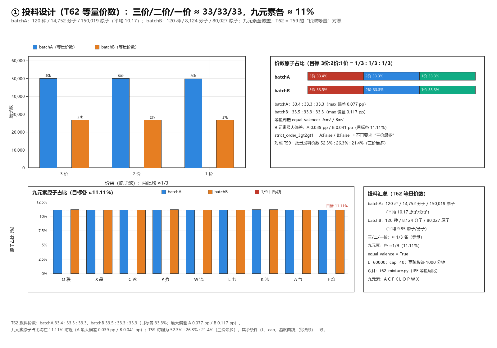

---

## 2. 第一阶段（A）：1000 → 0°C

### 2.1 反应判定

| 判定 | 次数 | 占比 |
|---|---:|---:|
| 完全反应 | 12,085,845 | 99.40% |
| 不完全反应 | 59,269 | 0.49% |
| capped（合并>40 原子弹性） | **11,563** | **0.095%** |
| 不反应 | 2,606 | 0.02% |
| 净变化事件 | **266,450** | — |
| 自分解 | 0 | — |

第一阶段运行 283.0 秒；初始 14,752 个分子全部参与过反应（初始分子存活 0）。

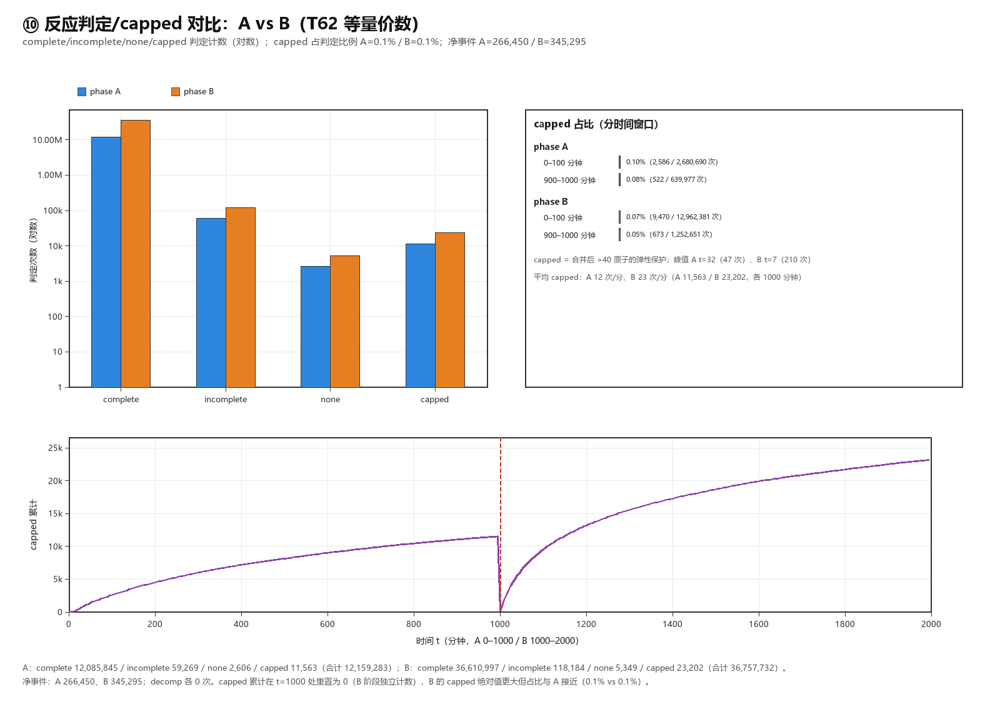

### 2.2 终态（43 种分子式 / 48 种结构）

**34,476 个分子、150,019 原子（质量守恒）、43 种分子式（48 种结构）**：

| 排名 | 分子式 | 原子数 | 数量 | 占比 |
|---:|---|---:|---:|---:|
| 1 | `LF` 电焰 | 2 | **15,264** | 44.3% |
| 2 | `OXCPWKA` 秩晶冰势流沌气 | 7 | **15,241** | 44.2% |
| 3 | `CF` 冰焰 | 2 | 885 | 2.6% |
| 4 | `L2` 电2 | 2 | 695 | 2.0% |
| 5 | `WA` 流气 | 2 | 620 | 1.8% |
| 6 | `XA` 晶气 | 2 | 457 | 1.3% |
| 7 | `OXCPWK` | 6 | 341 | 1.0% |
| 8 | `OK` 秩沌 | 2 | 290 | 0.8% |
| 9 | `F2` 焰2 | 2 | 191 | 0.6% |
| 10 | `O2XCP3WK2` | 10 | 133 | 0.4% |
| 11 | `PK` 势沌 | 2 | 74 | 0.2% |
| 12 | `OXPWKAF` | 7 | 67 | 0.2% |

- `OXCPWKA` 结构（`pot_v4` 规则 1~11 的 F）：**O–P–K 三元环（O=P、P–K、K=O 一条双键）为核心，
  P 上接 X–A–W–C 支链**；7 原子、7 根键（含 1 根双键，键级和 8），杂原子距离覆盖 d=3/4/5/6 四档，
  是"7 种元素各 1 个"这一计数向量的唯一 F 稳定态；
- `LF`：L–F 单键同价跨类盐（d=2），也是 F 不动点；
- 其余为**残差盐/小分子**：双原子同价盐（CF、L2、WA、XA、OK、PK、F2）与少量 6~18 原子多元分子，
  它们是 0°C 时动力学上未完全并回双组分的"余料"（合计仅 11.5% 分子）。

尺寸分布：2 原子 18,476、7 原子 15,308、10 原子 179、11 原子 60、13 原子 19、15 原子 9、
39/40 原子 10 个（cap 边界长尾）；平均 4.351、最大 40。

### 2.3 演化路径：高温成盐 → 中温"等摩尔七元环"成核 → 低温并盐

| t（分钟）/ T | 主导组成 |
|---|---|
| t=0 / 1000°C | 高温爆裂为双原子盐：OK 1,498、PK 1,418、CF 1,270、L2 1,239、LF 1,209、OP 1,137 |
| t=10 / 990°C | LF 5,156、CF 5,050、L2 3,980、OK 3,892、WA 3,276、XA 2,782（N 峰值约 4.7 万） |
| t=50 / 950°C | LF 7,483、CF 6,499、WA 5,104、**OXCPWKA 4,838（首次进入前五）**、L2 4,212 |
| t=100 / 900°C | **LF 10,300、OXCPWKA 9,595**、CF 4,192、L2 3,047、WA 2,997 |
| t=300 / 700°C | **OXCPWKA 13,769、LF 13,654**、CF 1,795、L2 1,485、WA 1,229 |
| t=600 / 400°C | LF 14,807、OXCPWKA 14,803、CF 1,139、L2 917、WA 774 |
| t=1000 / 0°C | **LF 15,264、OXCPWKA 15,241**、CF 885、L2 695、WA 620 |

**机制**：等量价数下，高温段几乎所有碰撞都是完全反应，元素先两两配成同价/跨类双原子盐
（最高 N≈4.68 万、事件 26.6 万）；约 t≈50 起 `OXCPWKA`（7 种元素各 1 个的计数向量）成核，
它以"每元素取 1"的方式同时消耗 7 种元素，因此随温度下降**持续吞并残差盐**，直到只剩
它和 `LF` 两种 F 不动点。整个 1000 分钟都在向同一不动点单调收敛，没有出现 T59 式的中后期洗牌。

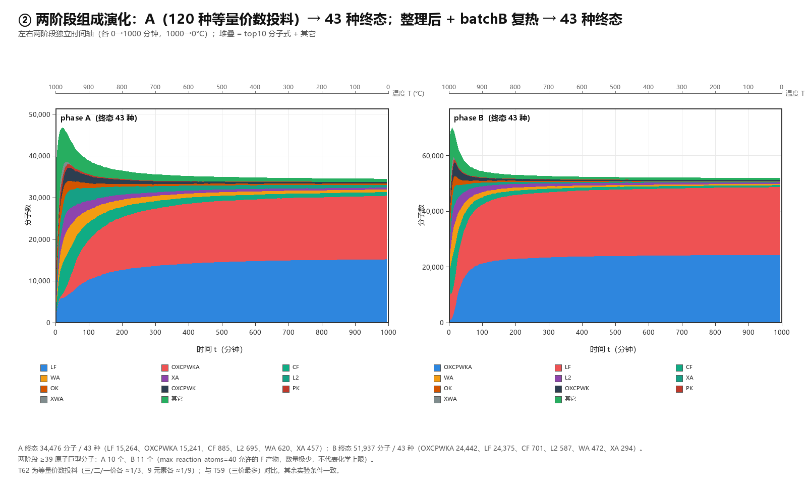

### 2.4 cap40 vs cap60（高保真对照）

| 指标 | cap=40（主实验） | cap=60（高保真） |
|---|---:|---:|
| 终态分子 / 原子 | 34,476 / 150,019 | 34,293 / 150,019 |
| 终态分子式 / 结构 | 43 / 48 | **41** |
| 平均 / 最大原子数 | 4.351 / 40 | 4.375 / **19** |
| capped 次数（占判定） | 11,563（0.095%） | **0（0.000%）** |
| 39/40 原子巨型分子 | 10 | **0** |
| 峰值最大原子数（演化中） | 40（cap 截断） | **56（瞬时形成又拆解）** |

把反应上限从 40 提到 60 后，A 终态从 43 种降到 41 种、最大分子从 40 降到 19，
**双组分格局不变**（OXCPWKA 15,411 / LF 15,259）——cap40 的 39/40 原子长尾只是边界产物。

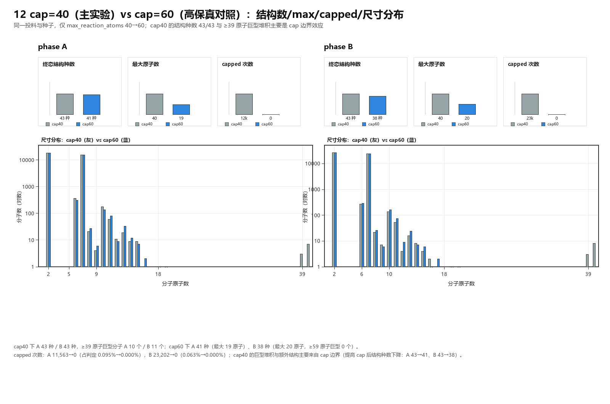

---

## 3. "整理"与第二次投放（0°C 之后）

第一阶段结束（T=0°C）后：

1. **清点归档**：导出全部 **34,476 个分子 / 150,019 原子 / 48 种结构**（`t62_stateA.json`），不丢弃任何物质；
2. **空间/速度重置**：底物重新均匀分布到 60000² 区域、重置到第二阶段初速（复热准备）；
3. **二次投放**：加入 batchB **8,124 个分子 / 80,027 原子**（同样三/二/一价等量 + 9 元素各 1/9）；
4. 第二阶段初始：**42,600 个分子 / 230,046 原子**（= 150,019 + 80,027，质量守恒），**温度重置 1000°C**。

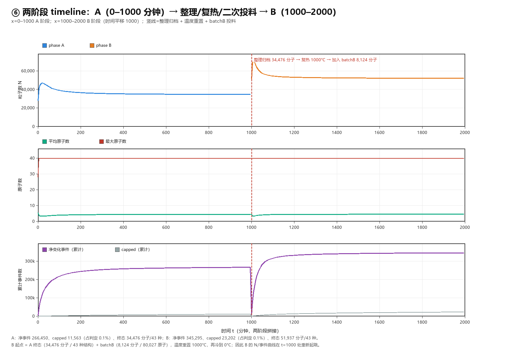

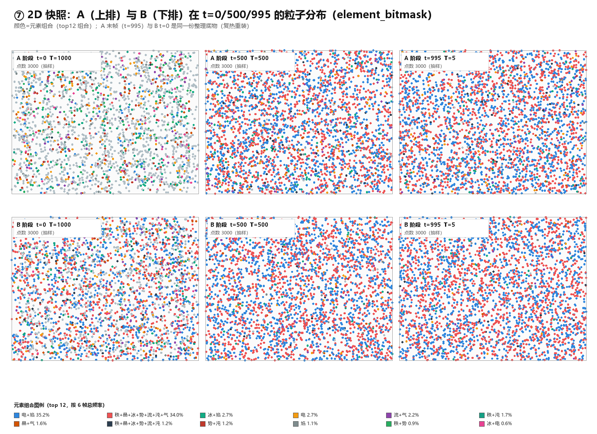

---

## 4. 第二阶段（B）：重置 1000 → 0°C

### 4.1 反应判定

| 判定 | 次数 | 占比 |
|---|---:|---:|
| 完全反应 | 36,610,997 | 99.60% |
| 不完全反应 | 118,184 | 0.32% |
| capped（合并>40 原子弹性） | **23,202** | **0.063%** |
| 不反应 | 5,349 | 0.015% |
| 净变化事件 | **345,295** | — |
| 自分解 | 1 | — |

第二阶段运行 537.1 秒；演化中 N 峰值 70,097（复热后先爆裂成盐再收敛）。

### 4.2 终态（43 种分子式 / 47 种结构）

**51,937 个分子、230,046 原子（质量守恒）、43 种分子式（47 种结构）**：

| 排名 | 分子式 | 原子数 | 数量 | 占比 | 变化（相对 A） |
|---:|---|---:|---:|---:|---|
| 1 | `OXCPWKA` | 7 | **24,442** | 47.1% | ↑（A 15,241） |
| 2 | `LF` | 2 | **24,375** | 46.9% | ↑（A 15,264） |
| 3 | `CF` | 2 | 701 | 1.3% | ↓（A 885） |
| 4 | `L2` | 2 | 587 | 1.1% | ↓（A 695） |
| 5 | `WA` | 2 | 472 | 0.9% | ↓（A 620） |
| 6 | `XA` | 2 | 294 | 0.6% | ↓（A 457） |
| 7 | `OXCPWK` | 6 | 248 | 0.5% | ↓（A 341） |
| 8 | `OK` | 2 | 238 | 0.5% | ↓（A 290） |
| 9 | `F2` | 2 | 160 | 0.3% | ↓（A 191） |
| 10 | `O2XCP3WK2` | 10 | 88 | 0.2% | ↓（A 133） |
| 11 | `PK` | 2 | 70 | 0.1% | ↓（A 74） |
| 12 | `OXPWKAF` | 7 | 61 | 0.1% | ↓（A 67） |

尺寸分布：2 原子 26,898、7 原子 24,503、10 原子 139、13 原子 16、39/40 原子 11 个；
平均 4.429、最大 40。元素守恒逐项核对通过（B 终态元素 = A 终态 + batchB）。

### 4.3 二次投放的效果：双组分更纯，格局不变

- **A → B 主导分子不变**：`OXCPWKA` 与 `LF` 仍是 top2，且比例仍≈1:1（24,442 : 24,375）；
- **纯度提高**：双组分占分子数从 A 的 88.5% 升到 B 的 **94.0%**、占原子数从 91.4% 升到 **95.5%**；
  残差盐（CF、L2、WA、XA、OK、PK、F2）全部下降 20%~50%；
- **与 T59 的"整理+复热=洗牌"形成强对照**：T59 二次投放后主导分子从 `O2XP2WK2A` 换成
  `O2XP2WK2A2`/`OXCPWK`（大洗牌），而 T62 的二次投放只让体系**更接近同一不动点**；
- 结构种数 A/B 都是 43 种（T59 为 43/67）——等量价数体系的终态更"纯净"、对初始条件/二次投料更稳健。

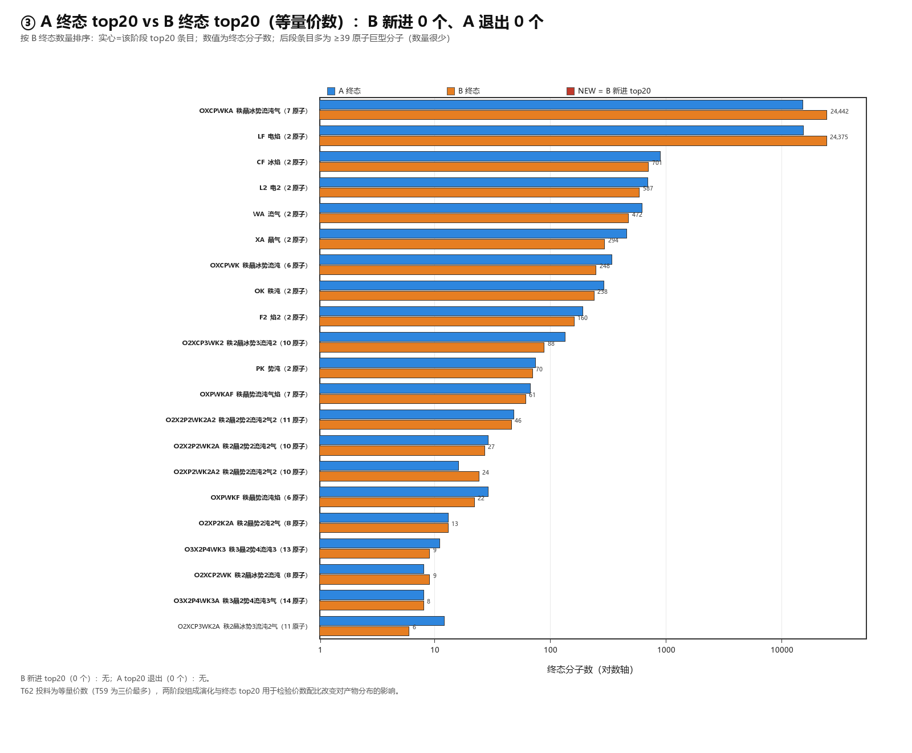

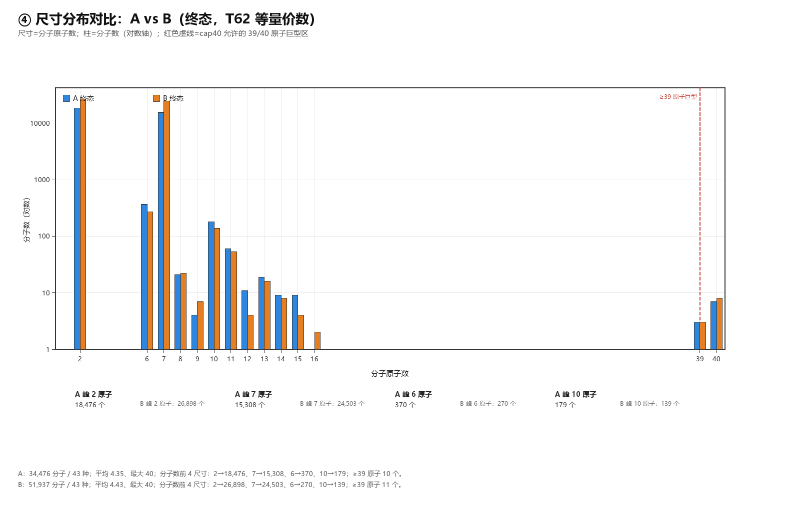

---

## 5. 与 T59（三价最多/一价最少）的对比

> 两轮的环境、规模（≈15 万 + 8 万原子）、温度日程、引擎、种子机制完全相同，
> **唯一差异是价数配比**，因此下表可视为"价数配比"的单变量对照实验。

| 指标 | T59A（3>2>1） | **T62A（1:1:1）** | T59B | **T62B** |
|---|---:|---:|---:|---:|
| 投料三/二/一价占比 | 52.31 / 26.26 / 21.43% | **33.41 / 33.30 / 33.29%** | 46.62 / 33.06 / 20.32% | **33.42 / 33.30 / 33.28%** |
| 初始分子 / 原子 | 13,174 / 150,103 | 14,752 / 150,019 | 34,326 / 230,133 | 42,600 / 230,046 |
| 终态分子 / 原子 | 27,431 / 150,103 | 34,476 / 150,019 | 38,609 / 230,133 | **51,937 / 230,046** |
| 终态分子式种数 | 43 | 43 | 67 | **43** |
| 平均 / 最大原子数 | 5.472 / 40 | 4.351 / 40 | 5.961 / 40 | 4.429 / 40 |
| 完全反应判定 | 8,089,903 | 12,085,845 | 21,297,049 | 36,610,997 |
| capped（占判定） | 32,985（0.40%） | **11,563（0.095%）** | 94,949（0.44%） | **23,202（0.063%）** |
| 净变化事件 | 174,549 | 266,450 | 206,740 | 345,295 |
| 目录外新物质 | 5,597 | 4,266 | 2,504 | 1,832 |
| 主导分子（top2） | `CF` 9,349 / `O2XP2WK2A` 6,204 | **`LF` 15,264 / `OXCPWKA` 15,241** | `CF` 12,131 / `O2XP2WK2A2` 6,615 | **`OXCPWKA` 24,442 / `LF` 24,375** |
| cap60 终态结构 / 最大原子 | 9 / 18 | **41 / 19** | 13 / 60 | **38 / 20** |

**解读**：

1. **价数配比是终态配方（最强证据）**：
   - 3 > 2 > 1（三价富余）→ 三价元素成骨架，二价做桥/端帽，一价成盐，终态是
     `CF` + `O2XP2WK2A(2)` 等"大分子 + 盐"的混合物；
   - 1:1:1（等量）→ 每种元素恰好够组成"每元素各 1 个"的 7 原子杂环 `OXCPWKA`，
     剩下的 L+F 组成 `LF`，体系收敛到 **7+2 双组分 1:1 混合物**；
2. **等量价数让终态更"干净"、更不依赖 cap 和初始条件**：B 阶段结构 43 种（T59 67 种）、
   capped 占比低 4~7 倍、cap60 下 max 仅 19/20 原子（T59 cap60 B 出现 59/60 原子巨型）；
   T62B 与 T62A 的 **top20 分子集合完全相同**（新进/退出均 0 个）；
3. **等量价数让反应更充分**：完全反应判定 A +49%、B +72%（12.09M/36.61M vs 8.09M/21.30M），
   净事件 +53%/+67%；但目录外新物质反而更少（4,266/1,832 vs 5,597/2,504）——
   说明"均衡配比"把反应导向**少数几个全局 F 不动点**，而不是产生大量亚稳新物质；
4. **二次投放的作用从"洗牌"变成"提纯"**：T59 复热后主导分子替换，T62 复热后仍是同一对分子、
   只是残差盐进一步并回双组分（纯度 91.4% → 95.5% 原子）。

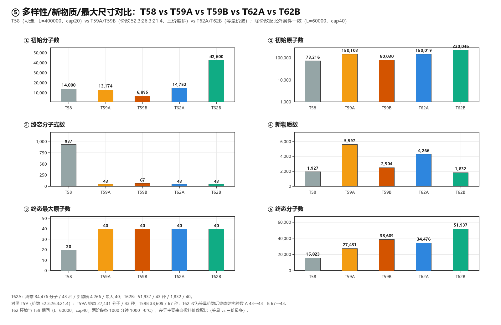

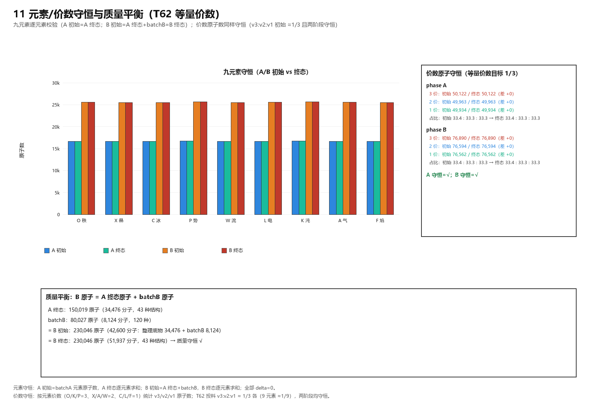

---

## 6. 终态结构分析（数量前 30 与严格六边形摆放）

### 6.1 两类分子

| 类别 | 分子式（B 数量） | 结构特征 |
|---|---|---|
| **等摩尔杂环/支链家族** | `OXCPWKA`（24,442）、`OXCPWK`（248）、`OXPWKAF`（61）、`O2XCP3WK2`（88）等 | 家族原型 `OXCPWKA` = O–P–K 三元环为核（含 O=K 双键），P 上接 X–A–W–C 支链，**每元素各 1 个**；其余为同族变体（元素/原子数略多或略少） |
| **同价/跨类双原子盐** | `LF`（24,375）、`CF`（701）、`L2`（587）、`WA`（472）、`XA`（294）、`OK`（238）、`F2`（160）、`PK`（70） | 1+1、2+2、3+3 或跨类配对的双原子分子，F 不动点 |

**为什么是 `OXCPWKA` + `LF` 而不是"先配完盐再留余料"？**

- 三价 O/P/K、二价 X/W/A、一价 C/L/F 各 3 种，等量投料意味着**每种元素的总原子数相同**；
- `OXCPWKA` 恰好含 O、X、C、P、W、K、A 各 1 个（7 种元素各取 1），它的 F 稳定结构存在且唯一；
- 剩余未被它消耗的元素只有 L 和 F（一价），二者组成最稳定的 L–F 盐；
- 因此"化学计量"上最优解就是 `n(OXCPWKA) = n(LF) = 每种元素原子数`，
  即 A 阶段约 16,6xx + 16,6xx，B 阶段约 25,5xx + 25,5xx；实测 A 15,241/15,264、
  B 24,442/24,375，分别达到理想配额的 **91.7% / 95.7%**（其余为 0°C 残差盐）。

### 6.2 图

- `images/t62_top30_structures.png`：B 终态数量前 30 的分子结构（自动布局，按 9 元素着色、多重键标注）；
- `images/t62_top30_bars.png`：top30 数量 / 原子数 / 元素组成条形图；
- `images/t62_hex_medium.png`、`images/t62_hex_giants_*.png`、`images/t62_hex_summary.png`、
  `images/t62_hex_legend.png`：**全部 ≥5 原子大分子**的严格六边形棋盘格摆放。

**严格摆放结果**（`t62_hex_layouts.json`）：T62A/T62B 终态跨阶段去重后共
**39 种大分子结构 = 28 种中等分子（5~18 原子）+ 11 种巨型分子（≥19 原子）**，
**39/39 全部找到严格六边形棋盘格摆放并通过 `pot_v2.validate_place` 复核**
（38 个直接 `embed_mol2` 成功、1 个需随机原子标号重排；S/C/L 键型合法、L 键中点格为空、无重复占格；
总耗时 8.1 秒）。中等分子图中可清楚看到 `OXCPWKA` 的"O–P–K 三元环 + X–A–W–C 支链"结构，
以及 `OXCPWK`、`OXPWKAF`、`O2XCP3WK2` 等同一"等摩尔杂环/支链"家族的变体。

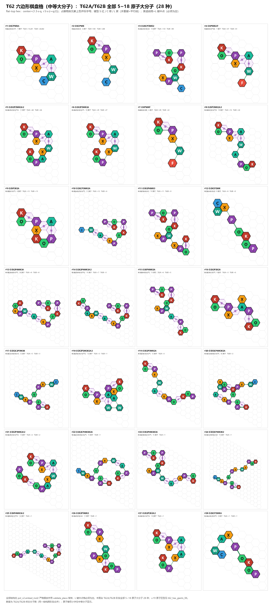

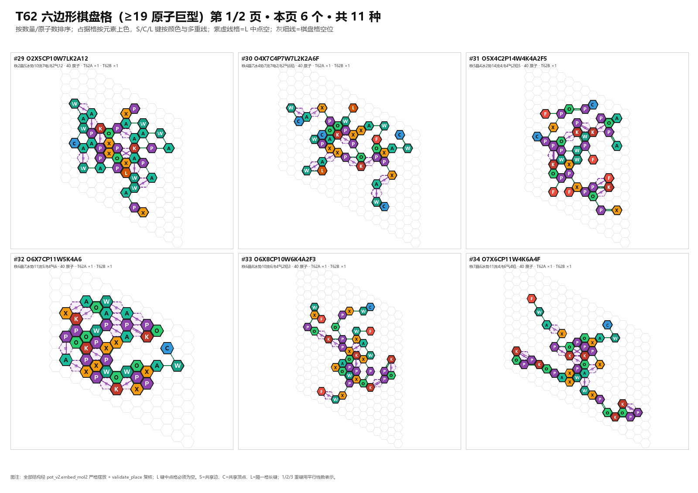

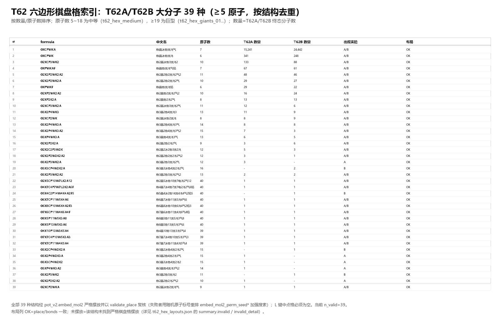

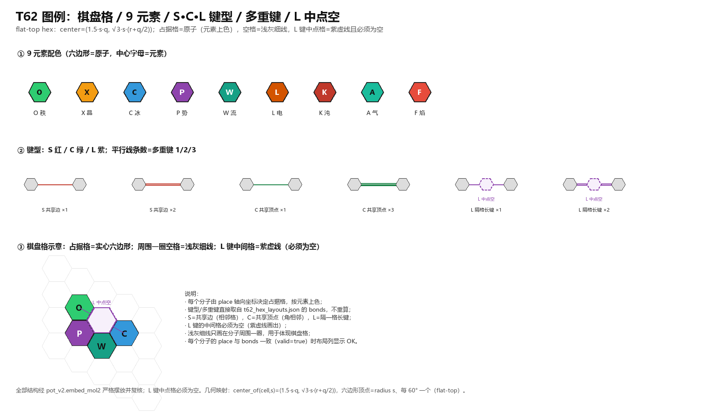

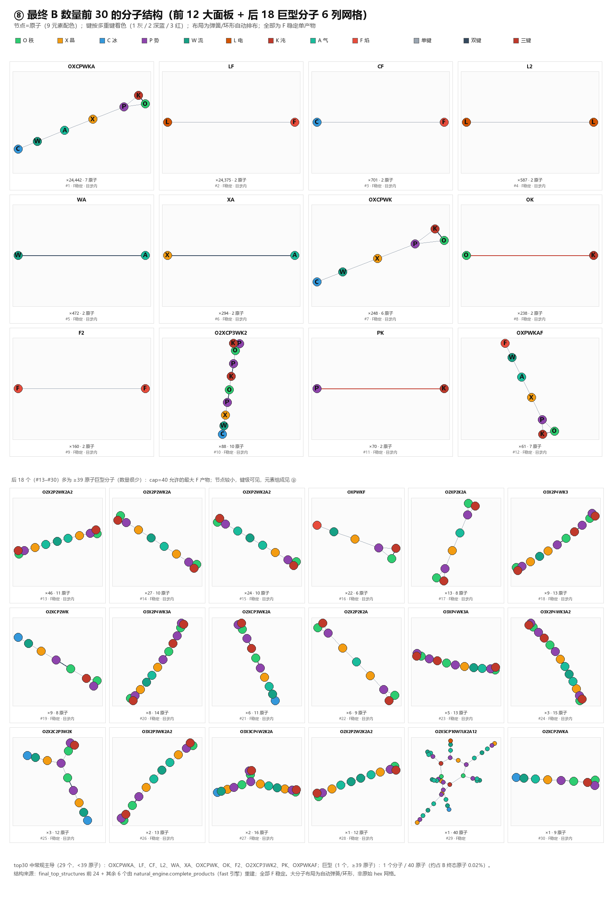

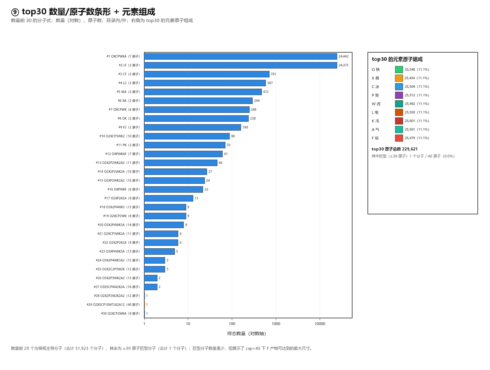

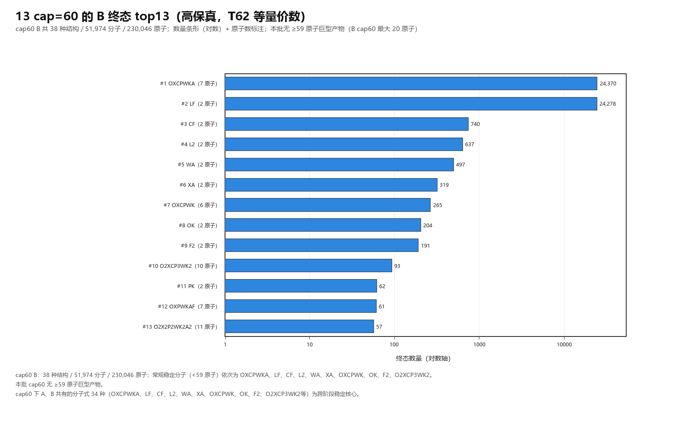

---

## 7. 验证与局限

**验证**（详见 `t62_verify.json`、`docs/T62_VERIFY.md`）

- **投料等量性**：batchA 三/二/一价 33.41/33.30/33.29%（最大偏差 0.077 pp）、batchB 33.45/33.28/33.27%、
  合计 33.42/33.30/33.28%；9 元素各≈11.11%（偏差 ≤0.04 pp）；九元素全覆盖；A/B 各 120 种；
- **质量/元素守恒**：A 终态 150,019 原子、B 终态 230,046 原子（= batchA + batchB），逐元素核对全部一致；
  B 初始 42,600 分子 = stateA 34,476 + batchB 8,124；
- **价数守恒**：三/二/一价原子 A 终态 50,122/49,963/49,934 == batchA 初始；B 终态 76,890/76,594/76,562；
  全程占比≈1/3（最大偏差 0.08 pp）；
- **无化学对照**：batchA 500 分钟 min=703.5、median=766.5、100% ≥500 次角-对角穿越（by_size 10 组全部 ≥500）；
- **反应判定自洽**：四类计数与 time_series 累计一致；capped 占判定 0.095%/0.063%（<1%）；
  events_total 与蓄水池抽样一致；终态最大原子数 40 == cap40；事件样本逐条原子/价数守恒 0 异常；
- **cap40 vs cap60**：同投料同种子重跑，capped 0.095%→0%，终态最大 40→19，双组分格局不变。

**局限**

1. 2D 稀薄气体 DSMC 近似（同 T55~T59）；面积模型 A ∝ 原子数、截面加权伙伴是简化；
2. cap=40/60 仍是人工边界：cap40 的 39/40 原子长尾（A 10 个、B 11 个）是边界产物；
   cap60 下已证明它们消失（max 19/20），但 60 仍非物理上限；
3. 84,225 目录只对 ≤16 原子完备；`OXCPWKA`（7 原子）与残差盐均在目录内，
   少量 >16 原子分子/目录外新物质（A 4,266、B 1,832 种）属目录未枚举或动力学亚稳；
4. 两阶段随机投料由 seed 20261124/20261125 固定；换种子会改变具体残差盐数量，
   但"等量价数 → `OXCPWKA`+`LF` 双组分 1:1"的格局由化学计量决定，应可复现；
5. 1000°C 相对 T35 阈值等同"无限高温"（同 T59），终态主要由 F + 元素配比决定；
   低温窗口（T0≈12°C）下的等量价数行为未在本轮考察，可作为后续实验。

---

## 8. 文件清单

| 文件 | 内容 |
|---|---|
| `t62_mixture.py` | 等量价数投料设计（IPF 把三/二/一价与 9 元素都配平） |
| `t62_two_phase.py` | 两阶段实验主脚本（A + 整理 + B；support cap/control） |
| `t62_loads.json` | batchA / batchB 投料表 + 汇总 + IPF 收敛诊断 |
| `t62_phaseA_result.json` / `t62_stateA.json` | 第一阶段结果 / 0°C 整理归档底物 |
| `t62_phaseB_result.json` / `t62_stateB.json` | 第二阶段结果 / 终态归档 |
| `t62_control_A.json` | batchA 无化学对照（穿越验证） |
| `t62_phaseA_hf_result.json` / `t62_phaseB_hf_result.json` | cap=60 高保真对照 |
| `t62_analysis.py` / `t62_analysis.json` | 分析脚本 / 汇总（含量化对比、结构重建、价数均衡段） |
| `t62_render.py` | 全套主图脚本（13 张 `images/t62_*.png`） |
| `t62_verify.py` / `t62_verify.json` | 独立验证（守恒/等量性/对照/自洽） |
| `t62_hex_layouts.py` / `t62_hex_layouts.json` / `t62_hex_render.py` | 大分子严格六边形摆放与图 |
| `docs/T62_EQUAL_VALENCE.md` | 本报告 |
| `docs/T62_VERIFY.md` | 独立验证报告 |
