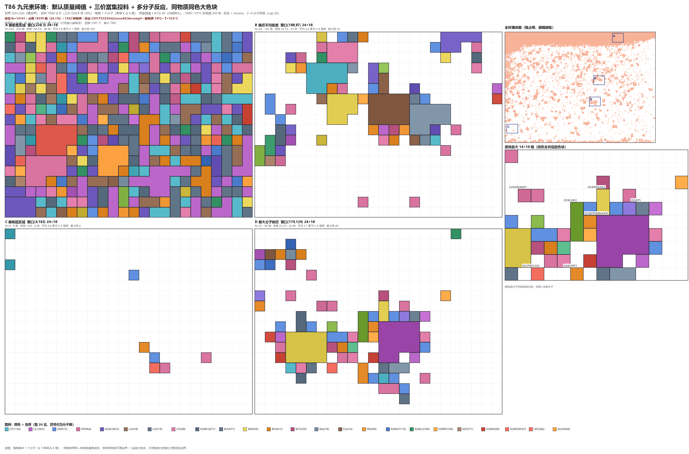

# T86 九元素环境：默认质量阈值 + 三价元素富集投料 + 多分子同时反应

> 日期：2026-11-20 · 脚本 `t86_env_tri.py` / `t86_render.py` · 结果 `t86_env_tri_result.json` · 图 `images/t86_slices.png`
> 前置：T85（低阈值 + 10°C 恒温 + resolve 完全/不完全反应）

## 0. 摘要

用户 m03027 / m03045 三点要求：

1. **质量阈值回到默认 (1.67, 2.30)**（T85 曾在实验内降到 (1.20, 1.85)）；
2. **投料更偏三价元素**：用 IPF 重配平 batchA 的 120 个物种，令 O/X/F 各占 **18%**（合计 **54%**，默认各 1/9=11.1%），其余 6 元素各 7.67%；总分子数仍 7,000（89 个物种）；
3. **多分子同时反应**（2~4 个相邻分子同一组）+ **反应原子上限 26 → 36**。

环境其余协议与 T85 相同：320×220 硬边界方格、骨架占格（k 格/分子）、
1000°C 指数冷却 650 拍到 **10°C** 后恒温 550 拍、`natural_engine.resolve` 判定。

**结果一句话**：三价元素富集后，终态分子数仍翻倍（7,000→14,141）、
分子式 **1,742 种**（目录外 **1,472 种**，比 T85 的 896 多 64%），
反应 18,276 次（complete 30,177 / incomplete 29,342 / none 45，**不完全占 49.3%**），
质量分层 y 均值 **30.1 / 73.0 / 112.8** 行，最大团 **7,961**（56.3% 分子在一个顶部凝胶里），
ρ 0.481±0.055，9 元素严格守恒。

## 1. 相对 T85 的改动

### 1.1 投料：三价元素富集（IPF 重配平）

以 `t62_loads.json` 的 batchA 120 个物种为基，用迭代比例拟合（IPF，400 轮）：

```
目标元素占比：O 18% / X 18% / F 18% / K,A,C,P,W,L 各 7.667%
```

结果（`config.feed`）：7,000 分子 / **67,317 原子** / 89 个物种；
实际占比 O 0.1801、X 0.1799、F 0.1798、其余 0.0765~0.0768；
**价数份额：三价 53.98% / 二价 23.00% / 一价 23.01%**（默认三/二/一价约 33.3%）。

质量轴只由 O/K/P 决定，所以：O 增 → 平均质量升高；X 增 → 物态更偏"固"；F 增 → 温度轴更偏"热"。
同一个 7,000 分子的世界里，三价元素份额从 33% 提到 **54%**。

### 1.2 质量阈值回到默认

`MASS_THRESH["mass"] = (1.67, 2.30)`（内核默认，不改 `alchemy/attrs.py`）。
T85 的 (1.20,1.85) 让投料重档占 56.3%，这次回到默认后投料重档只占约 28%。

### 1.3 多分子同时反应 + cap 36

- `TriWorld(T85.ResolveWorld)`：`max_group=4`；`react_phase` 对每个分子收集 4 邻接邻居，
  随机挑最多 3 个、使总原子数 ≤ cap，组成 2~4 分子组；
- 触发概率 `p = p_react · mult^{1/组内对数} · gate`，`mult` 取组内各对 `MODE_MULT` 的几何平均，
  `gate = 0.15 + 0.85·ρ`（恒素场）；
- `E.resolve(组, T)` 输出 complete / incomplete / none，产物数不再限制为 ≤2（本轮直接允许 ≥3 个产物）；
- `cap = 26 → 36`（"稍微提高反应原子数上限"）。

## 2. 参数

| 项 | 值 |
|---|---|
| 世界 | 320×220 = 70,400 格（硬边界，非环面） |
| 投料 | 7,000 分子 / 67,317 原子 / 89 物种（三价 54%） |
| 骨架占格 | k = len(skeleton_units)，1~4 格/分子（目录外按 8.08 原子/骨架估算） |
| 温度 | T0=1000°C，T(t)=10+990·exp(−10·t/650)，t>650 恒温 10.0°C |
| 拍数 | 1,200 |
| 反应 | resolve；2~4 分子组；cap=36；p_react=0.012；force_r=2 |
| 质量阈值 | (1.67, 2.30) 默认 |
| 恒素场 | 10×20 网格，ρ 扩散/回归同 T83 |
| seed | 20261120 |

## 3. 全局结果

| 项 | T86（默认阈值+三价 54%） | T85（低阈值+三价 33%） |
|---|---|---|
| 终态分子 | **14,141** | 14,436 |
| 占用格 | **18,395（26.1%）** | 18,879（26.8%） |
| 分子式种数 | **1,742** | 2,620 |
| 目录外新物质 | **1,472** | 896 |
| complete / incomplete / none | **30,177 / 29,342 / 45** | 24,994 / 13,285 / 11 |
| 不完全占比 | **49.3%** | 34.7% |
| 生效反应 | **18,276** | 12,814 |
| 放置失败 | 314 | 2,650 |
| 质量 y 均值 | **30.1 / 73.0 / 112.8** | 36.6 / 90.1 / 131.6 |
| 反应高度 底/中/顶 | 2,577 / 5,446 / 10,253 | 2,544 / 3,739 / 6,531 |
| 团簇 | **1,597 个，最大 7,961（56.3%）** | 1,876 个，最大 6,416 |
| ρ | **0.481 ± 0.055** | 0.392 ± 0.044 |
| 终态 T | 10.0°C | 10.0°C |
| 运行时间 | 694.8 s | 726.0 s |
| 守恒 | ✔ 9 元素逐个相等 | ✔ |

终态组成 top：**CF 1,156、CL 1,003、OK 973、OP 964、X2AF2 655**，
其后 X2WF2 477、L2 539、XF2 117、C2 519、LKF2 568、O2X3PCK2F7 143……

- **为什么分子数还是翻倍**：complete 把 2~4 个分子整体重排后经常裂成 2~3 个产物，
  多分子组让"一次反应产出 ≥3 个分子"更常见；N 在 t=400 达到峰值 15,144，之后缓慢回落。
- **为什么不完全占比从 34.7% 升到 49.3%**：多分子组 + cap 36 让 `Σc` 更大，
  在 T=10°C 的恒温平台上更容易出现 `T < Σc` 而落入 incomplete 分支——
  正是"进一步的不完全反应"。
- **为什么种数反而少（1,742 < 2,620）**：三价元素多 → 分子更倾向长成少数几种稳定骨架，
  碎片化仍以 CF/CL/OK/OP 等二原子小分子为主；但目录外新式多了 64%（1,472），
  因为三价元素多给了更多 F(v) 的重排组合。

## 4. 切片



| 切片 | 位置(列,行) | N | 密度 | 种 | 平均原子/骨架 | 质量档 轻/中/重 | 读图 |
|---|---|---|---|---|---|---|---|
| **A 最密** | (226,5) 右上·顶部 | **393** | **100.5%** | 80 | 3.8 / 1.10 | **78.6 / 10.2 / 11.2%** | 顶部凝胶膜整片填满，全为 CL 59、CF 35、X2AF2 32、L2 27、XF2 23 等轻碎片 |
| B 平均 | (180,67) 右侧 | 60 | 24.3% | 43 | 5.8 / 1.75 | 41.7 / 26.7 / 31.7% | 稀疏团 + 大片空格 |
| C 最稀 | (4,185) 左下·底部 | 8 | 1.8% | 6 | 4.8 / 1.00 | 0 / 37.5 / 62.5% | 底部/边缘的孤立重分子 |
| D 大分子 | (175,129) 中下 | 67 | 22.2% | 43 | 5.7 / 1.43 | 26.9 / 17.9 / **55.2%** | 底部沉降区的较大分子 |

- A 区是 **1.0 满占**的顶部浮膜（393 分子 / 432 格），密度图上顶部一整条橙红色带；
- 全局团簇 1,597 个，**最大 7,961 个分子连在一起**（56.3%）——顶部重力上浮 + 三素粘附
  把轻碎片压成一张连续的"膜"，与 T85 的 6,416 同机制但更极端（三价 O/X/F 多 → 轻碎片更多）；
- 底部（D 区）是重分子与已沉降大分子的混合区；密度图上 y≈180–200 行有第二条较密的带。

## 5. 分析

1. **默认阈值 + 三价富集，仍能形成清晰三层**：轻 30.1 / 中 73.0 / 重 112.8 行；
   与 T85（36.6/90.1/131.6）相比分层位置略上移、跨度略小，但方向一致。
2. **三价元素改变了"质量分布"但不改变"终态反轻"**：三价 54% 提高初始平均质量，
   但反应产物仍大量为不含 O/K/P 的轻碎片（CF/CL/L2/XF2…），终态质量档 轻 59.8% / 中 14.8% / 重 25.4%。
3. **多分子反应显著加速了化学**：生效反应 18,276（T85 12,814，+43%），
   反应高度更集中在顶部（10,253 / 18,276 = 56%），因为顶部浮膜里分子密度极高、接触多。
4. **不完全反应成为主力**（49.3%）：恒温 10°C 平台上，`T < Σc` 对多数组成立，
   断键重连（incomplete）与完全重排各占一半；`none` 只有 45 次，`self_decomp` 仍为 0
   （resolve 的自分解要求分子不稳定且 `T ≥ m["c"]`，本轮 T=10 太低）。
5. **新物质 1,472 种**：三价元素富集给出更多重排组合，但其中大多数是 2~4 原子碎片；
   目录内 1,742 种说明"化学空间"被打开，但稳定大分子依然很少——与 T78~T85 的结论一致。

## 6. 诚实局限

1. 点粒子 + footprint 登记；分子内部构型不影响动力学（骨架只用于占格和渲染）。
2. 多分子组最多 4 个，且按"邻接 + 总原子 ≤ cap"贪心挑选，不搜索全部组合。
3. `resolve` 仍只按 `Σc` 与键类阈值判定，不含真实能量与活化能。
4. `MODE_MULT` 用组内几何平均近似多体模式，不是严格的 k 体速率。
5. cap=36 仍截断大分子生长；单 seed（20261120）。
6. 恒素场 ρ 与温度 T 是全局场 + 局部扩散，未做热-化学耦合。
7. 顶部"膜"是 2D 边界 + 上浮 + 粘附的联合产物，3D 下未必如此。

## 7. 复现

```
python t86_env_tri.py --W 320 --H 220 --target 7000 --ticks 1200 \
    --cool-ticks 650 --cap 36 --p-react 0.012 --snap-every 200 \
    --out t86_env_tri_result.json
python t86_render.py     # → images/t86_slices.png + t86_slices.json
```

## 8. 产物

- `t86_env_tri.py`（实验）、`t86_render.py`（色块切片渲染）
- `t86_env_tri_result.json`（投影 + 8 个快照）、`t86_slices.json`
- `images/t86_slices.png`（3,470×2,288）+ `t86_slice_{a,b,c,d}.png` + `t86_slice_zoom.png`
- 本文档
