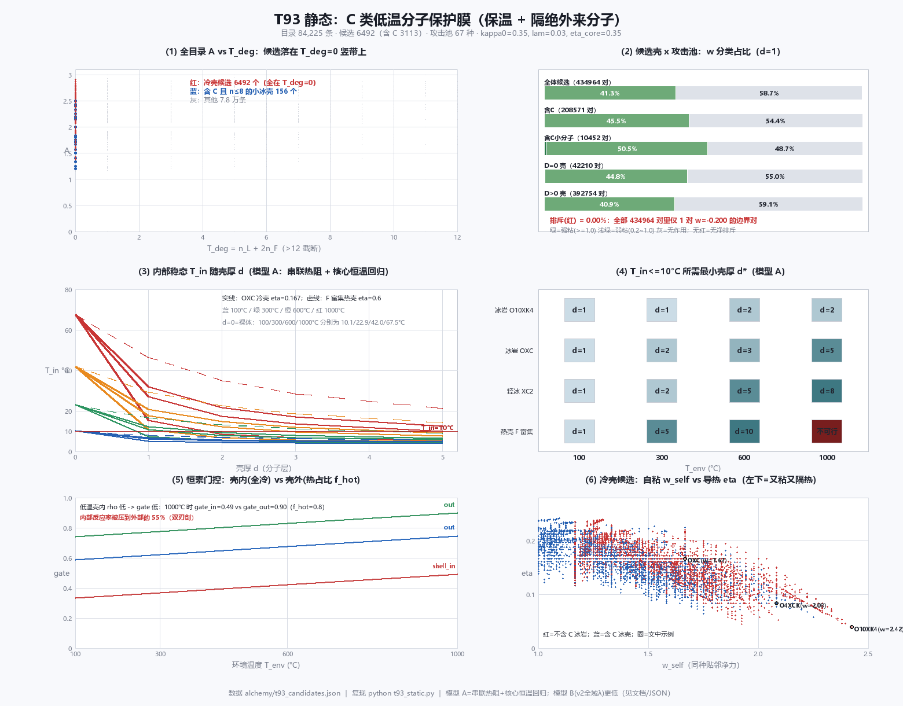

# T93 静态研究：C 类低温分子保护膜——保温与隔绝外来分子的可行性与边界

**日期**：2026-11-23　**目录**：`t4_catalog_all_validated.json`（84,225 种分子）
**规则**：三素（A/B/D，`docs/THREE_SU_AXES.md`）＋三轴（质量/物态/温度，`docs/MATERIAL_AXES.md`）＋温度 v2（`docs/THERMAL_DIMENSION.md`）
**目的**：回答"能否用 C（冰素，1 价，低温）类低温分子在多分子生命外围形成保护膜——保温＋隔绝外来分子"。
**工具**：`alchemy/t93_static.py`（纯静态计算，未运行动态世界；耗时 20.4 s）→ `alchemy/t93_candidates.json`、`alchemy/images/t93_candidates.png`



---

## 0 摘要

1. **冷壳单体是存在的，但不是"富 C 小分子"**。在 84,225 种目录分子中，满足「T_deg=0（无 F/L）＋温度档冷＋物态档固＋自粘 w_self≥1.0＋骨架格数 k≥1」的候选共 **6,492** 个；其中含 C 的 3,113 个（47.95%），但按 w_self 排序的前 30 名**全部是 O–X–K 冰岩**（无 C）。全体第一名为 **O10XK4**（n=15，A=2.909，D=0，η=0.039，w_self=2.424，k=1，重·固·冷）。含 C 小分子（n≤8）前三为 **O4XCK**（n=7，A=2.500，η=0.083，w=2.083）、**O4X2CK**（w=2.024）、**O3XCK2**（w=2.000）。
2. **任务指定的 6 种 C 类参考分子只覆盖 3 种**：OXC 在目录内且是唯一通过严格口径者（重·固·冷，w_self=1.667，k=1）；XC2、X2C2 在目录内但 **k_raw=0**（按 T90 的 `k=max(1,k_raw)` 仍可占 1 格，属 relaxed 口径）；O2C、XO2C、OXC2 **不在目录内**（仅能按三素公式推算，且因缺 X 层物态档记为"气"）。
3. **保温是"暂态延迟＋有热汇时的稳态降低"，不是永久隔热**。模型 A（串联热阻＋核心恒温回归，κ0=0.35、η_core=η_env=0.35、C_core=60、λ=0.03）：OXC 冷壳在 **T_env=600°C、d=3 时 T_in=9.669°C**；若不考虑热汇，稳态 T_in 必趋于 T_env，冷壳只能把升温时间常数拉长到 **1,418–5,524 拍**（d=1…5，半衰期 983–3,829 拍）。冰岩 O10XK4（η=0.039）在 600°C 只需 d=2 即 6.698°C，1000°C 下 d=2 为 8.509°C。相反，"F 富集热壳"（η≈0.6）在 600°C 下 d=3 仍有 18.684°C，几乎不保温。
4. **力场层面无法"排斥"外来分子——这是本任务最重要的负面结论**。`Rep=κR·√(D_iD_j)/3·J_rep` 要求**双方都有动素（D>0）且共享元素（J>0）**；而攻击池（T87 top10＋全部 n∈[2,4] 且 F/O 占半数的目录分子，共 67 种）中 34 种 D=0，其斥力恒为 0。统计 6,492 个候选壳 × 67 种攻击物 = **434,964 对**（d=1）：**strong 0.054%／weak 41.289%／none 58.656%／repel 0.000%**；严格 `w<−0.2` 的对数为 **0**，只有 1 对恰好落在边界 `w=−0.200`（XP2 vs P2F2）。D=0 壳（630 个）对全池的最小 w 为 **0.0**——连中性都没有，只有粘附。真正互斥的只有纯动素物种之间：P2–P2 w=−0.5、W2–W2 −0.333、WA −0.333、L2–L2 −0.167。
5. **恒素门控（T83 `gate=0.15+0.85ρ`）确实能被冷壳压低，但代价是内部反应也变慢**：T_env=1000°C 时壳内全冷使 `gate_in=0.490`，壳外热占比 f_hot=0.8 时为 `gate_out=0.898`，内部反应率仅为外部的 **54.6%**（100°C 时反而 0.333 vs 0.741，比例为 44.9%，因为环境越热 bonus 越大、冷壳收益越大）。冷壳同时把生命体自身的复制/代谢概率压低——双刃剑。
6. **可实现的三条防線**：①**粘附/浸润层**（冷壳自身强粘，挡住"穿过"而非"推开"，属被动拦截）；②**固态占格物理封闭**（固化壳层占格、k≥1、骨架成格，把外来分子挡在格点之外）；③**恒素门控**（降低整体反应率）。**真正的斥力膜在现有模型下不可行**，需要模型扩展（见 §5）。
7. **重力是前提**：OXC/O10XK4 等重档冷壳会下沉，XC2/X2C2 等轻档冷壳会上浮；冷壳膜在重力场中必须先稳定附着，微重力/高黏液体环境最有利。

---

## 1 方法与口径

### 1.1 数据与全量指标

目录 `t4_catalog_all_validated.json` 共 **84,225** 条，字段 `formula/natoms/zh/atoms/edges/place/feed/source`，最大原子数 97。逐条计算：

- 三素（`alchemy/three_su.py`）：`P=3n_O+2n_X+1n_C`，`Q=3n_K+2n_A+1n_F`，`S=3n_P+2n_W+1n_L`；`A=P/n_att`，`B=Q/n_rng`，`D=S/n_rep`（缺族记 0）；`r_att=1+[Q≥10]+[Q≥20]`，`r_rep=1+[Q≥15]+[Q≥30]`。
- 三轴档（`alchemy/attrs.py::molecule_attrs`，直接调用内核实现，**不重写公式**）：质量、物态、温度三个分数值与档位（阈值 mass 1.67/2.30、state 1.70/2.22、temperature 1.50/2.00）。
- 温度 v2：`T_deg = n_L + 2n_F`；`ρ̂ = (3n_O+2n_K+n_P)/(3N)`；`η = (1−ρ̂)(T_deg+1)/(T_deg+4)`（clamp[0,1]）。
- 自粘 `w_self = pair_force(comp, comp, d=1).w`；骨架格数 `k_raw = len(skeleton_units(atoms, edges))`，T90 占地口径 `k_eff = max(1, k_raw)`。

全量 84,225 条用 `attrs.molecule_attrs` 直算仅约 3.4 s，**无需抽样**；总脚本 20.4 s（含 PNG 绘制），所有数字均为全量精确值。

### 1.2 力与 w 判定

`Att = κA·√(A_iA_j)/3·J_att·F(d,r)`，`Rep = κR·√(D_iD_j)/3·J_rep·F(d,r)`，`w = Att − Rep`；κA=2.5、κR=0.5；`J` 为全元素原子数 Jaccard，`F(d,r)` 为距离衰减。判定：`w≥1.0` strong（强粘锁）、`0.2≤w<1.0` weak（弱粘）、`|w|<0.2` none、`w≤−0.2` repel（净排斥）。本任务只算 d=1（相邻贴邻），因为膜的功能发生在界面第一层。

由两式可得**净排斥的充要条件**：

```
w < 0  ⇔  0.5·√(D_iD_j) > 2.5·√(A_iA_j)  ⇔  D_i·D_j > 25·A_i·A_j
```

即双方必须都"动素极强、聚素极弱"，而且 J>0 要求两者共享元素——共享的 O/X/C/K/A/F 都属吸引族（同时抬高 A），所以这个不等式在"壳 vs 富 F/O 攻击物"的结构下几乎不可能成立。

### 1.3 冷壳候选筛选口径

- 严格口径（任务给定）：`T_deg==0`（无 F、无 L）且温度档=冷 且物态档=固 且 `w_self≥1.0` 且 `k_raw≥1`。
- relaxed 口径：把 `k_raw≥1` 换成 T90 的 `k_eff=max(1,k_raw)≥1`，多出 15 个 `k_raw=0` 的固体（XC2、X2C2 在此列）。

### 1.4 保温模型

**模型 A（主口径：串联热阻＋核心恒温回归）**。以 `C3K3F2` 主体 24 个（T90）为核，`N_core=192`，`ρ̂_core=1/6`，热惯性 `C_core=24·N(1+ρ̂)/4 = 60`，`T°_core=4`。壳内壁与核心同温，壳外为环境 `T_env`，`η_env=0.35`：

```
κ(η_i,η_j) = κ0·√(η_i·η_j),  κ0=0.35
R(d) = 1/κ(η_core,η_s) + (d−1)/κ(η_s,η_s) + 1/κ(η_s,η_env)
N 热 = λ·C_core·R,  λ=0.03
稳态 T_in = (T_env + N热·T°_core) / (1 + N热)
时间常数 τ = C_core·R
```

`d=0` 即裸体：`R=1/κ(η_core,η_env)=8.163`，`N热=14.69`。

**模型 B（v2 完整形态，对照）**：每层壳也是独立节点（`C_s=1`），除层间导热外各层还有 `λ(T°_s−τ_s)` 回归（`T°_s=0`），三对角稳态方程用 Thomas 算法求解。模型 B 中壳自身成为热汇，因此 T_in 会显著低于模型 A——它是"冷壳能永久降温"的上界乐观估计，文档以模型 A 为主。

### 1.5 排斥/隔绝模型

候选壳（6,492 个）与攻击池逐对计算 `pair_force(d=1)` 并按 §1.2 分类。攻击池 = T87 终态 top10（OK/OP/CL/CF/X2AF2/C2/XLF/LF/XCF/X2WF2）∪ 全部 `n∈[2,4]` 且 `(n_F+n_O) ≥ 0.5n` 的目录分子，去重后 **67 种**（D=0 的 34 种，D>0 的 33 种）。分组统计：全体候选 / 含 C / 含 C 且 n≤8 / n≤8 / D=0 壳 / D>0 壳。

### 1.6 恒素门控估算（T83 `update_rho`）

按 `t83_env_axes.py`：`t0=1000 → t_end=25`，`ambient_bonus=0.20·(T_amb−25)/975`；`target=0.5+0.30·(f_hot−f_cold)+ambient_bonus`（clamp[0,1]）；稳态取 `ρ≈target`，`gate=0.15+0.85ρ`。壳内假设全为冷档（f_hot=0, f_cold=1），壳外取 f_hot∈{0.3,0.5,0.8}。

### 1.7 环境与重力

壳的档位决定它在重力场中的行为（参考 T92）：重档下沉、轻档上浮。膜必须先"附着"，再谈"保温"。

---

## 2 结果

### 2.1 全目录基线

| 统计项 | 数值 |
|---|---|
| 分子总数 / 最大原子数 | 84,225 / 97 |
| A=0（无聚素）/ D=0（无动素） | 3,829 / 3,822 |
| T_deg=0（无 F/L） | 21,889 |
| 质量档 轻/中/重 | 29,419 / 27,118 / 27,688 |
| 物态档 气/液/固 | 28,575 / 28,495 / 27,155 |
| 温度档 冷/温/热 | 30,501 / 26,160 / 27,564 |
| 27 格覆盖 | 27/27 全非空 |
| 同种自粘 w 档（T81 校准）strong/weak/none/repel | 81.98% / 13.48% / 0.11% / 4.44% |
| 异种随机 199,997 对 strong/weak/none/repel | 2.04% / 74.96% / 22.65% / 0.35%（T81 记 0.37%） |
| 异种最小 w | −0.4231（OP2K5A5 vs P2K4A5） |

### 2.2 冷壳候选集

| 统计项 | 数值 |
|---|---|
| 严格口径候选 | **6,492** |
| relaxed 口径（k_eff≥1） | 6,507（+15 个 k_raw=0 固体，含 XC2、X2C2） |
| 含 C / 含 C 且 n≤8 / n≤8 | 3,113（47.95%）/ 156 / 331 |
| D=0 / D>0（可带斥力） | 630（9.7%）/ 5,862（90.3%） |
| 含 W | 4,141 |
| 档位组成（全部为"冷·固"） | 重 2,293 / 中 2,204 / 轻 1,995 |

**候选 top20（按 w_self 降序）**

| # | 分子 | n | A | D | ρ̂ | η | w_self | k_raw | 档位 |
|---|---|---|---|---|---|---|---|---|---|
| 1 | O10XK4 | 15 | 2.909 | 0 | 0.844 | 0.039 | 2.424 | 1 | 重·固·冷 |
| 2 | O7XK3 | 11 | 2.875 | 0 | 0.818 | 0.045 | 2.396 | 1 | 重·固·冷 |
| 3 | O6XK2 | 9 | 2.857 | 0 | 0.815 | 0.046 | 2.381 | 1 | 重·固·冷 |
| 4 | O6XK4 | 11 | 2.857 | 0 | 0.788 | 0.053 | 2.381 | 1 | 重·固·冷 |
| 5 | O10X2K4 | 16 | 2.833 | 0 | 0.792 | 0.052 | 2.361 | 2 | 重·固·冷 |
| 6 | O5XK3 | 9 | 2.833 | 0 | 0.778 | 0.056 | 2.361 | 1 | 重·固·冷 |
| 7 | O14X3K6 | 23 | 2.824 | 0 | 0.783 | 0.054 | 2.353 | 4 | 重·固·冷 |
| 8 | O4XK2 | 7 | 2.800 | 0 | 0.762 | 0.059 | 2.333 | 2 | 重·固·冷 |
| 9 | O4XK6 | 11 | 2.800 | 0 | 0.727 | 0.068 | 2.333 | 1 | 重·固·冷 |
| 10 | O8X2K2A | 13 | 2.800 | 0 | 0.718 | 0.070 | 2.333 | 2 | 重·固·冷 |
| 11 | O4XK10 | 15 | 2.800 | 0 | 0.700 | 0.072 | 2.333 | 1 | 中·固·冷 |
| 12 | O11X3K5 | 19 | 2.786 | 0 | 0.772 | 0.061 | 2.321 | 4 | 重·固·冷 |
| 13 | O14X4K6 | 24 | 2.778 | 0 | 0.764 | 0.062 | 2.315 | 4 | 重·固·冷 |
| 14 | O7X2K3 | 12 | 2.778 | 0 | 0.762 | 0.062 | 2.315 | 2 | 重·固·冷 |
| 15 | O7X2K3A | 13 | 2.778 | 0 | 0.712 | 0.077 | 2.315 | 2 | 重·固·冷 |
| 16 | O20X6K8 | 34 | 2.769 | 0 | 0.750 | 0.064 | 2.308 | 6 | 重·固·冷 |
| 17 | O10X3K4 | 17 | 2.769 | 0 | 0.735 | 0.064 | 2.308 | 3 | 重·固·冷 |
| 18 | O6X2K2 | 10 | 2.750 | 0 | 0.733 | 0.067 | 2.292 | 1 | 重·固·冷 |
| 19 | O18X6K8 | 32 | 2.750 | 0 | 0.740 | 0.068 | 2.292 | 7 | 重·固·冷 |
| 20 | O6X2K4 | 12 | 2.750 | 0 | 0.722 | 0.069 | 2.292 | 2 | 重·固·冷 |

> 关键观察：**前 30 名无一含 C**，全部是 O–X–K 冰岩；"最高自粘冷壳"是重冰岩，不是任务设想的富 C 小分子。

**含 C 小分子（n≤8）top20**

| # | 分子 | n | A | D | ρ̂ | η | w_self | k_raw | 档位 |
|---|---|---|---|---|---|---|---|---|---|
| 1 | O4XCK | 7 | 2.500 | 0 | 0.667 | 0.083 | 2.083 | 1 | 重·固·冷 |
| 2 | O4X2CK | 8 | 2.429 | 0 | 0.583 | 0.104 | 2.024 | 1 | 重·固·冷 |
| 3 | O3XCK2 | 7 | 2.400 | 0 | 0.571 | 0.095 | 2.000 | 1 | 重·固·冷 |
| 4 | O3XC | 5 | 2.400 | 0 | 0.600 | 0.100 | 2.000 | 1 | 重·固·冷 |
| 5 | O3X2CK2 | 8 | 2.333 | 0 | 0.542 | 0.115 | 1.944 | 1 | 重·固·冷 |
| 6 | O3X2C | 6 | 2.333 | 0 | 0.556 | 0.125 | 1.944 | 1 | 重·固·冷 |
| 7 | O3X2CA | 7 | 2.333 | 0 | 0.524 | 0.143 | 1.944 | 2 | 重·固·冷 |
| 8 | O2XCK3 | 7 | 2.250 | 0 | 0.476 | 0.107 | 1.875 | 1 | 重·固·冷 |
| 9 | O2XCK | 5 | 2.250 | 0 | 0.467 | 0.117 | 1.875 | 1 | 重·固·冷 |
| 10 | O2X2CK3 | 8 | 2.200 | 0 | 0.458 | 0.125 | 1.833 | 1 | 重·固·冷 |
| 11 | O2X2CK | 6 | 2.200 | 0 | 0.444 | 0.139 | 1.833 | 1 | 重·固·冷 |
| 12 | O3XC2K | 7 | 2.167 | 0 | 0.429 | 0.119 | 1.806 | 1 | 重·固·冷 |
| 13 | O2X3CK | 7 | 2.167 | 0 | 0.429 | 0.155 | 1.806 | 1 | 重·固·冷 |
| 14 | O3X2C2K | 8 | 2.143 | 0 | 0.417 | 0.135 | 1.786 | 1 | 重·固·冷 |
| 15 | O4XCWK | 8 | 2.500 | 2.00 | 0.583 | 0.104 | 1.750 | 1 | 重·固·冷 |
| 16 | O4XCPW | 8 | 2.500 | 2.50 | 0.500 | 0.115 | 1.667 | 1 | 重·固·冷 |
| 17 | OXCK4 | 7 | 2.000 | 0 | 0.476 | 0.119 | 1.667 | 1 | 中·固·冷 |
| 18 | O3XCW | 6 | 2.400 | 2.00 | 0.500 | 0.125 | 1.667 | 1 | 重·固·冷 |
| 19 | OXCK2 | 5 | 2.000 | 0 | 0.400 | 0.133 | 1.667 | 1 | 重·固·冷 |
| 20 | OX2CK4 | 8 | 2.000 | 0 | 0.417 | 0.135 | 1.667 | 1 | 中·固·冷 |

含 C 小分子中只有 `O4XCWK`（D=2.00）与 `O4XCPW`（D=2.50）、`O3XCW`（D=2.00）带斥力"潜力"，其余 D=0（详见 §2.6，实际上仍无法净排斥攻击池）。

### 2.3 六种 C 类参考分子覆盖表

| 分子 | 在目录 | n | A | D | T_deg | ρ̂ | η | w_self | k_raw | 档位 | 严格口径 |
|---|---|---|---|---|---|---|---|---|---|---|---|
| **OXC** | ✓ | 3 | 2.000 | 0 | 0 | 0.3333 | 0.1667 | 1.6667 | 1 | 重·固·冷 | **通过** |
| O2C | ✗ | 3 | 2.333 | 0 | 0 | 0.6667 | 0.0833 | 1.9444 | — | 重·气·冷（推算） | — |
| **XC2** | ✓ | 3 | 1.333 | 0 | 0 | 0 | 0.2500 | 1.1111 | 0 | 轻·固·冷 | 否（relaxed 通过） |
| **X2C2** | ✓ | 4 | 1.500 | 0 | 0 | 0 | 0.2500 | 1.2500 | 0 | 轻·固·冷 | 否（relaxed 通过） |
| XO2C | ✗ | 4 | 2.250 | 0 | 0 | 0.5000 | 0.1250 | 1.8750 | — | 重·气·冷（推算） | — |
| OXC2 | ✗ | 4 | 1.750 | 0 | 0 | 0.2500 | 0.1875 | 1.4583 | — | 重·气·冷（推算） | — |

说明：不在目录者由 `three_su`/`attrs` 公式按组成推算，`tier` 标"推算式"；XO2C、OXC2 因无 X（二价层）使物态层为 0 → 记为"气"，若真实成键带 X 连接可能仍是固，这是**推算偏差的来源**。XC2/X2C2 的 `k_raw=0` 说明它们的三价骨架为 0 块（纯 C/X 无法组成三价连通块），只靠 T90 的 `max(1,k_raw)` 才能占 1 格。

### 2.4 保温（模型 A）

**OXC 冷壳（η=0.167），T_in (°C)**

| T_env | d=0（裸体） | d=1 | d=2 | d=3 | d=5 |
|---|---|---|---|---|---|
| 100 | 10.117 | 6.205 | 5.291 | 4.913 | 4.576 |
| 300 | 22.861 | 10.798 | 7.982 | 6.815 | 5.775 |
| 600 | 41.977 | 17.687 | 12.017 | **9.669** | 7.575 |
| 1000 | 67.464 | 26.873 | 17.398 | 13.473 | 9.974 |

**各壳种在 600°C 的 T_in（°C）**

| 壳种（η） | d=0 | d=1 | d=2 | d=3 | d=5 |
|---|---|---|---|---|---|
| 冰岩 O10XK4（0.039） | 41.977 | 10.694 | 6.698 | 5.689 | 4.967 |
| 冰岩 OXC（0.167） | 41.977 | 17.687 | 12.017 | 9.669 | 7.575 |
| 轻冰 XC2（0.250） | 41.977 | 20.661 | 14.578 | 11.749 | 9.048 |
| 热壳 F 富集（0.600） | 41.977 | 29.421 | 22.615 | 18.684 | 14.324 |

**"T_in≤10°C"所需条件（模型 A）**

| 壳种 | 100°C | 300°C | 600°C | 1000°C | d=1 允许 T_env | d=2 | d=3 | d=5 |
|---|---|---|---|---|---|---|---|---|
| 冰岩 O10XK4 | d=1 | d=1 | d=2 | d=2 | 538.2 | 1329.4 | 2120.6 | 3703.1 |
| 冰岩 OXC | d=1 | d=2 | d=3 | d=5 | 265.3 | 450.0 | 634.8 | 1004.4 |
| 轻冰 XC2 | d=1 | d=2 | d=5 | d=8 | 218.6 | 342.1 | 465.5 | 712.3 |
| 热壳 F 富集 | d=1 | d=5 | d=10 | 不可行 | 144.7 | 196.1 | 247.5 | 350.4 |

**模型 B（v2 完整，壳层自身成为热汇）对照：600°C 下 T_in（°C）**

| 壳种 | d=1 | d=2 | d=3 | d=5 |
|---|---|---|---|---|
| 冰岩 O10XK4 | 8.859 | 5.035 | 4.227 | 3.973 |
| 冰岩 OXC | 15.559 | 9.066 | 6.407 | 4.529 |
| 轻冰 XC2 | 18.473 | 11.299 | 7.937 | 5.165 |
| 热壳 F 富集 | 27.133 | 18.748 | 13.769 | 8.442 |

（模型 B 中每一层壳自身也向 0 回归，故**层数越多 T_in 越低**：壳既隔热又是冷源，这是"冷壳永久降温"的乐观上界；热壳在模型 B 下仍是四者最差，600°C d=3 = 13.769°C。）

**暂态：保温主要是"延迟"（OXC）**

| d | R | τ=C_core·R（拍） | 半衰期（拍） |
|---|---|---|---|
| 1 | 23.636 | 1,418 | 983 |
| 2 | 40.744 | 2,445 | 1,695 |
| 3 | 57.853 | 3,471 | 2,406 |
| 5 | 92.070 | 5,524 | 3,829 |

T87 世界的观察窗约 400–800 拍，所以 d≥1 的冷壳在窗口内几乎"升不上去"，表现就是保温；但没有持续热汇时它终究会趋于 T_env。

**体量敏感性（OXC，d=3，600°C）**

| C_core | 12 | 60（基准，24 个 C3K3F2） | 240 |
|---|---|---|---|
| T_in (°C) | 31.306 | 9.669 | 5.427 |
| 裸体 T_in (°C) | 155.316 | 41.977 | 13.971 |
| 600°C 所需最小 d | 4 | 3 | 1 |

体越大越容易保温（热容大、相对热阻高）。

### 2.5 排斥/隔绝统计

**候选壳 × 67 种攻击物（d=1）**

| 分组 | 壳数 | 对数 | strong | weak | none | repel | 最小 w |
|---|---|---|---|---|---|---|---|
| 全体候选 | 6,492 | 434,964 | 0.054% | 41.289% | 58.656% | **0.000%** | −0.2000（XP2 vs P2F2） |
| 含 C | 3,113 | 208,571 | 0.042% | 45.531% | 54.428% | 0.000% | −0.1429（OXCP2 vs P2F2） |
| 含 C 且 n≤8 | 156 | 10,452 | 0.832% | 50.517% | 48.651% | **0.000%** | −0.1429 |
| n≤8 | 331 | 22,177 | 1.060% | 45.597% | 53.339% | 0.005%（唯一 1 对） | −0.2000 |
| D=0 壳 | 630 | 42,210 | 0.213% | 44.826% | 54.961% | **0.000%** | **0.0000**（O2X vs CL） |
| D>0 壳 | 5,862 | 392,754 | 0.037% | 40.909% | 59.054% | 0.000% | −0.2000 |

**结论**：`w<−0.2` 的对数为 **0**（434,964 对中唯一负值是恰好 `−0.200` 的 XP2/P2F2，按判定归为 repel）。**净排斥比例 = 0.000%**。D=0 壳对全池的最小 w 就是 0.0——只能"不吸引"，不会"推开"。

**T87 top10 逐种（含 C 小冰壳 156 个壳的统计，%）**

| 攻击物 | A | D | strong | weak | none | repel |
|---|---|---|---|---|---|---|
| OK | 3.00 | 0 | 0.0 | 93.0 | 7.0 | 0.0 |
| OP | 3.00 | 3 | 0.0 | 66.0 | 34.0 | 0.0 |
| CL | 1.00 | 1 | 0.0 | 3.9 | 96.2 | 0.0 |
| CF | 1.00 | 0 | 0.0 | 4.5 | 95.5 | 0.0 |
| X2AF2 | 2.00 | 0 | 0.0 | 65.4 | 34.6 | 0.0 |
| C2 | 1.00 | 0 | 0.0 | 21.8 | 78.2 | 0.0 |
| XLF | 2.00 | 1 | 0.0 | 12.8 | 87.2 | 0.0 |
| LF | 0.00 | 1 | 0.0 | 0.0 | 100.0 | 0.0 |
| XCF | 1.50 | 0 | 0.0 | 100.0 | 0.0 | 0.0 |
| X2WF2 | 2.00 | 2 | 0.0 | 82.7 | 17.3 | 0.0 |

（全 67 种的行数据见 JSON `repulsion.per_attacker_c_small`。）

**典型壳 vs 攻击池（d=1）**

| 壳 | w_self | vs T87 top10 的 w（OK/OP/CL/CF/X2AF2/C2/XLF/LF/XCF/X2WF2） | 全池 strong/weak/none/repel |
|---|---|---|---|
| O10XK4 | 2.424 | 0.328/0.154/0.000/0.000/0.106/0.000/0.118/0.000/0.102/0.106 | 0/46.3/53.7/0% |
| OXC | 1.667 | 0.510/0.510/0.295/0.295/0.238/0.295/0.333/0.000/0.722/0.238 | 0/79.1/20.9/0% |
| XC2 | 1.111 | 0.000/0.000/0.241/0.241/0.194/0.642/0.272/0.000/0.589/0.194 | 0/32.8/67.2/0% |
| X2C2 | 1.250 | 0.000/0.000/0.204/0.204/0.412/0.510/0.241/0.000/0.500/0.412 | 0/35.8/64.2/0% |
| O4XCK | 2.083 | 0.652/0.285/0.165/0.165/0.169/0.165/0.207/0.000/0.403/0.169 | 3.0/68.7/28.4/0% |

**机制**：`w<0 ⇔ D_iD_j > 25·A_iA_j`。攻击池的 F/O 富集分子要么 D=0（斥力整项为 0），要么 A=3（如 OP、O2、O3F），要求 `D_iD_j>225` 才可能净排斥，而候选壳的 D 最多 3（如 XP2、O10XWK4 的 D=2），`3×3=9 ≪ 225`。即便双方 D>0，共享元素 O/X/C 会同时抬高 Att。真正互斥的只有 A≈0 的纯动素对：`P2–P2 −0.5`、`W2–W2 −0.333`、`WA −0.333`、`L2–L2 −0.167`（JSON `dyad_self`）——而生命食物/攻击分子没有一个是纯动素。

### 2.6 恒素门控（T83 口径）

| T_env | ambient_bonus | gate_in（壳内全冷） | gate_out（f_hot=0.5） | gate_out（f_hot=0.8） | ratio in/out（f=0.8） |
|---|---|---|---|---|---|
| 100 | 0.0154 | 0.3331 | 0.5881 | 0.7411 | 0.449 |
| 300 | 0.0564 | 0.3679 | 0.6229 | 0.7759 | 0.474 |
| 600 | 0.1179 | 0.4203 | 0.6753 | 0.8283 | 0.507 |
| 1000 | 0.2000 | 0.4900 | 0.7450 | 0.8980 | 0.546 |

冷壳确实把内部反应率压到外部的 45%–55%（环境越冷压得越狠，因为 ambient_bonus 小、冷壳的相对优势大）。**双刃剑**：内部生命的反应/复制概率同步被压低；且 T83 的 `target` 只依赖环境温度，不依赖壳内实际 τ——这是模型缺口（门控与保温未耦合）。

---

## 3 关键结论

1. **"C 类低温分子膜"在单体层面可行，但最优壳不是富 C 分子**：目录里通过严格筛选的 6,492 个冷·固单体中，w_self 前 30 全是 O–X–K 冰岩；C 类小分子的最好成绩是 O4XCK（w_self=2.083，排名第 7 于 n≤8 小分子榜）。
2. **保温在模型中是一条"足够陡的延迟曲线"**：600°C 下 OXC 需 d=3（T_in=9.669°C）、冰岩 O10XK4 需 d=2（6.698°C）、轻冰 XC2 需 d=5（9.048°C）；热壳 F 富集要 d=10 且 1000°C 不可行。**冷壳优于热壳 2–3 倍厚度效率**，因为 η 越低导热越差。
3. **但没有热汇时保温只是暂态**：τ≈1,418–5,524 拍（d=1…5），远长于 T87 观察窗，所以"看起来保温"；模型 B（每层壳自身向 0 回归）才给出弱稳态降温，且层数越多越冷（OXC 600°C 下 d=3=6.407°C、d=5=4.529°C），这是乐观上界。
4. **隔绝外来分子：粘附可以，力排斥不行**。434,964 对里净排斥 0 对（仅 1 对边界 −0.200）；D=0 壳最小 w=0.0。原因是 Rep 要求双方都有动素，而 F/O 攻击物 D=0 或 A=3；`D_iD_j>25A_iA_j` 在候选壳（D≤3）与攻击物之间不可达。
5. **真正能互斥的只有纯动素体系**（P/W/L 之间），这与"生命食物/攻击分子"的组成相反——所以冷壳无论怎么选，在力场层面都是"粘住/浸润"而非"推开"。
6. **恒素门控是可行的辅助防线**（内部 gate 可降到外部 45%–55%），但同样压低自身代谢，只能作为"降低外部反应入侵速率"的辅助，不是防御主体。
7. **结论：在现有模型下，"保温膜 + 物理占格隔绝 + 门控"可以实现；"力排斥膜"不可行**，需要模型扩展（§5）。

---

## 4 环境条件建议

**可行区间（模型 A，目标 T_in≤10°C，膜厚不超过 d=5）**

| 热浴温度 | 推荐壳种与厚度 | 说明 |
|---|---|---|
| ≤100°C | 任意冷壳 d=1（甚至裸体 10.1°C 已临界） | 若无膜，裸体已 ~10°C；膜主要防入侵 |
| 100–300°C | OXC d=2（7.98°C）、冰岩 d=1–2、XC2 d=2（9.25°C） | 中厚冷壳即可 |
| 300–600°C | 冰岩 O10XK4 d=2（6.70°C）最优；OXC d=3（9.67°C） | 重冰岩优于 C 类壳 |
| 600–1000°C | 冰岩 O10XK4 d=2（1000°C 下 8.51°C）唯一舒适解；OXC 需 d=5（9.97°C） | 轻冰 XC2 需 d=8，不现实 |
| >1000°C | 模型 A 下无 ≤5 层解；只能增大体量（C_core 240 时 O10XK4 d=1 即可）或接受更高 T_in | 体量是第三个自由度 |

**必须靠"固态占格物理封闭"的情形**：
- 所有力场层面（因为净排斥恒为 0）——只能靠壳层**占据格点**、以 k≥1 的骨架把外来分子挡在格点之外；这正是 T90 占地口径 `k=max(1,k_raw)` 的意义。
- 轻冰 XC2/X2C2 的 `k_raw=0`，只能靠 `k_eff=1` 占 1 格；若膜需要多层致密结构，优先选 `k_raw≥1` 的 OXC/O10XK4/O4XCK 等。

**需要模型扩展才能实现的"真正斥力膜"**：
1. **增加"表面动素"机制**：让壳可以携带或暴露 P/W/L 而自身保持冷·固（如 O4XCWK D=2、O3XCW D=2 这类含 W 冷壳），并允许壳面 D 有效；
2. **放宽 J 共享限制**：当前 `J>0` 要求共享元素，而共享的 O/X/C 都抬 A——可引入"异元素动素配对"或"格点阻挡项"（斥力不依赖 J）；
3. **让 D 尺度可比于 A**：当前 κR=0.5 vs κA=2.5，且 D 的分母 n_rep 使 D 最大仅 3，`D_iD_j>25A_iA_j` 极难满足；可调 κR 或改 `Rep∝√(D_iD_j)` 的归一化；
4. **门控与保温耦合**：T83 的 `target` 应使用壳内实际 τ 而非环境 T_amb；
5. **放弃"推开"改"吸附拦截"**：让壳表面成为强粘陷阱（w_self≥1.5 的 OXC/O4XCK 已具备），把外来分子固定在外层、再靠骨架排布阻止其穿透。

**重力**：重档壳（OXC、O10XK4、O4XCK 均为"重·固·冷"）在重力场中**下沉**，轻档（XC2、X2C2"轻·固·冷"）**上浮**；T92 中重档 y≈105–107/110 贴底、轻档 y≈45–62 偏上。因此"全包膜"在 1g 下难稳定，**微重力/高黏液体环境最有利**；也可用"重壳做下半球 + 轻壳做上半球"的非对称双层。

---

## 5 局限

1. **热学是设计稿级静态估算**：仓库里没有动态热学实现（t87/t88/t90 均无），模型 A/B 的 κ、C、λ 全部取自 `docs/THERMAL_DIMENSION.md` v2，未跑世界验证；v2 的 `clamp(τ,0,T°+10)` 会让冷壳自身恒 ≤10°C，是设计假设，若去掉则壳壁也会被加热。
2. **模型 A 无壳层热汇**（壳自身不回归 T°），因此"稳态 T_in"只在核心恒温回归下有意义；无热汇时真实行为是向 T_env 单调趋近（暂态延迟），文档已两模型并列。
3. **门控与保温未耦合**：T83 `update_rho` 的 `target` 用环境 T_amb 而非壳内 τ，故 gate 表是"环境口径"，与 T_in 表不是同一物理温度。
4. **物态/档位来自 attrs 的组成公式**，不含真实键级/几何；不在目录的推算分子（O2C、XO2C、OXC2）尤其如此——XO2C/OXC2 因无 X 层被记为"气"，可能与真实成键不符。
5. **排斥统计只做 d=1**：多层壳的面-面、跨骨架桥（g_geo 0.60）未逐层展开；但 d=1 已是斥力最强的位置，结论方向不会变。
6. **未考虑温度对 w 的影响**：`pair_force` 的 A/D 与温度无关，实际低温可能改变粘附；v2 的 η 已进热学但未进 Att/Rep。
7. **体量敏感性只测 3 档**（12/60/240），且 C_core 对应 24 个主体的基准值。

---

## 6 复现

```bash
cd "G:/AI work/deepseek/work1/alchemy"
$env:PYTHONIOENCODING='utf-8'
python t93_static.py            # 正式参数：全量 84,225，约 20.4 s
# 产物：
#   t93_candidates.json      (2,949 KB)
#   images/t93_candidates.png (1560x1220)
```

脚本无第三方依赖（标准库 + Pillow），全量计算无需抽样；控制台会打印候选数、排斥统计、OXC 的 T_in 序列与 gate 对比。

---

## 7 产物清单

| 文件 | 内容 |
|---|---|
| `alchemy/t93_static.py` | 静态分析主脚本（全目录指标 → 候选 → 排斥 → 保温 A/B → 门控 → 环境 → JSON/PNG） |
| `alchemy/t93_candidates.json` | 全部结构化结果：`meta`（耗时/口径）、`params`、`catalog_stats`、`candidate_stats`、`candidates`（全候选精简行）、7 张候选表、`refs`、`attack_pool`、6 组 `repulsion` + `per_attacker_all/c_small`、`repulsion_examples`、`dyad_self`、`thermal`（A/B/暂态/敏感性）、`gate`、`env` |
| `alchemy/images/t93_candidates.png` | 6 面板图：(1) A–T_deg 全目录散点+候选高亮；(2) 壳×攻击物 w 分类；(3) T_in–d 曲线（冷壳 vs 热壳）；(4) T_in≤10 最小壳厚热图；(5) 门控 in/out；(6) w_self–η 散点 |
| `alchemy/docs/T93_STATIC.md` | 本文档 |

---

## 附录 A 公式与符号

| 符号 | 公式 | 来源 |
|---|---|---|
| A/B/D | `A=P/n_att`，`B=Q/n_rng`，`D=S/n_rep`；`P=3n_O+2n_X+n_C`，`Q=3n_K+2n_A+n_F`，`S=3n_P+2n_W+n_L` | THREE_SU_AXES |
| r_att / r_rep | `1+[Q≥10]+[Q≥20]` / `1+[Q≥15]+[Q≥30]` | THREE_SU_AXES |
| Att / Rep / w | `κA·√(A_iA_j)/3·J_att·F`，`κR·√(D_iD_j)/3·J_rep·F`，`w=Att−Rep`；κA=2.5，κR=0.5 | THREE_SU_AXES |
| 档位 | 质量/物态/温度三分数，阈值 1.67/2.30、1.70/2.22、1.50/2.00 | MATERIAL_AXES / attrs |
| T_deg | `n_L+2n_F` | THERMAL v2 |
| ρ̂ | `(3n_O+2n_K+n_P)/(3N)` | THERMAL v2 |
| η | `(1−ρ̂)(T_deg+1)/(T_deg+4)`，clamp[0,1] | THERMAL v2 |
| κ_ij | `κ0·√(η_iη_j)·g_geo`，κ0=0.35 | THERMAL v2 |
| 热阻（模型 A） | `R(d)=1/κ(η_c,η_s)+(d−1)/κ(η_s,η_s)+1/κ(η_s,η_env)` | 本文 |
| 稳态（模型 A） | `T_in=(T_env+λC_core·R·T°_core)/(1+λC_core·R)`，λ=0.03，C_core=60，T°_core=4 | 本文 |
| 门控 | `target=0.5+0.30(f_hot−f_cold)+0.20(T_amb−25)/975`；`gate=0.15+0.85ρ` | T83 |
