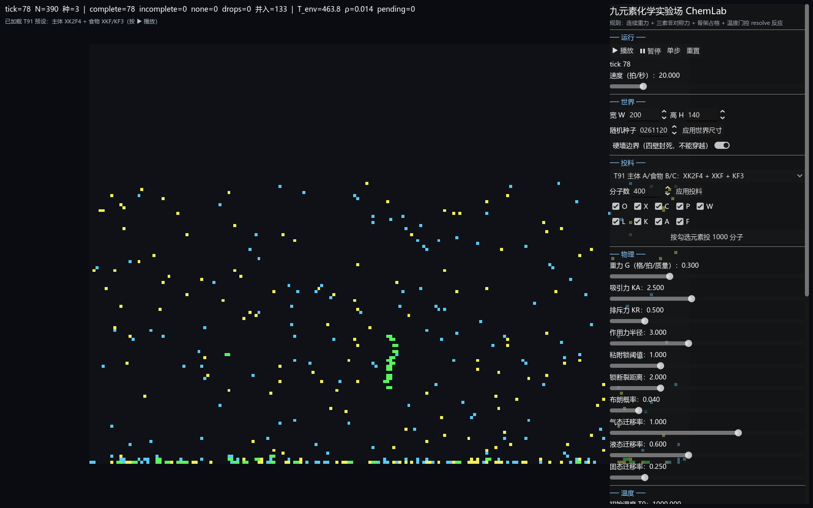

# ChemLab —— 九元素化学实验场（Godot 4.7 前端 + Python 内核侧车）

一个可交互的"九元素化学宇宙"沙盒：在方格世界里投放物质，实时调节重力、三素相互作用力、温度曲线、反应概率等参数，观察分子自行分层、成团、反应、生长。



## 快速开始

1. 双击 **`run_lab.bat`**（它会先启动 Python 内核服务，再打开 Godot 实验场）。
2. 启动后会自动加载一个演示预设（T91：主体 `XK2F4` + 食物 `XKF` / `KF3`）。
3. 点 **▶ 播放** 开始运行，**空格** 也可暂停/继续。
4. 右侧面板调参数、换投料；左侧世界用滚轮缩放、右键拖动平移；左键在世界上放置/删除分子（先点"放置模式"/"删除模式"）。

> 需要：Python 3.11（`python` 在 PATH 中）与 Godot 4.7。
> Godot 路径在 `run_lab.bat` 顶部的 `GODOT` 变量里，可自行修改。
> 也可以手动：先 `python kernel_server.py`，再 `Godot --path .`。

## 在 Godot 编辑器里打开 / 调试

1. 打开 Godot：G:\Godot_v4.7.2-stable_win64.exe\Godot_v4.7.2-stable_win64.exe
2. 项目管理器 → **导入** → 选 G:\AI work\deepseek\work1\alchemy\godot\chem_lab\project.godot → **导入并编辑**。
   （或者直接双击 project.godot，第一次可能需要选“用 Godot 打开”。）
3. **先单独启动内核**（游戏启动时只连一次，所以要先起服务）：
   双击 
un_kernel.bat，或在终端里 cd 到本目录后运行 python kernel_server.py，
   看到 [kernel] listening on 127.0.0.1:8765 即可。
4. 回到编辑器按 **F5** 运行整个项目；**F6** 运行当前场景；**F8** 停止。
5. 调试：
   - 在 scripts/*.gd 的行号左侧点一下设断点（再点取消），F9 也可切换断点；
   - 运行中 F10 = 单步跳过、F11 = 单步进入、F12 = 继续；
   - 底部 **Debugger** 面板：Stack Trace / Variables / Errors；
   - **Output** 面板看 print() 与运行日志（内核连接失败也会在这里报错）；
   - **Profiler / Monitors** 看帧耗时、内存；运行时 Scene 面板切到 **Remote** 可看运行时节点树。
6. 调参不必重启：右侧面板的滑块直接改 sim.p；改 W/H 会重建世界（清空分子）。
7. 常见问题：
   - 左上 HUD 显示“内核未连接”：先起 
un_kernel.bat，再重启游戏（F8→F5）；确认 8765 未被占用。
   - Address already in use：已有内核在跑（Get-Process python 可查），直接用它或先结束再启动。
   - 换端口：python kernel_server.py 8766，同时改 scripts/kernel_client.gd 里的 port = 8766。
   - 首次打开会生成 .godot/ 缓存（已 gitignore），导入需要几秒。
8. 只想运行、不改代码：双击 
un_lab.bat（自动起内核 + 打开游戏）。

## 界面说明

### 世界视图（左侧）
- 每格 = 1 个"骨架单位"；一个分子按其骨架块数 k 占 1~4 格（`k=1`(0,0)，`k=2` 横排，`k=3` 竖排，`k=4` 2×2）。
- 同一物质同一种颜色（对分子式做哈希），相邻同色自然合并成大色块。
- HUD：tick、N 分子数、种数、complete/incomplete/none、dropped、并入次数、环境温度 T_env、占位率 ρ、待处理内核请求数。

### 运行面板
- 播放 / 暂停 / 单步 / 重置；速度 1~120 拍/秒。

### 世界面板
- W/H 与随机种子；"应用世界尺寸"会重建世界（清空分子）。

### 投料面板
- 预设下拉：
  - **T91 主体/食物三件套**：`XK2F4 + XKF + KF3`、`XP2F4 + XPF + PF3`、`O2AF4 + OAF + OF3`、`O2WF4 + OWF + OF3`。选这类预设时，中心会撒一个 A 的圆盘（主体），B/C 各随机撒入一半数量。
  - **T88 群系**：B3_OFL、B3_OXC、B4_OXKF、B5_OXKAF、B6_OXCKAF、B9_all9，按元素子集 IPF 投料。
  - **自由投料**：按下方 9 个元素勾选框生成投料。
- "分子数" = 投料总分子数；"应用投料"应用当前预设。

### 物理面板（实时生效）
| 参数 | 含义 |
|---|---|
| 重力 G | 每拍每质量单位累积的格数（`gacc += G·mass`，整数部分下移；质量 3 → 约 0.9 格/拍） |
| 吸引力 KA / 排斥力 KR | 三素力系数（默认 2.5 / 0.5） |
| 作用力半径 | 计算合力时扫描的 Chebyshev 半径 |
| 粘附锁阈值 | 双方互作用力的较小值 ≥ 该值即记"粘附锁"（锁住相对位置，拉不开；不是化学键） |
| 锁断裂距离 | 锁住的伙伴被拉到超过该距离则移动被拒绝 |
| 布朗概率 | 无力时的随机抖动概率 |
| 气/液/固迁移率 | 物态决定移动概率的上限 |

### 温度面板
- 温度曲线：`T(t) = T_end + (T0−T_end)·exp(−6t/cool_ticks)`（t < cool_ticks），之后恒定 T_end。
- 环境耦合强度：`T_local = (邻近分子热值之和 + 耦合·T_env) / (分子数 + 耦合)`，用于反应门控。

### 反应面板
- 反应概率/接触；温度门槛余量（`T_local ≥ Σc + margin` 才可能触发）；cap（参与反应的两分子原子数上限）。

### 点击注入 / 删除
- 输入分子式（如 `CKF2`）+ "查询"可看到它的原子数、k、A/D、吸引/排斥半径、热值、27 格归属。
- "放置模式"后左键点击世界放置该分子；"删除模式"删除点击处分子。

### 存档 / 导出
- 保存/读取状态（`user://chemlab_state.json`）、导出 CSV、保存截图。

## 物理与反应规则（与本仓库 T83~T91 一致）

1. **世界**：W×H 方格；每格最多 1 个分子；分子按骨架块数占 k 格。边界默认硬墙（四壁封死），可在面板切换为环面。
2. **重力（连续）**：`gacc += GRAV·mass`；质量越大下沉越快；只能把单格分子往下挤（重压轻）。
3. **三素非对称力**（无匹配度 J）：
   - 作用在 j 上的力：`F_ij = KA·A_i·decay(d, r_att_i) − KR·D_j·decay(d, r_rep_j)`
   - 因此 A 吸 B 的同时 B 可能斥 A（动量不守恒，团簇可被"推着走"）。
   - `decay(d,r)=1 (d≤1)`，`=(r+1−d)/r (1<d≤r)`，`0 (d>r)`。
   - A/D 来自 `alchemy.three_su.scores()`（聚素吸引力/动素排斥力均值），半径来自散素点数 Q。
4. **粘附锁**：相邻且双向净力较小值 ≥ 阈值 → 记锁，移动时不能把锁伙伴拉开太远。**不是化学键**。
5. **反应**：相邻分子对，先看 `T_local ≥ c_A + c_B + margin`，再按 `p_react` 掷骰；通过后向内核 `resolve` 发异步请求（Python 侧真正的规则 1~11），返回 `complete / incomplete / none` 与产物；complete/incomplete 才消耗两分子并在附近放置产物。
6. **温度**：分子热值 `heat = n_L + 2·n_F`（元素 F 最热、L 次之、C 冷）；T_local 用邻域平均 + 环境耦合；环境按上面的指数曲线降温并恒温。

## 内核服务（Python 侧车）

`kernel_server.py` 在本机 `127.0.0.1:8765` 上监听 TCP，按行 JSON：

| op | 参数 | 返回 |
|---|---|---|
| `ping` | — | `{pong:true}` |
| `molecule` | `formula` | 原子数/k/attrs/A/D/半径/热值/cell/k/c 等 |
| `resolve` | `mols:[{formula}...], T` | `{type, products, csum, isum, stages}` |
| `f` | `vec:[9]` | `F(vec)` 的产物列表 |
| `feed` | `elements:[...], n` | IPF 配平后的投料 `[{formula,count}]` |
| `stats` | — | 目录/缓存统计 |

内核只读 `alchemy` 仓库（`natural_engine`、`alchemy.three_su`、`alchemy.attrs`），不改任何文件。首次 `molecule` 查询约 1~5ms，之后走缓存。

## 性能

- 渲染：每个 tick 把 W×H 的 Image 重画一次（默认 200×140 = 2.8 万像素），再上传纹理，开销很小。
- 反应：每个 tick 最多发 600 个异步 `resolve`（`max_react_per_tick`），未返回的不阻塞模拟。
- 若放慢：减少 N、降低速度、减小 W×H，或把"反应概率"调低。

## 已知限制

- 反应产物若目录里没有 `place`（新物质），仍会以 1 格灰/彩色方块出现，但没有骨架形状（k 由原子数近似）。
- 世界边界默认硬墙（四壁封死，分子撞墙即停、重力下沉会堆积在底部）；可在面板取消勾选切换回环面（从底部绕回顶部）。
- 粘附锁、温度场是简化模型（见 `docs/T83_ENV_AXES.md`、`docs/T87_ENV_ASYM.md`）。
- 单进程 Python 服务串行处理请求；极高反应率时 `pending` 会上升（HUD 可见）。

## 文件结构

```
godot/chem_lab/
  kernel_server.py        Python 内核侧车（TCP JSON）
  main.tscn / project.godot
  run_lab.bat             一键启动：python 服务 + Godot
  scripts/main.gd         场景、UI、渲染、输入、存档
  scripts/sim.gd          ChemSim：世界/分子/重力/力/锁/温度/反应调度
  scripts/kernel_client.gd  TCP 客户端（同步 + 异步 resolve）
  scripts/chart.gd        n/种数/T_env 曲线
  preview.png             运行截图
```
